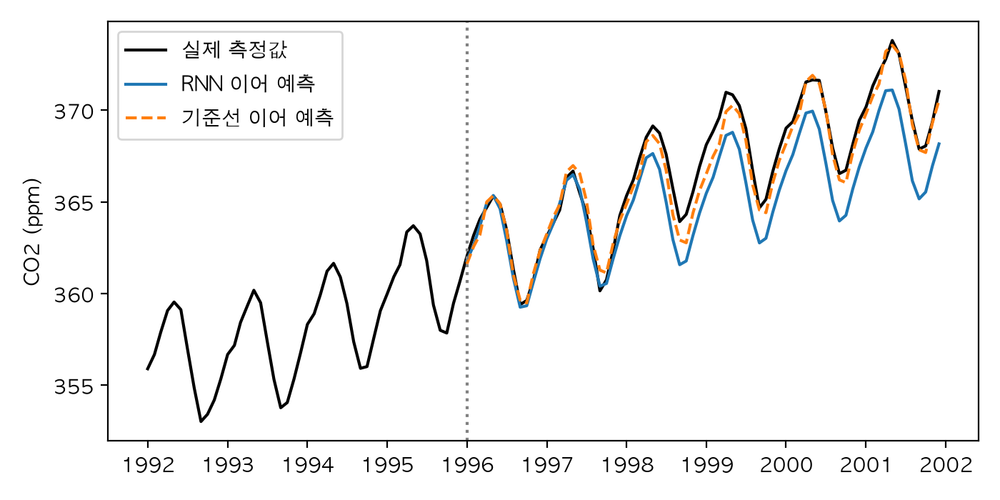

# Chapter 11. RNN과 LSTM: 순서가 있는 데이터

> **학습 목표**  
> - 순서가 있는 데이터를 (배치, 길이, 특성) 모양으로 만들고 읽기
> - RNN 셀을 손으로 구현하고 `nn.RNN`과 같은 결과가 나오는지 확인하기
> - 순서를 알아야만 풀리는 문제에서 RNN이 MLP와 어떻게 다른지 숫자로 보기
> - 기울기 소실과 폭주가 왜 생기는지 시점별 기울기를 재어 확인하기
> - LSTM과 GRU의 문(gate) 구조를 이해하고, 긴 기억이 필요한 문제에서 비교하기
> - 길이가 다른 순서열을 `pack_padded_sequence`로 올바르게 처리하기
> - 실제 시계열(이산화탄소 농도) 예측과 글자 단위 한국어 생성 모델 만들기

---

## 들어가며: 순서를 바꾸면 뜻이 바뀝니다

식당 리뷰 두 개를 보세요. "가격은 별로지만 맛은 최고"와 "맛은 별로지만 가격은 최고". 첫 번째 손님은 맛 때문에 또 올 것이고, 두 번째 손님은 아마 다시 오지 않을 거예요. 그런데 두 문장에 쓰인 글자를 세어 보면 어떨까요?

```python
from collections import Counter

import torch

리뷰1 = "가격은 별로지만 맛은 최고"
리뷰2 = "맛은 별로지만 가격은 최고"

# 글자마다 몇 번 나왔는지만 센다: 어느 글자가 먼저 왔는지는 버린다
print(Counter(리뷰1) == Counter(리뷰2))

글자들 = sorted(set(리뷰1))
번호 = {글자: i for i, 글자 in enumerate(글자들)}


def 개수_벡터(문장: str) -> torch.Tensor:
    """문장을 글자 종류별 개수로 바꾼다."""
    v = torch.zeros(len(글자들))
    for 글자 in 문장:
        v[번호[글자]] += 1
    return v


print(torch.equal(개수_벡터(리뷰1), 개수_벡터(리뷰2)))

# 숫자 줄도 마찬가지: 닷새 동안의 주가 (예제용 숫자)
오르는_중 = torch.tensor([100.0, 102.0, 105.0, 109.0, 114.0])
내리는_중 = 오르는_중.flip(0)                # 같은 숫자를 거꾸로
print(오르는_중.mean().item(), 내리는_중.mean().item())
print(오르는_중.std().item() == 내리는_중.std().item())
print("마지막 날 - 첫날:", (오르는_중[-1] - 오르는_중[0]).item(),
      (내리는_중[-1] - 내리는_중[0]).item())
```

```text
True
True
106.0 106.0
True
마지막 날 - 첫날: 14.0 -14.0
```

두 리뷰는 **글자의 종류와 개수가 완전히 같습니다.** 1권 7장의 `Counter`로 세어도, 글자 개수 벡터로 바꿔도 구별이 안 돼요. 다른 것은 오직 **순서**뿐입니다. 숫자 줄도 마찬가지예요. 계속 오르는 주가와 계속 내리는 주가는 평균도 표준편차도 똑같지만, 마지막 날에서 첫날을 빼면 +14와 -14로 정반대입니다. 투자자에게 이보다 중요한 차이는 없겠죠.

지금까지 만든 모델은 입력을 한 번에 통째로 받았습니다. 6장의 MLP는 숫자 묶음을 받아 곱하고 더했고, 9장의 CNN은 그림의 이웃한 칸을 함께 봤어요. 하지만 문장, 음성, 주가, 센서 기록처럼 **앞에서 뒤로 흘러가는 데이터**는 무엇이 먼저 오고 무엇이 나중에 오는지가 뜻의 절반입니다. 게다가 길이도 제각각이에요. 리뷰는 두 글자일 수도, 이백 글자일 수도 있습니다.

사람은 이런 데이터를 어떻게 읽을까요? 책을 읽을 때 우리는 한 글자씩 읽으면서 머릿속에 "지금까지의 줄거리"를 계속 고쳐 씁니다. 이 장의 주인공 **순환 신경망(RNN, Recurrent Neural Network)** 이 정확히 그렇게 동작해요. 한 시점씩 읽으면서 작은 메모장을 고쳐 쓰고, 다 읽은 뒤 그 메모로 판단합니다.

이 장에서는 RNN을 손으로 만들어 보고, RNN이 긴 순서열에서 왜 기억을 잃는지 숫자로 확인한 뒤, 그 문제를 푼 **LSTM**과 **GRU**를 만납니다. 그리고 실제 대기 중 이산화탄소 측정값으로 미래를 예측하고, 마지막 실습에서는 우리 속담을 읽고 새 속담(?)을 지어내는 글자 단위 모델을 만들어 봅니다.

> **Q. 이 장의 예제를 실행하려면 무엇을 설치해야 하나요?**
> 4장부터 써 온 `torch`, `numpy`에 더해 `uv add statsmodels pandas matplotlib`를 실행하세요. statsmodels는 통계 분석 라이브러리인데, 이 장에서는 그 안에 들어 있는 이산화탄소 측정 데이터만 씁니다. 인터넷에서 받을 필요가 없어요. 이 장의 예제는 파이썬 3.12, PyTorch 2.14, statsmodels 0.15, pandas 3.0, matplotlib 3.11에서 실행해 확인했습니다. 모델이 작아서 모두 CPU로 돌렸고, 씨앗을 고정했으니 같은 버전이면 같은 숫자를 볼 수 있어요.

## 11.1 순서 데이터의 모양

### 창을 밀며 잘라 내기

순서가 있는 데이터를 모델에 넣으려면 먼저 모양부터 정해야 합니다. 열흘치 기온이 있고, "사흘을 보고 다음 날을 맞히는" 문제를 만든다고 해 봅시다. 사흘짜리 **창(window)** 을 하루씩 밀면서 잘라 내면 문제와 정답 쌍이 여러 개 생겨요.

```python
import torch

# 예제용으로 만든 열흘치 하루 평균 기온(°C)
기온 = torch.tensor([3.0, 4.5, 6.0, 5.5, 7.0, 8.5, 8.0, 9.5, 11.0, 10.5])

# 창 크기 3: 사흘을 보고 다음 날을 맞히는 문제로 바꾼다
창 = 3
조각들 = 기온.unfold(0, 창, 1)        # 길이 3짜리 창을 한 칸씩 밀며 잘라 낸다
print(조각들.shape)
print(조각들[:3])

X = 조각들[:-1]                        # 마지막 창은 다음 날 정답이 없으니 뺀다
y = 기온[창:]                          # 각 창의 바로 다음 날
for i in range(3):
    print(X[i].tolist(), "→", y[i].item())

# 순환 신경망이 받는 모양: (배치, 길이, 특성)
X = X.unsqueeze(-1)                    # 하루에 숫자 1개(기온)이니 특성 1
print("입력:", tuple(X.shape), "정답:", tuple(y.shape))
print("같은 메모리를 쓰나?", 조각들.data_ptr() == 기온.data_ptr())
```

```text
torch.Size([8, 3])
tensor([[3.0000, 4.5000, 6.0000],
        [4.5000, 6.0000, 5.5000],
        [6.0000, 5.5000, 7.0000]])
[3.0, 4.5, 6.0] → 5.5
[4.5, 6.0, 5.5] → 7.0
[6.0, 5.5, 7.0] → 8.5
입력: (7, 3, 1) 정답: (7,)
같은 메모리를 쓰나? True
```

`unfold(0, 3, 1)`은 0번 차원을 따라 길이 3짜리 창을 1칸씩 밀면서 잘라 냅니다. 열흘에서 사흘짜리 창은 8개가 나와요(10 - 3 + 1). 마지막 창 `[9.5, 11.0, 10.5]`는 다음 날 기온이 없으니 문제로 쓸 수 없어서 빼고 7개를 썼습니다. 마지막 줄을 보면 `unfold`도 4장 4.5절의 `view`처럼 숫자를 복사하지 않고 같은 메모리를 다른 보폭으로 읽는 **창**이에요.

순환 신경망이 받는 입력은 **(배치, 길이, 특성)** 의 3차원입니다. 4장에서 권한 대로 자리마다 이름을 붙여 읽어 보세요. `(7, 3, 1)`은 "문제 7개, 각각 사흘, 하루마다 숫자 1개"예요. 기온 하나만 보니 특성이 1이고, 기온·습도·바람을 함께 본다면 특성이 3이 됩니다. 문장이라면 "문장 수, 글자 수, 글자 하나를 나타내는 숫자의 개수"가 되겠죠.

이렇게 과거의 창으로 다음 값을 맞히는 문제는 2장 2.9절에서 말한 시간 순서 데이터 그대로입니다. 학습·검증·테스트를 반드시 **시간 순서로** 잘라야 한다는 점도 같아요. 11.10절의 시계열 예측에서 그대로 지킵니다.

## 11.2 RNN 셀: 메모장을 고쳐 쓰며 읽기

### 손으로 만드는 RNN 셀

RNN이 하는 일은 한 문장으로 요약됩니다. **"지금 읽은 것과 지난 메모를 섞어서 새 메모를 쓴다."** 회의록을 쓰는 사람을 떠올려 보세요. 발언을 하나 들을 때마다 지금까지의 요약에 새 발언을 반영해 요약을 다시 씁니다. 요약 칸의 크기는 정해져 있어서, 중요한 것은 남기고 덜 중요한 것은 밀어내야 해요.

이 메모를 **은닉 상태(hidden state)** 라고 부르고 보통 `h`로 씁니다. 식으로 쓰면 이렇습니다.

```text
새 메모 h_t = tanh( x_t @ W_x  +  h_(t-1) @ W_h  +  b )
              지금 읽은 것   지난 메모
```

6장 6.1절의 층 하나(입력 @ 가중치 + 편향)에 "지난 메모 @ 가중치"라는 항이 하나 더 붙었을 뿐이에요. 바깥의 `tanh`는 6장 6.2절에서 본 활성화 함수로, 메모의 값을 -1과 1 사이로 묶어 줍니다. 손으로 만들어 보겠습니다.

```python
import torch

torch.manual_seed(0)
입력_크기, 메모_크기 = 3, 4                  # 한 시점의 특성 3개, 메모장 칸 4개
W_x = torch.randn(입력_크기, 메모_크기) * 0.5   # 새로 읽은 것 → 메모
W_h = torch.randn(메모_크기, 메모_크기) * 0.5   # 지난 메모 → 새 메모
b = torch.zeros(메모_크기)


def rnn_셀(x: torch.Tensor, h: torch.Tensor) -> torch.Tensor:
    """지금 읽은 x와 지난 메모 h로 새 메모를 쓴다."""
    return torch.tanh(x @ W_x + h @ W_h + b)


순서열 = torch.randn(2, 5, 입력_크기)      # (배치 2, 길이 5, 특성 3)
h = torch.zeros(2, 메모_크기)              # 처음에는 빈 메모장
메모들 = []
for t in range(순서열.shape[1]):           # 한 시점씩 차례로 읽는다
    h = rnn_셀(순서열[:, t], h)            # (2, 3)과 (2, 4) → (2, 4)
    메모들.append(h)
    print(f"t={t}: 첫 문장의 메모 {[round(v, 3) for v in h[0].tolist()]}")

출력 = torch.stack(메모들, dim=1)          # 시점마다의 메모를 모으면 (2, 5, 4)
print("모든 시점의 메모:", tuple(출력.shape), "마지막 메모:", tuple(h.shape))
```

```text
t=0: 첫 문장의 메모 [0.034, 0.412, -0.082, -0.311]
t=1: 첫 문장의 메모 [0.419, 0.388, -0.072, 0.271]
t=2: 첫 문장의 메모 [0.203, -0.596, -0.832, 0.29]
t=3: 첫 문장의 메모 [0.395, -0.032, -0.8, -0.651]
t=4: 첫 문장의 메모 [-0.498, -0.029, 0.382, 0.437]
모든 시점의 메모: (2, 5, 4) 마지막 메모: (2, 4)
```

핵심은 `for` 문입니다. 길이 5인 순서열을 한 시점씩 꺼내 `rnn_셀`에 넣고, 돌아온 새 메모를 다음 시점에 다시 넣었어요. 처음에는 0으로 채운 빈 메모장으로 시작합니다. 시점마다 메모의 숫자가 바뀌는 게 보이죠? 지금 읽은 입력과 지난 메모가 섞여서 새 메모가 됩니다.

눈여겨볼 점이 두 가지 있습니다. 첫째, **모든 시점이 같은 `W_x`, `W_h`, `b`를 씁니다.** 시점이 5개든 500개든 가중치는 한 벌이에요. 둘째, 시점마다 나온 메모를 모으면 `(2, 5, 4)`, 즉 (배치, 길이, 메모 크기)가 되고, 마지막 메모 `h`는 `(2, 4)`입니다. 앞의 것은 "읽어 가는 동안의 모든 메모", 뒤의 것은 "다 읽고 난 뒤의 최종 메모"예요.

5장 5.5절에서 PyTorch는 "실행하면서 그래프를 그린다"고 했습니다. 그래서 이런 평범한 `for` 문도 그대로 `backward()`를 할 수 있어요. 역전파는 이 반복을 거꾸로 거슬러 올라가는데, 이것을 **시간을 거슬러 가는 역전파(BPTT, Backpropagation Through Time)** 라고 부릅니다. 이름은 거창하지만 5장 5.6절의 연쇄 법칙을 시점 수만큼 반복하는 것뿐이에요.

### nn.RNN: 같은 일을 하는 부품

PyTorch에는 이 반복을 빠르게 해 주는 `nn.RNN`이 있습니다. 정말 같은 계산인지, `nn.RNN`의 가중치를 꺼내 손으로 다시 계산해 보겠습니다.

```python
import torch
from torch import nn

torch.manual_seed(0)
rnn = nn.RNN(input_size=3, hidden_size=4, batch_first=True)
for 이름, p in rnn.named_parameters():
    print(f"{이름:14} {tuple(p.shape)}")

# 같은 가중치로 손으로 계산해 보기 (PyTorch는 x @ W.T 꼴로 가중치를 보관한다)
순서열 = torch.randn(2, 5, 3)
h = torch.zeros(2, 4)
for t in range(5):
    h = torch.tanh(순서열[:, t] @ rnn.weight_ih_l0.T + rnn.bias_ih_l0
                   + h @ rnn.weight_hh_l0.T + rnn.bias_hh_l0)

출력, h_n = rnn(순서열)
print("출력:", tuple(출력.shape), "h_n:", tuple(h_n.shape))
print("손 계산과 차이:", (h - h_n[0]).abs().max().item())
print("출력의 마지막 시점 == h_n?", torch.allclose(출력[:, -1], h_n[0]))
```

```text
weight_ih_l0   (4, 3)
weight_hh_l0   (4, 4)
bias_ih_l0     (4,)
bias_hh_l0     (4,)
출력: (2, 5, 4) h_n: (1, 2, 4)
손 계산과 차이: 0.0
출력의 마지막 시점 == h_n? True
```

손 계산과 차이가 0입니다. 같은 계산이에요. 가중치 이름의 `ih`는 입력(input)에서 메모(hidden)로, `hh`는 메모에서 메모로 가는 가중치라는 뜻이고, 끝의 `l0`은 0번 층이라는 뜻입니다(11.8절에서 층을 쌓아요). 6장 6.1절의 `nn.Linear`처럼 가중치를 `(출력, 입력)` 모양으로 보관하기 때문에 손 계산에서는 `.T`로 전치해서 곱했습니다. 편향이 `bias_ih`와 `bias_hh` 두 개인 것은 NVIDIA GPU용 계산 라이브러리(cuDNN)의 방식에 맞춘 것일 뿐, 둘을 더한 것이 앞의 `b`와 같은 역할을 해요.

`nn.RNN`은 두 가지를 돌려줍니다.

- **출력** `(2, 5, 4)`: 모든 시점의 메모. 시점마다 무언가를 내야 하는 문제(다음 글자 맞히기 등)에 씁니다.
- **h_n** `(1, 2, 4)`: 마지막 시점의 메모. 다 읽고 한 번 판단하는 문제(문장 분류 등)에 씁니다. 맨 앞의 1은 층 수예요.

마지막 줄에서 확인한 것처럼, 층이 하나일 때 `출력[:, -1]`과 `h_n[0]`은 같은 값입니다.

### 길이가 달라도 같은 모델

메모장의 크기와 가중치가 시점 수와 상관없으니, 한 모델에 어떤 길이든 넣을 수 있어야 합니다. 확인해 보죠.

```python
import torch
from torch import nn

torch.manual_seed(0)
rnn = nn.RNN(input_size=3, hidden_size=4, batch_first=True)
print("파라미터 수:", sum(p.numel() for p in rnn.parameters()))

for 길이 in [1, 5, 500]:                   # 같은 모델에 길이가 다른 입력
    출력, h_n = rnn(torch.randn(2, 길이, 3))
    print(f"길이 {길이:3d}: 출력 {tuple(출력.shape)}, h_n {tuple(h_n.shape)}")

# 처음 메모장을 직접 넘길 수도 있다: (층 수, 배치, 메모 크기)
h0 = torch.zeros(1, 2, 4)
앞부분, h_중간 = rnn(torch.randn(2, 3, 3), h0)
뒷부분, h_끝 = rnn(torch.randn(2, 2, 3), h_중간)   # 이어서 읽기
print("이어 읽은 출력:", tuple(앞부분.shape), tuple(뒷부분.shape))

# batch_first를 빼면 (길이, 배치, 특성) 순서를 기대한다
rnn_기본 = nn.RNN(input_size=3, hidden_size=4)
출력, _ = rnn_기본(torch.randn(5, 2, 3))
print("batch_first=False 출력:", tuple(출력.shape))
```

```text
파라미터 수: 36
길이   1: 출력 (2, 1, 4), h_n (1, 2, 4)
길이   5: 출력 (2, 5, 4), h_n (1, 2, 4)
길이 500: 출력 (2, 500, 4), h_n (1, 2, 4)
이어 읽은 출력: (2, 3, 4) (2, 2, 4)
batch_first=False 출력: (5, 2, 4)
```

파라미터 36개짜리 모델이 길이 1, 5, 500을 모두 받았습니다. 출력의 가운데 자리만 길이를 따라 늘어나고 `h_n`의 모양은 언제나 같아요. 파라미터 36개는 `W_x`(4×3) 12개, `W_h`(4×4) 16개, 편향 두 벌 8개를 더한 값입니다.

`rnn(입력, h0)`처럼 처음 메모를 직접 넘길 수도 있습니다. 앞부분을 읽고 받은 `h_중간`을 넘겨서 뒷부분을 **이어서 읽는** 것도 가능해요. 긴 글을 조각조각 읽거나, 11.11절처럼 글자를 하나씩 생성할 때 이 방법을 씁니다.

마지막으로, `batch_first=True`를 빼면 `nn.RNN`은 **(길이, 배치, 특성)** 순서를 기대합니다. 옛날 관례가 남은 것인데, 이걸 깜빡하면 배치와 길이가 뒤바뀐 채로 오류 없이 돌아가서 찾기 어려운 버그가 됩니다. 이 책은 언제나 `batch_first=True`를 씁니다.

## 11.3 순서를 알아야 풀리는 문제: 괄호 짝 맞추기

### 문제와 데이터

RNN이 정말 순서를 이해하는지 시험해 볼 문제가 필요합니다. 코드 편집기는 괄호의 짝이 안 맞으면 빨간 줄을 긋죠. `(()())`는 짝이 맞고, `())(()`는 맞지 않습니다. 두 괄호 모두 여는 괄호 셋, 닫는 괄호 셋으로 개수가 같은데도요. 앞에서부터 읽으며 "지금 열린 괄호가 몇 개인가"를 세다가, 0 아래로 내려가는 순간이 있으면 틀린 겁니다. 순서를 모르면 절대 풀 수 없는 문제예요.

괄호 실험은 11.9절에서도 다시 쓰니, 8장의 `학습도구.py`처럼 데이터를 만드는 코드를 모듈로 모아 두겠습니다. 아래 내용을 `괄호도구.py`로 저장하세요.

```python
"""11장 괄호 실험에서 함께 쓰는 데이터 도구."""
import random

import torch
from torch.nn.utils.rnn import pad_sequence


def 짝맞나(괄호: str) -> bool:
    """여는 괄호보다 닫는 괄호가 먼저 많아지는 순간이 없고, 끝에서 개수가 같으면 짝이 맞다."""
    깊이 = 0
    for 글자 in 괄호:
        깊이 += 1 if 글자 == "(" else -1
        if 깊이 < 0:
            return False
    return 깊이 == 0


def 괄호_만들기(개수: int, 길이들: list[int], 씨앗: int) -> tuple[list[str], torch.Tensor]:
    """짝이 맞는 괄호와 맞지 않는 괄호를 반반 만든다. 두 쪽 모두 '('와 ')'의 개수는 같다."""
    rng = random.Random(씨앗)
    괄호들 = []
    while len(괄호들) < 개수:
        길이 = rng.choice(길이들)
        글자들 = list("(" * (길이 // 2) + ")" * (길이 // 2))
        rng.shuffle(글자들)
        if not 짝맞나(글자들):
            continue                                 # 먼저 짝이 맞는 괄호를 하나 얻고
        if len(괄호들) % 2 == 1:                     # 홀수 번째는 두 글자를 맞바꿔 짝을 깬다
            while True:
                i, j = rng.sample(range(길이), 2)
                바꾼 = 글자들.copy()
                바꾼[i], 바꾼[j] = 바꾼[j], 바꾼[i]
                if not 짝맞나(바꾼):
                    break
            글자들 = 바꾼
        괄호들.append("".join(글자들))
    정답 = torch.tensor([int(짝맞나(괄호)) for 괄호 in 괄호들])
    return 괄호들, 정답


def 원핫으로(괄호들: list[str]) -> tuple[torch.Tensor, torch.Tensor]:
    """'('는 1번, ')'는 2번, 빈칸(패딩)은 0번 칸이 1인 원-핫 텐서와 길이를 돌려준다."""
    번호들 = [torch.tensor([1 if 글자 == "(" else 2 for 글자 in 괄호]) for 괄호 in 괄호들]
    채운 = pad_sequence(번호들, batch_first=True, padding_value=0)
    길이 = torch.tensor([len(괄호) for 괄호 in 괄호들])
    return torch.nn.functional.one_hot(채운, 3).float(), 길이
```

`괄호_만들기`는 짝이 맞는 괄호와 맞지 않는 괄호를 반반씩 만듭니다. 맞지 않는 괄호는 짝이 맞는 괄호에서 두 글자를 맞바꿔 만들어서, **여는 괄호와 닫는 괄호의 개수가 언제나 같게** 했어요. 개수만 세서는 절대 구별할 수 없게 일부러 만든 것입니다. `원핫으로`는 7장 7.7절의 `pad_sequence`로 길이를 맞춘 뒤, 4장 4.4절의 원-핫으로 바꿉니다. 0번(빈칸)을 비워 둔 것도 7장과 같아요.

```python
from collections import Counter

from 괄호도구 import 괄호_만들기, 원핫으로, 짝맞나

print(짝맞나("(()())"), 짝맞나("())(()"), 짝맞나("(()"))

괄호들, 정답 = 괄호_만들기(3000, 길이들=[20], 씨앗=0)
for 괄호, 답 in zip(괄호들[:4], 정답[:4].tolist()):
    print(괄호, "짝 맞음" if 답 else "짝 틀림")
print("짝 맞음 비율:", 정답.float().mean().item())
print("'('와 ')' 개수가 늘 같은가:", all(Counter(괄호)["("] == 10 for 괄호 in 괄호들))

X, 길이 = 원핫으로(괄호들[:2])
print("원-핫 모양:", tuple(X.shape))
print(X[0, :3])
```

```text
True False False
((()(((())(()))))()) 짝 맞음
()()()()()())((()()) 짝 틀림
()(((()))(())()(())) 짝 맞음
()())(()(()()))(()() 짝 틀림
짝 맞음 비율: 0.5
'('와 ')' 개수가 늘 같은가: True
원-핫 모양: (2, 20, 3)
tensor([[0., 1., 0.],
        [0., 1., 0.],
        [0., 1., 0.]])
```

길이 20짜리 괄호 3,000개를 만들었고, 짝이 맞는 것과 틀린 것이 정확히 반반입니다. 모든 괄호가 여는 괄호 10개, 닫는 괄호 10개라는 것도 확인했어요. 원-핫 텐서의 모양 `(2, 20, 3)`은 "괄호 2개, 각각 20글자, 글자마다 숫자 3개"이고, 첫 괄호의 처음 세 글자가 모두 `(`라서 1번 칸이 1입니다.

### 세 모델의 대결

이제 세 모델로 풀어 보겠습니다.

- **개수만 보는 MLP**: 글자를 모두 더해 "여는 괄호 몇 개, 닫는 괄호 몇 개"만 봅니다. 들어가며에서 본 글자 개수 벡터와 같은 방식이에요.
- **펼쳐서 보는 MLP**: 20글자 × 3칸을 한 줄 60칸으로 펴서 넣습니다. 6장에서 그림을 펴서 넣던 방식이에요.
- **RNN**: 한 글자씩 읽으며 메모를 고쳐 쓰고, 마지막 메모로 판단합니다.

```python
import torch
from torch import nn

from 괄호도구 import 괄호_만들기, 원핫으로

괄호_학습, y_학습 = 괄호_만들기(3000, [20], 씨앗=0)      # 길이 20짜리 괄호만
괄호_검증, y_검증 = 괄호_만들기(1000, [20], 씨앗=1)
X_학습, _ = 원핫으로(괄호_학습)                          # (3000, 20, 3)
X_검증, _ = 원핫으로(괄호_검증)


class 개수_모델(nn.Module):
    """글자 개수만 보는 모델: 순서를 버린다."""
    def __init__(self) -> None:
        super().__init__()
        self.mlp = nn.Sequential(nn.Linear(3, 32), nn.ReLU(), nn.Linear(32, 2))

    def forward(self, x: torch.Tensor) -> torch.Tensor:
        return self.mlp(x.sum(dim=1))              # (배치, 20, 3) → (배치, 3)


class 순환_모델(nn.Module):
    """한 글자씩 읽으며 메모를 고쳐 쓰고, 마지막 메모로 판단한다."""
    def __init__(self, 메모_크기: int = 32) -> None:
        super().__init__()
        self.rnn = nn.RNN(3, 메모_크기, batch_first=True)
        self.판단 = nn.Linear(메모_크기, 2)

    def forward(self, x: torch.Tensor) -> torch.Tensor:
        _, h_n = self.rnn(x)
        return self.판단(h_n[-1])                  # 마지막 층의 마지막 메모


def 학습_평가(모델: nn.Module, 에폭_수: int = 30) -> tuple[float, float]:
    torch.manual_seed(0)
    옵티마이저 = torch.optim.Adam(모델.parameters(), lr=3e-3)
    for _ in range(에폭_수):
        for 묶음 in torch.randperm(len(X_학습)).split(64):
            손실 = nn.functional.cross_entropy(모델(X_학습[묶음]), y_학습[묶음])
            옵티마이저.zero_grad()
            손실.backward()
            옵티마이저.step()
    with torch.no_grad():
        정확도 = lambda X, y: (모델(X).argmax(dim=1) == y).float().mean().item()
        return 정확도(X_학습, y_학습), 정확도(X_검증, y_검증)


torch.manual_seed(0)
모델들 = {"개수만 보는 MLP": 개수_모델(),
          "펼쳐서 보는 MLP": nn.Sequential(nn.Flatten(), nn.Linear(20 * 3, 64), nn.ReLU(), nn.Linear(64, 2)),
          "RNN": 순환_모델()}
for 이름, 모델 in 모델들.items():
    학습, 검증 = 학습_평가(모델)
    개수 = sum(p.numel() for p in 모델.parameters())
    print(f"{이름}: 파라미터 {개수:,}개, 학습 {학습:.1%}, 검증 {검증:.1%}")
```

```text
개수만 보는 MLP: 파라미터 194개, 학습 50.0%, 검증 50.0%
펼쳐서 보는 MLP: 파라미터 4,034개, 학습 100.0%, 검증 99.7%
RNN: 파라미터 1,250개, 학습 100.0%, 검증 100.0%
```

**개수만 보는 MLP**는 정확히 50.0%, 동전 던지기입니다. 모든 괄호의 개수가 같으니 이 모델 눈에는 3,000개가 모두 똑같아 보여요. 순서를 버리면 이 문제는 원리적으로 풀 수 없습니다.

**RNN**은 학습·검증 모두 100.0%입니다. 한 글자씩 읽으며 메모에 "지금 열린 괄호의 깊이"와 "이미 0 아래로 내려간 적이 있는가" 같은 정보를 담는 법을 스스로 배운 거예요.

그런데 **펼쳐서 보는 MLP**도 검증 99.7%로 잘 풉니다. 60칸이 각각 "몇 번째 자리에 무엇이 있는가"를 담고 있으니, 순서 정보가 사라지지 않았기 때문이에요. 그럼 RNN이 필요 없는 걸까요? 파라미터 수를 보세요. 펼친 MLP는 4,034개, RNN은 1,250개입니다. 펼친 MLP는 1번 자리, 2번 자리, …, 20번 자리를 위한 가중치를 **따로따로** 배워야 하지만, RNN은 모든 자리에 같은 가중치를 돌려 씁니다. 그 차이가 길이를 바꿨을 때 드러납니다.

### 처음 보는 길이

학습할 때는 길이 20만 봤습니다. 길이 24, 30, 40짜리 괄호를 주면 어떻게 될까요?

```python
import torch
from torch import nn

from 괄호도구 import 괄호_만들기, 원핫으로

괄호_학습, y_학습 = 괄호_만들기(3000, [20], 씨앗=0)
X_학습, _ = 원핫으로(괄호_학습)

torch.manual_seed(0)
rnn = nn.RNN(3, 32, batch_first=True)
판단 = nn.Linear(32, 2)
모델 = lambda x: 판단(rnn(x)[1][-1])               # 마지막 메모로 판단
옵티마이저 = torch.optim.Adam([*rnn.parameters(), *판단.parameters()], lr=3e-3)
for _ in range(30):                                 # 앞 예제와 같은 학습
    for 묶음 in torch.randperm(len(X_학습)).split(64):
        손실 = nn.functional.cross_entropy(모델(X_학습[묶음]), y_학습[묶음])
        옵티마이저.zero_grad()
        손실.backward()
        옵티마이저.step()

펼친_MLP = nn.Sequential(nn.Flatten(), nn.Linear(20 * 3, 64), nn.ReLU(), nn.Linear(64, 2))
for 길이 in [20, 24, 30, 40]:
    괄호들, 정답 = 괄호_만들기(1000, [길이], 씨앗=2)
    X, _ = 원핫으로(괄호들)
    with torch.no_grad():
        정확도 = (모델(X).argmax(dim=1) == 정답).float().mean().item()
    try:
        펼친_MLP(X)
        mlp_결과 = "실행됨"
    except RuntimeError as e:
        mlp_결과 = "모양 오류 " + str(e)[str(e).index("("):]
    print(f"길이 {길이}: RNN 정확도 {정확도:.1%} / 펼친 MLP {mlp_결과}")
```

```text
길이 20: RNN 정확도 100.0% / 펼친 MLP 실행됨
길이 24: RNN 정확도 86.6% / 펼친 MLP 모양 오류 (1000x72 and 60x64)
길이 30: RNN 정확도 57.5% / 펼친 MLP 모양 오류 (1000x90 and 60x64)
길이 40: RNN 정확도 48.2% / 펼친 MLP 모양 오류 (1000x120 and 60x64)
```

펼친 MLP는 길이 24부터 아예 실행이 안 됩니다. 첫 층이 60칸짜리 입력만 받도록 만들어졌는데 72칸(24 × 3)이 들어왔다는 모양 오류예요(4장 4.10절의 오류 읽는 법 그대로입니다). 문장 길이가 바뀔 때마다 모델을 새로 만들어야 한다면 쓸 수가 없겠죠.

RNN은 어떤 길이든 받아 줍니다. 하지만 결과는 정직하게 봐야 해요. 길이 24에서는 86.6%로 꽤 맞히지만, 30에서 57.5%, 40에서는 48.2%로 동전 던지기가 됩니다. **길이를 받아 줄 수 있는 것과 처음 보는 길이에서 잘하는 것은 다른 문제**예요. 길이 20만 본 모델은 "열린 괄호가 열 개 넘게 쌓이는" 상황을 겪어 본 적이 없으니 당연합니다. 11.9절에서 여러 길이를 섞어 학습하면 이 숫자가 어떻게 바뀌는지 다시 봅니다.

## 11.4 기울기 소실과 폭주

### 거듭 곱하기의 함정

RNN이 길이 20의 괄호는 잘 풀었습니다. 그럼 길이 100, 1000인 문장도 잘 기억할까요? 여기에 RNN의 가장 큰 약점이 숨어 있습니다.

어릴 때 하던 귓속말 전달 놀이를 떠올려 보세요. 열 명을 거치면 처음 말이 엉뚱하게 바뀌어 있죠. 한 사람이 전할 때마다 조금씩 흐려지는 것이 쌓이기 때문입니다. RNN의 역전파도 똑같아요. 5장 5.6절에서 연쇄 법칙은 **단계마다의 기울기를 곱하는 것**이라고 했습니다. 100번째 시점의 손실이 1번째 시점의 입력까지 거슬러 가려면 100단계의 기울기를 곱해야 해요. 같은 크기의 수를 100번 곱하면 어떻게 될까요?

```python
import torch

# 같은 수를 거듭 곱하면: 1보다 조금 작으면 사라지고, 조금 크면 터진다
for 배율 in [0.5, 0.9, 1.0, 1.1, 1.5]:
    결과 = [배율 ** 횟수 for 횟수 in (10, 50, 100)]
    print(f"{배율} 거듭 곱하기  10번 {결과[0]:9.3g}  50번 {결과[1]:9.3g}  100번 {결과[2]:9.3g}")

# 역전파의 한 단계에는 tanh의 기울기(1 - tanh²)가 곱해진다. 언제나 1 이하
z = torch.tensor([0.0, 1.0, 2.0, 3.0], requires_grad=True)
torch.tanh(z).sum().backward()
print("tanh의 기울기:", [round(v, 4) for v in z.grad.tolist()])
```

```text
0.5 거듭 곱하기  10번  0.000977  50번  8.88e-16  100번  7.89e-31
0.9 거듭 곱하기  10번     0.349  50번   0.00515  100번  2.66e-05
1.0 거듭 곱하기  10번         1  50번         1  100번         1
1.1 거듭 곱하기  10번      2.59  50번       117  100번  1.38e+04
1.5 거듭 곱하기  10번      57.7  50번  6.38e+08  100번  4.07e+17
tanh의 기울기: [1.0, 0.42, 0.0707, 0.0099]
```

0.9를 100번 곱하면 0.0000266, 0.5를 100번 곱하면 10의 -31제곱입니다. 사실상 0이에요. 반대로 1.1을 100번 곱하면 1만 3천, 1.5는 10의 17제곱으로 터져 버립니다. 정확히 1일 때만 그대로 유지되는데, 학습 중에 모든 단계가 정확히 1이기를 바랄 수는 없죠.

게다가 RNN의 한 단계에는 `tanh`의 기울기가 곱해집니다. 마지막 줄처럼 `tanh`의 기울기는 0에서 1이 최대이고, 입력이 커질수록 0.42, 0.07, 0.01로 빠르게 작아져요. 1 이하의 수를 계속 곱하니 기울기가 줄어드는 쪽으로 기울어 있는 셈입니다.

### 시점별 기울기를 재 보기

실제 RNN에서 확인해 보겠습니다. 길이 100인 순서열을 넣고, 마지막 출력이 각 시점의 입력에 얼마나 민감한지를 5장 5.12절의 `torch.autograd.grad`로 재 보죠. 이 값이 작다는 것은 "그 시점의 입력을 바꿔도 마지막 출력이 거의 안 변한다", 즉 **그 시점을 기억하지 못한다**는 뜻이고, 학습할 때 그 시점까지 고칠 신호가 닿지 않는다는 뜻이기도 합니다.

```python
import torch
from torch import nn

torch.manual_seed(0)
길이 = 100
x = torch.randn(1, 길이, 8, requires_grad=True)    # 길이 100짜리 순서열 하나


def 시점별_기울기(rnn: nn.RNN) -> torch.Tensor:
    """마지막 출력이 각 시점의 입력에 얼마나 민감한지(기울기의 크기)를 잰다."""
    출력, _ = rnn(x)
    기울기, = torch.autograd.grad(출력[0, -1].sum(), x)
    return 기울기[0].norm(dim=1)                    # 시점마다 하나의 크기


torch.manual_seed(0)
기본 = nn.RNN(8, 32, batch_first=True)
torch.manual_seed(0)
큰_가중치 = nn.RNN(8, 32, batch_first=True)
with torch.no_grad():
    큰_가중치.weight_hh_l0.mul_(4)                 # 메모 → 메모 가중치만 4배로

시점들 = [99, 95, 90, 80, 50, 0]
print("시점      " + "".join(f"{t:>10}" for t in 시점들))
for 이름, rnn in [("기본 RNN", 기본), ("W_h 4배", 큰_가중치)]:
    크기 = 시점별_기울기(rnn)
    print(f"{이름:8}" + "".join(f"{크기[t].item():10.2e}" for t in 시점들))
```

```text
시점              99        95        90        80        50         0
기본 RNN    2.02e+00  1.85e-01  5.55e-03  9.52e-06  3.01e-14  0.00e+00
W_h 4배    7.35e-01  1.43e+00  9.16e+00  2.64e+01  5.81e+02  1.67e+07
```

**기본 RNN**의 줄을 오른쪽으로 읽어 보세요. 마지막 시점(99)에서 2.02이던 기울기가 4시점 전에 0.185, 9시점 전에 0.0056, 19시점 전에 0.0000095로 줄어들고, 49시점 전에는 10의 -14제곱, 맨 처음 시점에서는 0이 됩니다. 이 RNN에게 100시점 전의 입력은 없었던 것과 같아요. 9장 9.8절에서 층을 깊게 쌓을 때 본 **기울기 소실(vanishing gradient)** 이, 여기서는 층 대신 시간 방향으로 일어난 거예요. 학습해도 먼 과거와 지금을 잇는 규칙을 배울 수가 없어요.

메모 → 메모 가중치 `W_h`만 4배로 키우면 반대 현상이 납니다. 과거로 갈수록 기울기가 커져서 맨 처음 시점에서는 1,670만이 돼요. 이것이 8장 8.9절에서 본 **기울기 폭주(exploding gradient)** 입니다. 8장에서 예고한 대로 RNN처럼 같은 계산을 반복하는 모델에서 특히 잘 생기는 이유가 바로 이 거듭 곱하기예요.

두 문제의 처방은 다릅니다.

- **폭주**는 비교적 쉽게 막습니다. 8장 8.9절의 `clip_grad_norm_`으로 한 걸음의 크기에 상한을 두면 돼요. 그래서 순환 신경망을 학습할 때는 클리핑을 거의 기본으로 켭니다. 이 장의 학습 예제에도 대부분 들어 있어요.
- **소실**은 클리핑으로 해결되지 않습니다. 작아진 기울기를 키울 방법이 없으니까요. 구조 자체를 바꿔야 합니다. 그 답이 다음 절의 LSTM입니다.

> **Q. 활성화 함수를 ReLU로 바꾸면 기울기가 1이니 해결되지 않나요?**
> `nn.RNN(..., nonlinearity="relu")`로 바꿀 수 있고, 기울기가 줄어드는 정도는 덜합니다. 하지만 ReLU는 위로 상한이 없어서 메모의 값이 시점마다 커질 수 있고, 그러면 이번에는 폭주가 쉽게 일어나요. 결국 `W_h`를 거듭 곱하는 구조가 그대로인 한, 줄어들거나 터지거나 둘 중 하나를 피하기 어렵습니다. 그래서 실무에서는 활성화 함수를 바꾸기보다 LSTM이나 GRU를 씁니다.

## 11.5 LSTM: 기억을 따로 나르는 벨트

### 메모장과 벨트

**LSTM(Long Short-Term Memory)** 의 아이디어는 간단합니다. 메모를 매번 **새로 쓰지 말고, 지울 것만 지우고 더할 것만 더하자**는 거예요.

공장의 컨베이어 벨트를 떠올려 보세요. 벨트 위의 물건은 그대로 다음 칸으로 흘러갑니다. 각 작업대에서는 벨트에서 필요 없는 물건을 **덜어 내고**, 새 물건을 **올려놓고**, 지금 필요한 물건만 **꺼내서** 씁니다. 벨트 위의 물건을 매번 몽땅 다시 만드는 게 아니라 조금씩 고치기만 하니, 아무도 건드리지 않은 물건은 먼 곳까지 그대로 실려 갑니다.

LSTM에서 이 벨트를 **셀 상태(cell state)** `c`라고 부르고, 덜어 내기·올려놓기·꺼내기의 양을 정하는 장치를 **문(gate)** 이라고 부릅니다. 문은 0에서 1 사이의 값으로, 0이면 닫힘, 1이면 활짝 열림이에요. 6장 6.2절의 시그모이드가 바로 0~1 사이 값을 만드는 함수라서 문마다 시그모이드를 씁니다.

| 이름 | 하는 일 | 값의 범위 |
|---|---|---|
| 망각문 `f` | 벨트 위의 기억을 얼마나 **남길지** | 0~1 (시그모이드) |
| 입력문 `i` | 새 후보를 얼마나 **올려놓을지** | 0~1 (시그모이드) |
| 후보 `g` | 올려놓을 새 내용 | -1~1 (tanh) |
| 출력문 `o` | 벨트에서 지금 얼마나 **꺼내 보일지** | 0~1 (시그모이드) |

그리고 한 시점의 계산은 이 두 줄이 전부입니다.

```text
c_t = f * c_(t-1) + i * g          벨트: 남길 만큼 남기고, 올릴 만큼 더한다
h_t = o * tanh(c_t)                메모: 벨트에서 꺼내 보일 만큼만
```

### 손으로 만드는 LSTM 셀

RNN 때처럼 `nn.LSTM`의 가중치를 꺼내 손으로 계산하고, 결과를 비교해 보겠습니다.

```python
import torch
from torch import nn

torch.manual_seed(0)
lstm = nn.LSTM(input_size=3, hidden_size=4, batch_first=True)
print("weight_ih_l0:", tuple(lstm.weight_ih_l0.shape), "weight_hh_l0:", tuple(lstm.weight_hh_l0.shape))


def lstm_셀(x: torch.Tensor, h: torch.Tensor, c: torch.Tensor) -> tuple[torch.Tensor, torch.Tensor]:
    """문 세 개와 새 내용 후보로 기억 c와 메모 h를 고쳐 쓴다."""
    점수 = (x @ lstm.weight_ih_l0.T + lstm.bias_ih_l0
            + h @ lstm.weight_hh_l0.T + lstm.bias_hh_l0)      # (배치, 4 × 4)
    i, f, g, o = 점수.chunk(4, dim=1)          # PyTorch의 순서: 입력·망각·후보·출력
    입력문, 망각문, 출력문 = torch.sigmoid(i), torch.sigmoid(f), torch.sigmoid(o)
    후보 = torch.tanh(g)
    c = 망각문 * c + 입력문 * 후보            # 지울 만큼 지우고, 적을 만큼 더한다
    h = 출력문 * torch.tanh(c)                # 기억 중 지금 꺼내 보일 만큼만
    return h, c


순서열 = torch.randn(2, 5, 3)
h, c = torch.zeros(2, 4), torch.zeros(2, 4)
for t in range(5):
    h, c = lstm_셀(순서열[:, t], h, c)

출력, (h_n, c_n) = lstm(순서열)             # LSTM은 (h_n, c_n) 두 개를 돌려준다
print("출력:", tuple(출력.shape), "h_n:", tuple(h_n.shape), "c_n:", tuple(c_n.shape))
print("h 차이:", (h - h_n[0]).abs().max().item(), " c 차이:", (c - c_n[0]).abs().max().item())
print("기억 c :", [round(v, 3) for v in c[0].tolist()])
print("메모 h :", [round(v, 3) for v in h[0].tolist()])
```

```text
weight_ih_l0: (16, 3) weight_hh_l0: (16, 4)
출력: (2, 5, 4) h_n: (1, 2, 4) c_n: (1, 2, 4)
h 차이: 0.0  c 차이: 0.0
기억 c : [0.123, 0.341, -0.288, 0.479]
메모 h : [0.076, 0.158, -0.147, 0.244]
```

이번에도 차이가 0입니다. 코드를 보면 문 넷의 점수를 한꺼번에 계산했어요. 가중치의 줄 수가 메모 크기 4의 4배인 16인 이유입니다. 이렇게 계산한 `(배치, 16)`을 `chunk(4, dim=1)`로 네 조각으로 나누면 차례대로 입력문, 망각문, 후보, 출력문의 점수가 돼요. 이 순서(i, f, g, o)는 PyTorch가 정한 약속이라, 손으로 가중치를 다룰 때 꼭 지켜야 합니다.

`nn.LSTM`은 `(h_n, c_n)` 두 개를 묶어서 돌려줍니다. 메모 `h`와 벨트 `c`를 모두 다음으로 넘겨야 이어서 읽을 수 있기 때문이에요. 마지막 두 줄을 보면 `h`의 값이 `c`보다 작습니다. 벨트의 내용에 `tanh`를 씌우고 출력문으로 한 번 더 걸렀으니까요.

### 왜 기울기가 살아남을까

핵심은 벨트의 식 `c_t = f * c_(t-1) + i * g`에 있습니다. RNN은 매번 `tanh(… h @ W_h …)`로 메모를 **새로 만들어서**, 거꾸로 갈 때마다 `W_h`와 `tanh`의 기울기가 곱해졌어요. LSTM의 벨트는 이전 값에 망각문 `f`를 곱하고 무언가를 **더할** 뿐입니다. 거꾸로 갈 때 한 단계마다 곱해지는 것은 사실상 `f` 하나예요. 모델이 "이건 기억해야 해"라고 판단하면 망각문을 1 가까이 열어 둘 수 있고, 그러면 기울기도 거의 줄지 않고 먼 과거까지 흘러갑니다.

중요한 건 망각문의 값을 **모델이 배운다**는 점이에요. 처음부터 기억력이 좋은 게 아니라, 기억이 필요하면 문을 열어 두는 법을 배울 수 있는 구조입니다. 11.7절에서 이 차이를 숫자로 확인합니다.

## 11.6 GRU와 파라미터 비용

### 문을 두 개로 줄인 GRU

LSTM은 잘 동작하지만 문이 셋에 벨트까지 따로 있어서 복잡합니다. 2014년에 나온 **GRU(Gated Recurrent Unit)** 는 이걸 줄였어요. 벨트와 메모를 하나로 합치고, 문을 둘만 둡니다.

- **갱신문 `z`**: 지난 메모를 얼마나 남기고 새 후보로 얼마나 바꿀지. LSTM의 망각문과 입력문을 하나로 묶은 것입니다. `새 메모 = (1 - z) * 새 후보 + z * 지난 메모`처럼 둘을 섞어요.
- **리셋문 `r`**: 새 후보를 만들 때 지난 메모를 얼마나 참고할지.

"남기는 양"과 "바꾸는 양"을 합쳐서 1이 되게 묶은 것이 GRU의 요령입니다. 뭔가를 남기면 그만큼 덜 바꾸는 거죠. 세 가지의 크기를 비교해 보겠습니다.

```python
import torch
from torch import nn

입력_크기, 메모_크기 = 8, 32
for 종류 in [nn.RNN, nn.GRU, nn.LSTM]:
    torch.manual_seed(0)
    층 = 종류(입력_크기, 메모_크기, batch_first=True)
    개수 = sum(p.numel() for p in 층.parameters())
    출력, 상태 = 층(torch.randn(2, 10, 입력_크기))
    상태_모양 = [tuple(s.shape) for s in 상태] if isinstance(상태, tuple) else tuple(상태.shape)
    print(f"{종류.__name__:4} 파라미터 {개수:5,}개  가중치 줄 수 {층.weight_ih_l0.shape[0]:3}  상태 {상태_모양}")

기본 = 메모_크기 * 입력_크기 + 메모_크기 * 메모_크기 + 2 * 메모_크기
print(f"RNN 한 벌: {기본:,}개 → GRU는 3벌 {3 * 기본:,}개, LSTM은 4벌 {4 * 기본:,}개")
```

```text
RNN  파라미터 1,344개  가중치 줄 수  32  상태 (1, 2, 32)
GRU  파라미터 4,032개  가중치 줄 수  96  상태 (1, 2, 32)
LSTM 파라미터 5,376개  가중치 줄 수 128  상태 [(1, 2, 32), (1, 2, 32)]
RNN 한 벌: 1,344개 → GRU는 3벌 4,032개, LSTM은 4벌 5,376개
```

같은 메모 크기 32에서 RNN은 1,344개, GRU는 그 3배인 4,032개, LSTM은 4배인 5,376개입니다. RNN 한 벌의 계산을 GRU는 세 번(문 둘과 후보 하나), LSTM은 네 번(문 셋과 후보 하나) 하기 때문이에요. 가중치의 줄 수 32, 96, 128에 그대로 드러납니다.

상태의 모양도 보세요. RNN과 GRU는 `h_n` 하나, LSTM만 `(h_n, c_n)` 두 개입니다. 그래서 RNN이나 GRU로 짠 코드를 LSTM으로 바꿀 때 `_, h_n = 모델(x)`가 `_, (h_n, c_n) = 모델(x)`로 바뀌어야 해요. 이 장의 예제들이 `출력, _ = 순환(x)`처럼 출력만 받거나 `isinstance(상태, tuple)`로 확인하는 이유입니다.

> **Q. LSTM과 GRU 중 무엇을 써야 하나요?**
> 정답은 없습니다. 여러 연구에서 둘의 성능은 문제마다 엎치락뒤치락했어요. GRU는 파라미터가 적어 조금 빠르고 작은 데이터에서 유리할 때가 있고, LSTM은 더 오래 쓰여서 참고할 자료가 많습니다. 8장에서 말한 원칙대로, 둘 다 해 보고 **검증 데이터로** 고르세요. 바로 다음 절에서 셋을 한 문제로 비교해 봅니다.

## 11.7 긴 기억 시험: 멀리 떨어진 두 수 더하기

### 더하기 문제

11.4절에서 RNN의 기울기가 과거로 갈수록 사라지는 것을 봤습니다. 그럼 실제로 **멀리 떨어진 정보를 써야 하는 문제**를 RNN이 못 푸는지, LSTM과 GRU는 푸는지 확인해 보겠습니다. LSTM을 처음 제안한 논문에서도 쓴 고전적인 시험인 **더하기 문제(adding problem)** 입니다.

0~1 사이 숫자가 한 줄로 늘어서 있고, 그중 두 칸에만 표시가 붙어 있습니다. 하나는 앞 절반에, 하나는 뒤 절반에 있어요. 모델은 한 칸씩 읽으며 숫자와 표시를 보고, 다 읽은 뒤 **표시된 두 숫자의 합**을 말해야 합니다. 앞 절반의 숫자를 줄 끝까지 기억하고 있어야 풀 수 있죠.

```python
import torch


def 더하기_문제(개수: int, 길이: int, g: torch.Generator) -> tuple[torch.Tensor, torch.Tensor]:
    """0~1 사이 숫자 줄에서 표시된 두 칸(앞 절반에 하나, 뒤 절반에 하나)의 합을 맞히는 문제."""
    값 = torch.rand(개수, 길이, generator=g)
    표시 = torch.zeros(개수, 길이)
    앞 = torch.randint(0, 길이 // 2, (개수,), generator=g)
    뒤 = torch.randint(길이 // 2, 길이, (개수,), generator=g)
    표시[torch.arange(개수), 앞] = 1.0
    표시[torch.arange(개수), 뒤] = 1.0
    x = torch.stack([값, 표시], dim=-1)          # (개수, 길이, 특성 2): 숫자와 표시
    y = (값 * 표시).sum(dim=1, keepdim=True)      # 표시된 두 숫자의 합
    return x, y


g = torch.Generator().manual_seed(0)
x, y = 더하기_문제(1, 10, g)
print("숫자:", [round(v, 2) for v in x[0, :, 0].tolist()])
print("표시:", x[0, :, 1].int().tolist())
print("정답:", round(y.item(), 4))

# 아무것도 못 배운 모델은 늘 평균(1.0)을 말한다. 그때의 MSE는?
_, y = 더하기_문제(100_000, 50, g)
print(f"늘 1.0이라고 답할 때 MSE: {((y - 1.0) ** 2).mean().item():.4f}")
```

```text
숫자: [0.5, 0.77, 0.09, 0.13, 0.31, 0.63, 0.49, 0.9, 0.46, 0.63]
표시: [0, 1, 0, 0, 0, 0, 1, 0, 0, 0]
정답: 1.2583
늘 1.0이라고 답할 때 MSE: 0.1663
```

길이 10짜리 문제 하나를 보면 1번과 6번 칸에 표시가 있고, 정답은 0.77 + 0.49 = 1.2583입니다. 입력의 모양은 `(개수, 길이, 2)`로, 한 시점마다 "숫자, 표시" 두 개를 봐요.

마지막 줄은 이 문제의 **기준선**입니다. 아무것도 못 배운 모델은 늘 정답의 평균인 1.0 근처를 말하게 되는데, 그때의 MSE가 약 0.166이에요. 학습한 모델의 MSE가 0.166 근처라면 **아무것도 못 배운 것**이고, 0에 가까울수록 잘 배운 것입니다. 8장 8.11절에서 첫 손실을 확인하던 것처럼, 결과를 보기 전에 "못 배우면 얼마인가"를 먼저 알아 두는 습관이에요.

### RNN, LSTM, GRU 비교

길이 10과 50에서 세 모델을 같은 조건으로 학습합니다. 매번 새 문제 64개를 만들어 1,500번 학습하고, 처음 보는 시험 문제 1,000개로 MSE를 잽니다. 시험 문제에서 첫 시점까지 기울기가 얼마나 닿는지도 함께 재 보겠습니다.

```python
import torch
from torch import nn


def 더하기_문제(개수: int, 길이: int, g: torch.Generator) -> tuple[torch.Tensor, torch.Tensor]:
    """앞 예제와 같은 문제: 표시된 두 숫자의 합 맞히기."""
    값 = torch.rand(개수, 길이, generator=g)
    표시 = torch.zeros(개수, 길이)
    표시[torch.arange(개수), torch.randint(0, 길이 // 2, (개수,), generator=g)] = 1.0
    표시[torch.arange(개수), torch.randint(길이 // 2, 길이, (개수,), generator=g)] = 1.0
    return torch.stack([값, 표시], dim=-1), (값 * 표시).sum(dim=1, keepdim=True)


class 더하기_모델(nn.Module):
    def __init__(self, 종류: type[nn.Module]) -> None:
        super().__init__()
        self.순환 = 종류(2, 32, batch_first=True)    # nn.RNN, nn.LSTM, nn.GRU 중 하나
        self.답 = nn.Linear(32, 1)

    def forward(self, x: torch.Tensor) -> torch.Tensor:
        출력, _ = self.순환(x)                        # LSTM의 (h, c)도 _로 받아 넘긴다
        return self.답(출력[:, -1])                   # 마지막 시점의 메모로 답한다


def 실험(종류: type[nn.Module], 길이: int) -> tuple[float, float, list[float]]:
    torch.manual_seed(0)
    모델 = 더하기_모델(종류)
    옵티마이저 = torch.optim.Adam(모델.parameters(), lr=3e-3)
    g = torch.Generator().manual_seed(0)
    기록 = []
    for 단계 in range(1, 1501):                       # 매번 새 문제 64개로 1,500번
        x, y = 더하기_문제(64, 길이, g)
        손실 = nn.functional.mse_loss(모델(x), y)
        옵티마이저.zero_grad()
        손실.backward()
        nn.utils.clip_grad_norm_(모델.parameters(), max_norm=1.0)   # 8.9절의 안전벨트
        옵티마이저.step()
        if 단계 % 300 == 0:
            기록.append(round(손실.item(), 3))
    x, y = 더하기_문제(1000, 길이, torch.Generator().manual_seed(99))  # 시험 문제
    x.requires_grad_(True)
    예측 = 모델(x)
    기울기, = torch.autograd.grad(예측.sum(), x)        # 첫 시점까지 기울기가 닿는가
    return nn.functional.mse_loss(예측, y).item(), 기울기[:, 0].norm(dim=1).mean().item(), 기록


for 길이 in [10, 50]:
    for 종류 in [nn.RNN, nn.LSTM, nn.GRU]:
        mse, 첫_기울기, 기록 = 실험(종류, 길이)
        print(f"길이 {길이:2d}  {종류.__name__:4}  시험 MSE {mse:.4f}  첫 시점 기울기 {첫_기울기:.1e}")
        print(f"          300번마다 학습 손실 {기록}")
```

```text
길이 10  RNN   시험 MSE 0.0107  첫 시점 기울기 3.0e-01
          300번마다 학습 손실 [0.143, 0.062, 0.033, 0.014, 0.011]
길이 10  LSTM  시험 MSE 0.0002  첫 시점 기울기 3.5e-01
          300번마다 학습 손실 [0.088, 0.008, 0.001, 0.0, 0.0]
길이 10  GRU   시험 MSE 0.0002  첫 시점 기울기 3.4e-01
          300번마다 학습 손실 [0.008, 0.002, 0.001, 0.0, 0.0]
길이 50  RNN   시험 MSE 0.1582  첫 시점 기울기 2.5e-08
          300번마다 학습 손실 [0.164, 0.156, 0.182, 0.16, 0.174]
길이 50  LSTM  시험 MSE 0.0026  첫 시점 기울기 2.7e-01
          300번마다 학습 손실 [0.16, 0.154, 0.025, 0.007, 0.003]
길이 50  GRU   시험 MSE 0.0005  첫 시점 기울기 8.7e-02
          300번마다 학습 손실 [0.15, 0.004, 0.002, 0.001, 0.001]
```

**길이 10**에서는 셋 다 잘 풉니다. RNN의 MSE 0.0107도 기준선 0.166에 비하면 아주 작아요. 표시된 숫자가 기껏해야 9칸 전에 있으니 RNN의 기억으로도 충분합니다.

**길이 50**에서 결과가 갈립니다. RNN의 MSE는 0.1582로 기준선 0.166과 거의 같아요. 1,500번을 학습하고도 **아무것도 배우지 못한** 것입니다. 반면 LSTM은 0.0026, GRU는 0.0005로 길이 10일 때와 크게 다르지 않게 풀었습니다.

이유는 마지막 열에 있습니다. 학습을 마친 모델에서 첫 시점까지 닿는 기울기의 크기가 RNN은 0.000000025(2.5e-08)로 사실상 0인데, LSTM은 0.27, GRU는 0.087이에요. 11.4절에서 학습 전의 RNN으로 잰 기울기 소실이 학습 뒤에도 그대로 남아 있고, LSTM과 GRU는 먼 과거까지 고칠 신호를 전달하고 있습니다. 이 신호가 없으면 "앞 절반에 표시된 숫자를 기억해야 한다"는 규칙 자체를 배울 수가 없어요.

300번마다 찍은 학습 손실도 보세요. 길이 50의 RNN은 1,500번 내내 0.16~0.18에 머물렀습니다. 그런데 LSTM도 300번째, 600번째에는 0.16, 0.154로 RNN과 다를 바 없다가, 900번째에 0.025로 뚝 떨어져요. 망각문을 여는 법을 배우는 데 시간이 걸린 거예요. 그래서 순환 신경망의 학습 곡선은 한동안 평평하다가 갑자기 내려가는 모양이 흔합니다. 초반에 손실이 안 줄어든다고 너무 일찍 포기하지 마세요.

## 11.8 층 쌓기와 양방향

### 두 층, 그리고 거꾸로 읽기

6장에서 층을 쌓아 MLP를 깊게 만들었듯, 순환 신경망도 층을 쌓을 수 있습니다. 첫 층이 시점마다 낸 메모 줄 전체를 두 번째 층이 다시 순서대로 읽는 방식이에요. 또 하나의 선택지는 **양방향(bidirectional)** 입니다. 문장을 앞에서 뒤로 한 번, 뒤에서 앞으로 한 번 읽고 두 결과를 이어 붙여요. "배가 아파서 병원에 갔다"의 "배"가 과일인지 몸인지는 **뒤에 나오는** "아파서"를 봐야 알 수 있죠. 양방향은 시점마다 앞뒤 문맥을 모두 보게 해 줍니다.

```python
import torch
from torch import nn

torch.manual_seed(0)
x = torch.randn(2, 7, 8)                          # (배치 2, 길이 7, 특성 8)

설정들 = {"한 층": {}, "두 층": dict(num_layers=2, dropout=0.2),
          "양방향": dict(bidirectional=True), "두 층 양방향": dict(num_layers=2, bidirectional=True)}
for 이름, 설정 in 설정들.items():
    lstm = nn.LSTM(8, 16, batch_first=True, **설정)
    출력, (h_n, c_n) = lstm(x)
    개수 = sum(p.numel() for p in lstm.parameters())
    print(f"{이름}: 출력 {tuple(출력.shape)}, h_n {tuple(h_n.shape)}, 파라미터 {개수:,}개")

# 양방향 출력의 앞 16칸은 정방향, 뒤 16칸은 역방향
양방향 = nn.LSTM(8, 16, batch_first=True, bidirectional=True)
출력, (h_n, _) = 양방향(x)
print("정방향 마지막 = 출력[:, -1, :16]?", torch.allclose(h_n[0], 출력[:, -1, :16]))
print("역방향 마지막 = 출력[:, 0, 16:]?", torch.allclose(h_n[1], 출력[:, 0, 16:]))
양쪽_요약 = torch.cat([h_n[-2], h_n[-1]], dim=1)   # 분류에 쓸 때는 둘을 이어 붙인다
print("양쪽 요약:", tuple(양쪽_요약.shape))
```

```text
한 층: 출력 (2, 7, 16), h_n (1, 2, 16), 파라미터 1,664개
두 층: 출력 (2, 7, 16), h_n (2, 2, 16), 파라미터 3,840개
양방향: 출력 (2, 7, 32), h_n (2, 2, 16), 파라미터 3,328개
두 층 양방향: 출력 (2, 7, 32), h_n (4, 2, 16), 파라미터 9,728개
정방향 마지막 = 출력[:, -1, :16]? True
역방향 마지막 = 출력[:, 0, 16:]? True
양쪽 요약: (2, 32)
```

모양을 하나씩 읽어 보세요.

- **두 층**: 출력은 마지막 층의 메모라서 `(2, 7, 16)` 그대로이고, `h_n`의 첫 자리가 층 수 2가 됐습니다. `dropout=0.2`는 8장 8.3절의 드롭아웃을 **층과 층 사이**에 넣으라는 뜻이에요. 층이 하나면 넣을 자리가 없어서 쓸 수 없습니다.
- **양방향**: 시점마다 정방향 메모 16칸과 역방향 메모 16칸을 이어 붙여 출력이 `(2, 7, 32)`가 됩니다. `h_n`의 첫 자리 2는 층 수가 아니라 방향 수예요.
- **두 층 양방향**: `h_n`의 첫 자리가 층 수 × 방향 수 = 4입니다. 순서는 [0층 정방향, 0층 역방향, 1층 정방향, 1층 역방향]이에요.

양방향에는 함정이 하나 있습니다. 정방향의 "마지막"은 맨 끝 시점이지만, 역방향의 "마지막"은 **맨 처음 시점**이에요. 거꾸로 읽었으니까요. 그래서 역방향의 `h_n`은 `출력[:, -1]`이 아니라 `출력[:, 0, 16:]`과 같습니다. 문장 하나를 분류할 때는 보통 마지막 층의 두 방향 `h_n[-2]`와 `h_n[-1]`을 이어 붙여 씁니다.

양방향을 **쓰면 안 되는 곳**도 기억하세요. 다음 달 이산화탄소를 예측하거나 다음 글자를 생성할 때 역방향은 미래를 미리 보는 셈입니다. 2장 2.9절에서 경고한 미래 정보 누수가 모델 안에서 일어나는 거예요. 양방향은 문장 전체가 이미 주어진 분류나 태깅 문제에만 씁니다.

## 11.9 길이가 다른 순서열: pack_padded_sequence

### 패딩이 메모를 오염시킵니다

7장 7.7절에서 길이가 다른 문장을 `pad_sequence`로 0을 채워 묶었고, "11장의 순환 신경망은 길이를 받아 채운 칸을 건너뛸 수 있다"고 예고했습니다. 그런데 왜 건너뛰어야 할까요? 채운 0을 RNN이 그냥 읽으면 무슨 일이 생기는지 보겠습니다.

```python
import torch
from torch import nn
from torch.nn.utils.rnn import pad_sequence

torch.manual_seed(0)
rnn = nn.RNN(2, 4, batch_first=True)
짧은 = torch.randn(3, 2)                          # 길이 3
긴 = torch.randn(6, 2)                            # 길이 6
배치 = pad_sequence([짧은, 긴], batch_first=True)  # 짧은 쪽 뒤를 0으로 채워 (2, 6, 2)
print("패딩한 배치:", tuple(배치.shape))

출력, h_n = rnn(배치)
_, h_혼자 = rnn(짧은.unsqueeze(0))                 # 짧은 문장만 따로 읽었을 때
print("혼자 읽은 마지막 메모:", [round(v, 3) for v in h_혼자[0, 0].tolist()])
print("배치의 h_n           :", [round(v, 3) for v in h_n[0, 0].tolist()])
print("배치의 3번째 시점    :", [round(v, 3) for v in 출력[0, 2].tolist()])
```

```text
패딩한 배치: (2, 6, 2)
혼자 읽은 마지막 메모: [0.172, -0.593, 0.522, 0.458]
배치의 h_n           : [-0.349, -0.04, 0.226, -0.086]
배치의 3번째 시점    : [0.172, -0.593, 0.522, 0.458]
```

길이 3인 문장을 혼자 읽었을 때의 마지막 메모와, 길이 6에 맞춰 0을 채운 배치에서 받은 `h_n`이 다릅니다. RNN이 진짜 문장 3글자를 읽은 뒤에도 채운 0을 세 번 더 읽으며 메모를 계속 고쳐 썼기 때문이에요. 셋째 줄을 보면 배치의 3번째 시점 출력은 혼자 읽은 결과와 같습니다. 진짜 마지막 메모는 거기 있었는데, `h_n`은 그 뒤로 더 흘러간 메모를 준 거죠. 회의가 끝났는데 녹음기가 계속 돌아가서 정적까지 회의록에 반영된 셈입니다.

### 길이를 알려 주고 꾸러미로 싸기

`pack_padded_sequence`는 길이 정보를 받아서, 채운 칸을 빼고 **진짜 칸만 모은 꾸러미**를 만듭니다. RNN은 이 꾸러미를 받으면 문장마다 자기 길이까지만 읽어요.

```python
import torch
from torch import nn
from torch.nn.utils.rnn import pack_padded_sequence, pad_packed_sequence, pad_sequence

torch.manual_seed(0)
rnn = nn.RNN(2, 4, batch_first=True)
문장들 = [torch.randn(3, 2), torch.randn(6, 2), torch.randn(4, 2)]
길이 = torch.tensor([len(s) for s in 문장들])
배치 = pad_sequence(문장들, batch_first=True)

# 길이를 알려 주고 '꾸러미'로 싸면, 채운 칸은 아예 계산하지 않는다
꾸러미 = pack_padded_sequence(배치, 길이, batch_first=True, enforce_sorted=False)
print("실제 계산할 칸:", tuple(꾸러미.data.shape), "시점별 문장 수:", 꾸러미.batch_sizes.tolist())

출력_꾸러미, h_n = rnn(꾸러미)
for i, 문장 in enumerate(문장들):
    _, h_혼자 = rnn(문장.unsqueeze(0))
    print(f"문장 {i} (길이 {len(문장)}): 혼자 읽은 것과 같은가?", torch.allclose(h_n[0, i], h_혼자[0, 0], atol=1e-6))

출력, 출력_길이 = pad_packed_sequence(출력_꾸러미, batch_first=True)   # 다시 (배치, 길이, 특성)으로
print("되돌린 출력:", tuple(출력.shape), 출력_길이.tolist())
print("채운 칸의 출력은 0:", 출력[0, 3:].abs().sum().item())
```

```text
실제 계산할 칸: (13, 2) 시점별 문장 수: [3, 3, 3, 2, 1, 1]
문장 0 (길이 3): 혼자 읽은 것과 같은가? True
문장 1 (길이 6): 혼자 읽은 것과 같은가? True
문장 2 (길이 4): 혼자 읽은 것과 같은가? True
되돌린 출력: (3, 6, 4) [3, 6, 4]
채운 칸의 출력은 0: 0.0
```

꾸러미의 `data`는 `(13, 2)`입니다. 세 문장의 길이 3 + 6 + 4 = 13, 진짜 칸만 모았어요. `batch_sizes`는 시점마다 아직 읽을 문장이 몇 개 남았는지입니다. 처음 세 시점은 세 문장 모두, 4번째 시점은 길이 4 이상인 두 문장, 5·6번째 시점은 가장 긴 문장 하나뿐이에요. 이 정보 덕분에 RNN은 끝난 문장을 더 읽지 않습니다.

결과도 확인했습니다. 꾸러미로 읽은 `h_n`이 세 문장 모두 **혼자 읽은 결과와 같아요.** 꾸러미로 받은 출력은 `pad_packed_sequence`로 다시 `(배치, 길이, 특성)` 텐서로 펼 수 있고, 이때 채운 칸의 출력은 0이 됩니다. 원래 `pack_padded_sequence`는 문장을 길이순으로 정렬해서 넣어야 하는데, `enforce_sorted=False`를 주면 알아서 정렬했다가 원래 순서로 돌려줘요.

### 여러 길이로 학습하고, 더 긴 괄호로 시험하기

이제 11.3절의 괄호 문제를 다시 풉니다. 이번에는 길이 2부터 20까지를 섞어 학습하고, 꾸러미를 쓴 모델과 안 쓴 모델을 비교합니다. 그리고 학습 때 본 적 없는 길이 30, 40, 60으로 시험해요.

```python
import torch
from torch import nn
from torch.nn.utils.rnn import pack_padded_sequence

from 괄호도구 import 괄호_만들기, 원핫으로

학습_길이들 = list(range(2, 21, 2))                  # 2, 4, ..., 20 글자를 섞어서
괄호_학습, y_학습 = 괄호_만들기(6000, 학습_길이들, 씨앗=0)
X_학습, 길이_학습 = 원핫으로(괄호_학습)
print("학습 배치 모양:", tuple(X_학습.shape), "가장 짧은/긴 길이:", 길이_학습.min().item(), 길이_학습.max().item())


class 괄호_판정기(nn.Module):
    def __init__(self, 종류: type[nn.Module], 꾸릴까: bool) -> None:
        super().__init__()
        self.꾸릴까 = 꾸릴까
        self.순환 = 종류(3, 32, batch_first=True)
        self.판단 = nn.Linear(32, 2)

    def forward(self, x: torch.Tensor, 길이: torch.Tensor) -> torch.Tensor:
        if self.꾸릴까:
            x = pack_padded_sequence(x, 길이, batch_first=True, enforce_sorted=False)
        _, 상태 = self.순환(x)
        h_n = 상태[0] if isinstance(상태, tuple) else 상태   # LSTM은 (h_n, c_n)
        return self.판단(h_n[-1])


def 정확도(모델: nn.Module, 길이들: list[int], 씨앗: int) -> float:
    괄호들, 정답 = 괄호_만들기(1000, 길이들, 씨앗)
    X, 길이 = 원핫으로(괄호들)
    with torch.no_grad():
        return (모델(X, 길이).argmax(dim=1) == 정답).float().mean().item()


print("모델         꾸러미   검증(2~20)  길이 30  길이 40  길이 60")
for 종류 in [nn.RNN, nn.LSTM]:
    for 꾸릴까 in [False, True]:
        torch.manual_seed(0)
        모델 = 괄호_판정기(종류, 꾸릴까)
        옵티마이저 = torch.optim.Adam(모델.parameters(), lr=3e-3)
        for _ in range(15):
            for 묶음 in torch.randperm(len(X_학습)).split(64):
                손실 = nn.functional.cross_entropy(모델(X_학습[묶음], 길이_학습[묶음]), y_학습[묶음])
                옵티마이저.zero_grad()
                손실.backward()
                옵티마이저.step()
        결과 = [정확도(모델, 학습_길이들, 1)] + [정확도(모델, [n], 2) for n in (30, 40, 60)]
        print(f"{종류.__name__:5}  {'씀' if 꾸릴까 else '안 씀':4}  " + "  ".join(f"{r:8.1%}" for r in 결과))
```

```text
학습 배치 모양: (6000, 20, 3) 가장 짧은/긴 길이: 2 20
모델         꾸러미   검증(2~20)  길이 30  길이 40  길이 60
RNN    안 씀      78.3%     62.0%     60.3%     58.1%
RNN    씀        99.9%     92.1%     79.7%     66.5%
LSTM   안 씀     100.0%     75.5%     55.0%     43.9%
LSTM   씀       100.0%     98.2%     89.6%     70.0%
```

표로 정리하면 이렇습니다.

| 모델 | 꾸러미 | 검증(길이 2~20) | 길이 30 | 길이 40 | 길이 60 |
|---|---|---|---|---|---|
| RNN | 안 씀 | 78.3% | 62.0% | 60.3% | 58.1% |
| RNN | 씀 | 99.9% | 92.1% | 79.7% | 66.5% |
| LSTM | 안 씀 | 100.0% | 75.5% | 55.0% | 43.9% |
| LSTM | 씀 | 100.0% | 98.2% | 89.6% | 70.0% |

검증 열은 조금 후하게 봐야 합니다. 짧은 괄호는 만들 수 있는 가짓수가 적어서(길이 2는 `()`와 `)(` 두 가지뿐이고, 길이 10도 252가지예요) 검증 문제 상당수가 학습 문제와 똑같거든요. 처음 보는 길이 30, 40, 60 열이 진짜 일반화 성적입니다.

- **RNN은 꾸러미가 없으면 학습한 길이에서도 78.3%에 그칩니다.** 길이 2짜리 괄호는 진짜 글자 2개를 읽은 뒤 채운 칸을 18개나 더 읽어야 하니, 11.4절의 기울기 소실 때문에 정작 중요한 앞부분이 흐려집니다. 꾸러미를 쓰면 99.9%가 돼요.
- **LSTM은 꾸러미 없이도 학습한 길이에서 100%** 입니다. 채운 칸이 오면 문을 닫아 벨트를 보존하는 법을 배운 거예요. 하지만 처음 보는 길이에서는 꾸러미를 쓴 쪽이 훨씬 낫습니다(길이 40에서 55.0% 대 89.6%). 채운 칸을 견디는 요령을 배우느라 쓴 힘을, 꾸러미가 있으면 괄호 자체를 배우는 데 쓸 수 있으니까요.
- **여러 길이로 학습하자 처음 보는 길이에도 강해졌습니다.** 11.3절에서 길이 20만 보고 학습한 RNN은 길이 30에서 57.5%였는데, 길이를 섞어 학습하고 꾸러미를 쓴 RNN은 92.1%, LSTM은 98.2%예요. 그래도 길이 60에서는 66.5%, 70.0%로 떨어집니다. 학습 때 본 것보다 세 배 깊게 쌓인 괄호까지 일반화하기는 여전히 어려워요.

정리하면, 길이가 다른 순서열을 패딩해서 넣을 때는 **언제나 꾸러미로 싸서** 넣으세요. 7장의 `collate_fn`에서 길이를 함께 돌려주게 만든 이유가 여기 있습니다. LSTM이 패딩을 견뎌 준다고 해서 그 일을 모델에 떠넘길 이유는 없습니다.

## 11.10 시계열 예측: 마우나로아 이산화탄소

### 실제 측정 데이터 둘러보기

이제 진짜 데이터로 미래를 예측해 보겠습니다. 하와이 마우나로아 관측소는 1958년부터 대기 중 이산화탄소(CO2) 농도를 재 왔어요. 지구 온난화 이야기에 늘 나오는 "톱니 모양으로 오르는 곡선"이 바로 이 측정값입니다. statsmodels에는 1958년 3월부터 2001년 12월까지의 주간 측정값이 들어 있습니다(출처: Keeling, C.D. and T.P. Whorf, Scripps 해양연구소. 데이터 설명에 public domain으로 밝혀져 있어요).

```python
from statsmodels.datasets import co2

주간 = co2.load_pandas().data["co2"]                # 1958~2001년 주간 측정값 (ppm)
print(주간.shape, "빈 값:", 주간.isna().sum())

월간 = 주간.resample("MS").mean()                  # 달마다 평균 (MS: 매달 1일 기준)
print("달 수:", len(월간), "빈 달:", 월간.isna().sum())
월간 = 월간.interpolate()                          # 빈 달은 앞뒤 달 사이 값으로 메운다
print(월간.index[0].date(), "~", 월간.index[-1].date())

연평균 = 월간.groupby(월간.index.year).mean()
print("연평균:", 연평균[[1960, 1970, 1980, 1990, 2000]].round(1).to_dict())
print("2000년 달마다:", 월간["2000"].round(1).tolist())
```

```text
(2284,) 빈 값: 59
달 수: 526 빈 달: 5
1958-03-01 ~ 2001-12-01
연평균: {1960: 316.9, 1970: 325.7, 1980: 338.6, 1990: 354.1, 2000: 369.4}
2000년 달마다: [369.0, 369.4, 370.4, 371.5, 371.6, 371.6, 369.9, 368.0, 366.5, 366.7, 368.1, 369.4]
```

주간 측정값 2,284개 중 59개가 비어 있습니다. 기계 고장 같은 이유로 못 잰 주예요. pandas의 `resample("MS")`로 달마다 평균을 내니 526개월이 됐고, 그래도 빈 달이 5개 남아 `interpolate()`로 앞뒤 달 사이의 값을 채웠습니다. `groupby`는 1권 20장에서 본 그대로예요.

숫자 두 줄이 이 데이터의 성격을 말해 줍니다. 연평균은 1960년 316.9ppm에서 2000년 369.4ppm까지 **꾸준히 오르고(추세)**, 2000년의 달별 값은 5~6월에 가장 높고 9월에 가장 낮게 **해마다 오르내립니다(계절성)**. 북반구의 식물이 여름에 이산화탄소를 빨아들이기 때문이에요. 좋은 예측 모델이라면 이 두 가지를 모두 잡아야 합니다.

### 기준선부터 세우기

모델을 만들기 전에 할 일이 있습니다. **아주 단순한 방법으로 얼마나 맞히는지** 먼저 재 두는 거예요. 이걸 못 이기면 신경망을 쓸 이유가 없습니다. 지난 24개월을 보고 다음 달을 맞히는 문제로 만들고, 2장 2.9절대로 시간 순서로 자릅니다.

```python
import torch
from statsmodels.datasets import co2

월간 = co2.load_pandas().data["co2"].resample("MS").mean().interpolate()
값 = torch.tensor(월간.values, dtype=torch.float32)

창 = 24                                           # 지난 24개월을 보고 다음 달을 맞힌다
X = 값.unfold(0, 창, 1)[:-1]                      # (502, 24)
y = 값[창:]                                       # (502,)
날짜 = 월간.index[창:]                            # 정답 달의 날짜

# 시간 순서로 자르기(2장 2.9절): 1990년까지 학습, 1991~1995년 검증, 1996년부터 테스트
학습 = torch.tensor(날짜 < "1991-01-01")
검증 = torch.tensor((날짜 >= "1991-01-01") & (날짜 < "1996-01-01"))
테스트 = torch.tensor(날짜 >= "1996-01-01")
print("학습", 학습.sum().item(), "검증", 검증.sum().item(), "테스트", 테스트.sum().item())


def rmse(예측: torch.Tensor, 정답: torch.Tensor) -> float:
    return ((예측 - 정답) ** 2).mean().sqrt().item()


지난달 = X[:, -1]                                  # 기준선 1: 지난달 값 그대로
작년_같은달 = X[:, -12] + (X[:, -1] - X[:, -13])   # 기준선 2: 작년 같은 달 + 1년 동안 오른 만큼
for 이름, 예측 in [("지난달 그대로", 지난달), ("작년 같은 달 + 1년 증가분", 작년_같은달)]:
    print(f"{이름}: 검증 RMSE {rmse(예측[검증], y[검증]):.3f}, 테스트 RMSE {rmse(예측[테스트], y[테스트]):.3f} ppm")
```

```text
학습 370 검증 60 테스트 72
지난달 그대로: 검증 RMSE 1.305, 테스트 RMSE 1.253 ppm
작년 같은 달 + 1년 증가분: 검증 RMSE 0.340, 테스트 RMSE 0.428 ppm
```

1990년까지가 학습(370개월), 1991~1995년이 검증(60개월), 1996~2001년이 테스트(72개월)입니다. 오차는 **RMSE**로 쟀어요. 3장에서 본 것처럼 단위가 원래 값과 같아서 "평균 몇 ppm쯤 틀린다"로 읽을 수 있습니다.

- **지난달 그대로**: 다음 달도 지난달과 같을 거라고 말하는 방법입니다. 테스트 RMSE 1.253ppm. 계절에 따라 한 달에 1~2ppm씩 움직이니 꽤 틀려요.
- **작년 같은 달 + 1년 증가분**: "작년 이맘때 값에, 최근 1년 동안 오른 만큼을 더한다"는 방법입니다. 계절성과 추세를 모두 반영해서 테스트 RMSE가 0.428ppm으로 확 줄었어요.

두 번째 기준선은 이 데이터의 성격을 사람이 알고 만든 규칙입니다. 이제 신경망이 이 규칙을 **데이터에서 스스로** 배워서 이길 수 있는지 보겠습니다.

### RNN, LSTM, GRU로 예측하기

신경망에 넣을 때 한 가지 손질을 합니다. 315ppm, 370ppm 같은 절대값을 그대로 넣으면, 1990년까지만 본 모델은 1996년 이후의 처음 보는 큰 값을 다루지 못해요(2장 2.9절에서 나무 모델이 미래의 큰 값을 못 따라간 것과 같은 이야기입니다). 그래서 창마다 **마지막 달을 0으로 맞춘 상대값**을 넣고, **다음 달에 얼마나 변할지**를 맞히게 했습니다. 크기는 학습 구간에서만 잰 표준편차로 나눴어요. 학습 구간의 정보만 쓰는 것은 2장의 데이터 누수 규칙 그대로입니다.

```python
import copy

import torch
from statsmodels.datasets import co2
from torch import nn

월간 = co2.load_pandas().data["co2"].resample("MS").mean().interpolate()
값 = torch.tensor(월간.values, dtype=torch.float32)
창 = 24
X, y, 날짜 = 값.unfold(0, 창, 1)[:-1], 값[창:], 월간.index[창:]
학습 = torch.tensor(날짜 < "1991-01-01")
검증 = torch.tensor((날짜 >= "1991-01-01") & (날짜 < "1996-01-01"))
테스트 = torch.tensor(날짜 >= "1996-01-01")

# 절대값 대신 '마지막 달과의 차이'를 보고 '다음 달에 얼마나 변할지'를 맞힌다
마지막 = X[:, -1:]
입력, 목표 = X - 마지막, y - 마지막[:, 0]
척도 = 입력[학습].std()                            # 학습 구간에서만 잰 크기로 나눈다
입력, 목표 = 입력 / 척도, 목표 / 척도


class 예측기(nn.Module):
    def __init__(self, 종류: type[nn.Module]) -> None:
        super().__init__()
        self.순환 = 종류(1, 32, batch_first=True)
        self.답 = nn.Linear(32, 1)

    def forward(self, x: torch.Tensor) -> torch.Tensor:
        출력, _ = self.순환(x.unsqueeze(-1))       # (배치, 24) → (배치, 24, 1)
        return self.답(출력[:, -1]).squeeze(-1)


def ppm_rmse(모델: nn.Module, 구간: torch.Tensor) -> float:
    with torch.no_grad():
        예측 = 모델(입력[구간]) * 척도 + 마지막[구간, 0]   # 차이를 다시 ppm 값으로
    return ((예측 - y[구간]) ** 2).mean().sqrt().item()


가장_좋은 = (float("inf"), None)
for 종류 in [nn.RNN, nn.LSTM, nn.GRU]:
    torch.manual_seed(0)
    모델 = 예측기(종류)
    옵티마이저 = torch.optim.Adam(모델.parameters(), lr=3e-3)
    X_학습, y_학습 = 입력[학습], 목표[학습]
    최고 = (float("inf"), 0, None)
    for 에폭 in range(1, 201):
        for 묶음 in torch.randperm(len(X_학습)).split(32):
            손실 = nn.functional.mse_loss(모델(X_학습[묶음]), y_학습[묶음])
            옵티마이저.zero_grad()
            손실.backward()
            옵티마이저.step()
        검증_오차 = ppm_rmse(모델, 검증)
        if 검증_오차 < 최고[0]:                    # 검증 오차가 가장 낮았던 순간을 보관(8.8절)
            최고 = (검증_오차, 에폭, copy.deepcopy(모델.state_dict()))
    모델.load_state_dict(최고[2])
    print(f"{종류.__name__:4}: {최고[1]:3d}에폭 선택, 검증 RMSE {최고[0]:.3f}, 테스트 RMSE {ppm_rmse(모델, 테스트):.3f} ppm")
    if 최고[0] < 가장_좋은[0]:                     # 검증 성적으로 하나를 골라 저장
        가장_좋은 = (최고[0], 종류.__name__)
        torch.save({"종류": 종류.__name__, "가중치": 최고[2], "척도": 척도}, "co2_모델.pt")
print("저장한 모델:", 가장_좋은[1])
```

```text
RNN : 137에폭 선택, 검증 RMSE 0.276, 테스트 RMSE 0.325 ppm
LSTM:  47에폭 선택, 검증 RMSE 0.315, 테스트 RMSE 0.358 ppm
GRU : 148에폭 선택, 검증 RMSE 0.286, 테스트 RMSE 0.321 ppm
저장한 모델: RNN
```

에폭마다 검증 RMSE를 재서 가장 낮았던 순간의 가중치를 보관했다가 되돌렸습니다. 8장 8.8절의 조기 종료와 같은 생각이에요. 세 모델 모두 테스트 RMSE가 0.32~0.36ppm으로, 사람이 만든 기준선(0.428ppm)보다 16~25% 낮습니다. 계절의 오르내림과 추세를 데이터에서 배운 거예요.

그런데 셋 중 검증 성적이 가장 좋은 것은 놀랍게도 **평범한 RNN**(0.276ppm)이고, LSTM이 가장 뒤처졌습니다(0.315ppm). 이상한 결과가 아니에요. 이 문제의 창은 24개월이라, 11.7절의 길이 50처럼 먼 과거를 기억할 필요가 없습니다. 기억 장치가 필요 없는 문제에서는 단순한 모델이 충분하고, 오히려 파라미터가 적어 학습이 쉬울 수 있어요. LSTM이 언제나 이기는 것이 아니니, 늘 검증 데이터로 고르세요. 코드는 검증 성적이 가장 좋은 모델을 `co2_모델.pt`로 저장했습니다.

### 여러 달을 이어서 내다보기

지금까지는 "실제 지난 24개월을 보고 다음 한 달"을 맞혔습니다. 그런데 1995년 말에 서서 앞으로 6년을 내다본다면 1996~2001년의 실제 값은 아직 없겠죠. 이럴 때는 모델의 예측을 다시 입력에 이어 붙여, 그다음 달을 또 예측하는 식으로 **여러 달을 이어서** 내다봅니다. 1995년 12월까지만 알고 그 뒤 72개월을 이렇게 예측해 보겠습니다.

```python
import matplotlib.pyplot as plt
import torch
from statsmodels.datasets import co2
from torch import nn

월간 = co2.load_pandas().data["co2"].resample("MS").mean().interpolate()
값 = torch.tensor(월간.values, dtype=torch.float32)
시작 = 월간.index.get_loc(월간["1996-01"].index[0])  # 테스트 첫 달의 위치
개월 = len(값) - 시작                                # 1996년 1월부터 2001년 12월까지 72개월


class 예측기(nn.Module):                            # 앞 예제와 같은 구조
    def __init__(self, 종류: type[nn.Module]) -> None:
        super().__init__()
        self.순환 = 종류(1, 32, batch_first=True)
        self.답 = nn.Linear(32, 1)

    def forward(self, x: torch.Tensor) -> torch.Tensor:
        출력, _ = self.순환(x.unsqueeze(-1))
        return self.답(출력[:, -1]).squeeze(-1)


저장본 = torch.load("co2_모델.pt", weights_only=True)   # 앞 예제에서 검증 성적으로 고른 모델
모델 = 예측기(getattr(nn, 저장본["종류"]))
모델.load_state_dict(저장본["가중치"])
척도 = 저장본["척도"]

# 1995년 12월까지만 알고, 그 뒤 72개월을 자기 예측을 이어 붙이며 내다본다
모델_예측 = 값[:시작].clone()
기준선 = 값[:시작].clone()
with torch.no_grad():
    for _ in range(개월):
        창 = 모델_예측[-24:]
        변화 = 모델((창 - 창[-1]).unsqueeze(0) / 척도) * 척도
        모델_예측 = torch.cat([모델_예측, 창[-1:] + 변화])
        다음 = 기준선[-12] + (기준선[-1] - 기준선[-13])   # 작년 같은 달 + 1년 증가분
        기준선 = torch.cat([기준선, 다음.unsqueeze(0)])

실제 = 값[시작:]
for 이름, 예측 in [(저장본["종류"] + " 이어 예측", 모델_예측[시작:]), ("기준선 이어 예측", 기준선[시작:])]:
    오차 = 예측 - 실제
    print(f"{이름}: 첫 12개월 RMSE {오차[:12].pow(2).mean().sqrt():.3f}, "
          f"72개월 RMSE {오차.pow(2).mean().sqrt():.3f}, 2001년 12월 오차 {오차[-1]:+.2f} ppm")

연평균 = 월간.groupby(월간.index.year).mean()
print(f"연간 증가량: 1959~1990년 평균 {(연평균[1990] - 연평균[1959]) / 31:.2f}ppm, "
      f"1995~2001년 평균 {(연평균[2001] - 연평균[1995]) / 6:.2f}ppm")

plt.rcParams["font.family"] = "AppleGothic"
plt.rcParams["axes.unicode_minus"] = False
plt.figure(figsize=(7, 3.5))
보기 = slice(시작 - 48, None)                        # 1992년부터 그린다
plt.plot(월간.index[보기], 값[보기], color="black", label="실제 측정값")
plt.plot(월간.index[시작:], 모델_예측[시작:], label=f"{저장본['종류']} 이어 예측")
plt.plot(월간.index[시작:], 기준선[시작:], linestyle="--", label="기준선 이어 예측")
plt.axvline(월간.index[시작], color="gray", linestyle=":")
plt.ylabel("CO2 (ppm)")
plt.legend()
plt.tight_layout()
plt.savefig("co2_forecast.png", dpi=200)
```

```text
RNN 이어 예측: 첫 12개월 RMSE 0.353, 72개월 RMSE 1.934, 2001년 12월 오차 -2.86 ppm
기준선 이어 예측: 첫 12개월 RMSE 0.372, 72개월 RMSE 0.656, 2001년 12월 오차 -0.48 ppm
연간 증가량: 1959~1990년 평균 1.23ppm, 1995~2001년 평균 1.67ppm
```



결과가 흥미롭습니다. **첫 12개월**은 RNN 이어 예측(RMSE 0.353ppm)이 기준선 이어 예측(0.372ppm)보다 조금 낫습니다. 그런데 **72개월 전체**로 보면 RNN은 1.934ppm, 기준선은 0.656ppm으로 순위가 뒤집혀요. 그래프에서도 RNN의 예측은 계절의 오르내림은 잘 따라가지만, 해가 갈수록 실제 값보다 아래로 처집니다. 2001년 12월에는 2.86ppm이나 낮게 예측했어요.

이유는 이어 예측의 구조에 있습니다. 한 달 예측이 0.1ppm만 낮아도, 그 값이 다음 달 입력이 되어 다음 예측도 조금 낮아지고, 그렇게 **작은 오차가 72번 쌓입니다.** 출력의 마지막 줄을 보면 학습 구간(1959~1990년)의 연간 증가량은 평균 1.23ppm인데, 1995~2001년은 1.67ppm으로 더 빨랐어요. 모델은 학습 구간의 느린 증가에 맞춰 "한 달에 오르는 양"을 배웠으니 조금씩 모자라게 예측했고, 그 작은 차이가 6년 동안 쌓인 것입니다. 기준선은 "최근 1년 동안 오른 만큼"을 매번 그대로 이어 쓰니 이런 처짐이 덜했어요.

두 가지를 기억해 두세요. 첫째, **한 달 뒤를 잘 맞히는 모델이 6년 뒤도 잘 맞히는 것은 아닙니다.** 평가는 실제로 쓸 방식(몇 달 앞을 내다볼 것인가) 그대로 해야 해요. 둘째, 시계열에서는 단순한 기준선이 생각보다 강합니다. 신경망을 꺼내기 전에 기준선부터 세우는 습관이 이 결과로 정당화된 셈이에요.

## 11.11 실습: 속담 짓는 글자 단위 LSTM

이 장의 마지막 실습으로, 우리 속담을 한 글자씩 읽고 **다음 글자를 맞히는** LSTM을 학습시켜 보겠습니다. 다음 글자를 맞힐 수 있는 모델은 글을 **지어낼** 수도 있어요. 첫 글자를 주고, 모델이 고른 다음 글자를 다시 입력으로 넣기를 반복하면 됩니다. 11.10절에서 다음 달을 이어서 예측한 것과 같은 방법이에요. 단계는 넷입니다.

1. 속담 데이터를 파일로 만들기
2. 글자를 번호로 바꾸고, 입력과 정답을 한 칸 밀어 만들기
3. LSTM 학습하기
4. 새 속담 지어 보기

### 1단계: 데이터 만들기

속담은 오래전부터 전해 내려온 말이라 저작권이 없습니다. 잘 알려진 속담 117개를 `data/속담.txt`에 한 줄에 하나씩 저장합니다.

```python
from pathlib import Path

# 저작권이 없는 옛 속담 117개. " / "로 나눠 한 줄에 몇 개씩 적었다
속담 = """
가는 말이 고와야 오는 말이 곱다 / 가는 날이 장날
가랑비에 옷 젖는 줄 모른다 / 가재는 게 편
가지 많은 나무에 바람 잘 날 없다 / 간에 붙었다 쓸개에 붙었다 한다
갈수록 태산 / 개구리 올챙이 적 생각 못 한다 / 개똥도 약에 쓰려면 없다
고래 싸움에 새우 등 터진다 / 고생 끝에 낙이 온다 / 고양이 목에 방울 달기
고양이한테 생선을 맡기다 / 공든 탑이 무너지랴 / 구관이 명관이다
구더기 무서워 장 못 담글까 / 구슬이 서 말이라도 꿰어야 보배
굼벵이도 구르는 재주가 있다 / 궁하면 통한다 / 그림의 떡 / 금강산도 식후경
급하게 먹는 밥이 체한다 / 급할수록 돌아가라 / 기는 놈 위에 나는 놈 있다
길고 짧은 것은 대어 보아야 안다 / 까마귀 날자 배 떨어진다
꿩 먹고 알 먹는다 / 꿩 대신 닭 / 낮말은 새가 듣고 밤말은 쥐가 듣는다
낫 놓고 기역 자도 모른다 / 내 코가 석 자 / 누워서 떡 먹기 / 누워서 침 뱉기
눈 가리고 아웅 / 눈엣가시 / 늦게 배운 도둑이 날 새는 줄 모른다
다 된 죽에 코 빠뜨리기 / 닭 쫓던 개 지붕 쳐다보듯
달면 삼키고 쓰면 뱉는다 / 도둑이 제 발 저린다 / 도토리 키 재기
독 안에 든 쥐 / 돌다리도 두들겨 보고 건너라 / 동에 번쩍 서에 번쩍
되로 주고 말로 받는다 / 등잔 밑이 어둡다 / 땅 짚고 헤엄치기
떡 줄 사람은 생각도 않는데 김칫국부터 마신다 / 뛰는 놈 위에 나는 놈 있다
말 한마디로 천 냥 빚을 갚는다 / 말이 씨가 된다 / 모난 돌이 정 맞는다
모로 가도 서울만 가면 된다 / 목마른 사람이 우물 판다
못 먹는 감 찔러나 본다 / 무소식이 희소식
물에 빠진 놈 건져 놓으니 보따리 내놓으라 한다 / 믿는 도끼에 발등 찍힌다
밑 빠진 독에 물 붓기 / 바늘 도둑이 소도둑 된다 / 바늘 가는 데 실 간다
발 없는 말이 천 리 간다 / 배보다 배꼽이 더 크다 / 백문이 불여일견
백지장도 맞들면 낫다 / 뱁새가 황새를 따라가면 다리가 찢어진다
벼는 익을수록 고개를 숙인다 / 병 주고 약 준다 / 보기 좋은 떡이 먹기도 좋다
비 온 뒤에 땅이 굳어진다 / 빈 수레가 요란하다
사공이 많으면 배가 산으로 간다 / 사촌이 땅을 사면 배가 아프다 / 산 넘어 산
서당 개 삼 년이면 풍월을 읊는다 / 선무당이 사람 잡는다
세 살 버릇 여든까지 간다 / 소 잃고 외양간 고친다
소문난 잔치에 먹을 것 없다 / 쇠뿔도 단김에 빼라 / 수박 겉 핥기
시작이 반이다 / 식은 죽 먹기 / 싼 것이 비지떡 / 아니 땐 굴뚝에 연기 날까
아는 길도 물어 가라 / 아닌 밤중에 홍두깨 / 약방에 감초
얌전한 고양이 부뚜막에 먼저 올라간다 / 어물전 망신은 꼴뚜기가 시킨다
열 길 물속은 알아도 한 길 사람 속은 모른다
열 번 찍어 안 넘어가는 나무 없다 / 옥에도 티가 있다
올라가지 못할 나무는 쳐다보지도 마라 / 우물 안 개구리
우물에 가 숭늉 찾는다 / 원숭이도 나무에서 떨어진다
윗물이 맑아야 아랫물이 맑다 / 될성부른 나무는 떡잎부터 알아본다
작은 고추가 더 맵다 / 잘되면 제 탓 못되면 조상 탓 / 제 눈에 안경
종로에서 뺨 맞고 한강에서 눈 흘긴다 / 지렁이도 밟으면 꿈틀한다
짚신도 제짝이 있다 / 천 리 길도 한 걸음부터 / 첫술에 배부르랴
콩 심은 데 콩 나고 팥 심은 데 팥 난다 / 티끌 모아 태산
하늘은 스스로 돕는 자를 돕는다 / 하늘이 무너져도 솟아날 구멍이 있다
하룻강아지 범 무서운 줄 모른다 / 호랑이도 제 말 하면 온다
호랑이 굴에 가야 호랑이 새끼를 잡는다
호랑이는 죽어서 가죽을 남기고 사람은 죽어서 이름을 남긴다
혹 떼러 갔다가 혹 붙여 온다 / 홍시 먹다가 이 빠진다
"""
속담들 = [s.strip() for 줄 in 속담.strip().splitlines() for s in 줄.split(" / ")]
경로 = Path("data/속담.txt")
경로.parent.mkdir(exist_ok=True)
경로.write_text("\n".join(속담들) + "\n", encoding="utf-8")   # 파일에는 한 줄에 하나씩

글 = 경로.read_text(encoding="utf-8")
print("속담", len(속담들), "개, 글자", len(글), "개 (줄바꿈 포함)")
print("가장 짧은 속담:", min(속담들, key=len))
print("가장 긴 속담:", max(속담들, key=len))
```

```text
속담 117 개, 글자 1642 개 (줄바꿈 포함)
가장 짧은 속담: 눈엣가시
가장 긴 속담: 호랑이는 죽어서 가죽을 남기고 사람은 죽어서 이름을 남긴다
```

글자 수로는 1,642개입니다. 4장 들어가며의 사진 한 장이 숫자 620만 개였던 것과 비교하면 아주 작은 데이터예요. 이 크기가 결과에 어떤 영향을 주는지 4단계에서 봅니다.

### 2단계: 글자를 번호로, 입력과 정답 만들기

7장 7.7절에서 리뷰의 글자에 번호를 붙였던 것처럼, 글자마다 번호를 붙여 글 전체를 번호 한 줄로 바꿉니다. 이번에는 줄바꿈 `"\n"`도 한 글자로 쳐요. 모델이 "여기서 속담이 끝난다"는 것도 배우게 하기 위해서입니다.

```python
from pathlib import Path

import torch
from torch import nn

글 = Path("data/속담.txt").read_text(encoding="utf-8")
글자들 = sorted(set(글))                            # 줄바꿈 "\n"도 한 글자로 친다
번호 = {글자: i for i, 글자 in enumerate(글자들)}
print("글자 종류:", len(글자들), "앞쪽 다섯:", 글자들[:5])

전체 = torch.tensor([번호[글자] for 글자 in 글])   # 글 전체를 번호 한 줄로
print("번호로 바꾼 글:", tuple(전체.shape), 전체[:8].tolist())

# 다음 글자 맞히기: 입력을 한 칸 밀면 정답이 된다
조각 = 전체[:9]
입력, 정답 = 조각[:-1], 조각[1:]
print("입력:", "".join(글자들[i] for i in 입력))
print("정답:", "".join(글자들[i] for i in 정답))

# nn.Embedding: 번호를 받아 그 번호 줄의 벡터를 꺼내 주는 표
torch.manual_seed(0)
임베딩 = nn.Embedding(len(글자들), 8)             # 글자마다 숫자 8개짜리 벡터
벡터 = 임베딩(입력)
print("임베딩 표:", tuple(임베딩.weight.shape), "→ 꺼낸 벡터:", tuple(벡터.shape))
원핫 = nn.functional.one_hot(입력, len(글자들)).float()
print("원-핫 @ 표와 같은가?", torch.allclose(벡터, 원핫 @ 임베딩.weight))
```

```text
글자 종류: 346 앞쪽 다섯: ['\n', ' ', '가', '각', '간']
번호로 바꾼 글: (1642,) [2, 65, 1, 135, 261, 1, 19, 242]
입력: 가는 말이 고와
정답: 는 말이 고와야
임베딩 표: (346, 8) → 꺼낸 벡터: (8, 8)
원-핫 @ 표와 같은가? True
```

글자 종류는 346개이고, 정렬하면 줄바꿈과 띄어쓰기가 맨 앞에 옵니다. "가는 말이 고와야…"는 `[2, 65, 1, 135, …]`가 돼요. "가"가 2번, "는"이 65번, 띄어쓰기가 1번입니다.

**입력과 정답**을 보세요. 정답은 입력을 한 칸 민 것입니다. 입력의 첫 글자 "가"를 읽었을 때의 정답은 "는", "가는"까지 읽었을 때의 정답은 띄어쓰기… 이런 식으로 **모든 시점이 다음 글자를 맞히는 문제**가 됩니다. 정답을 따로 매길 필요 없이 글 자체가 문제와 정답이 되는 거예요. 14장에서 만날 거대 언어 모델(LLM)도 바로 이 방식으로 학습합니다.

마지막 부분은 **`nn.Embedding`** 입니다. 11.3절에서는 괄호를 원-핫으로 바꿔 넣었는데, 글자가 346종류면 글자 하나가 숫자 346개짜리 원-핫이 되고 거의 전부 0이에요. `nn.Embedding(346, 8)`은 `(346, 8)` 모양의 표를 하나 두고, 번호를 받으면 **그 번호의 줄을 꺼내 줍니다.** 원-핫 벡터에 이 표를 곱한 것과 결과가 같다는 것을 마지막 줄에서 확인했어요(원-핫은 한 칸만 1이니 곱하면 그 줄만 남죠). 계산은 곱셈 없이 줄을 꺼내기만 하니 훨씬 빠르고, 표의 숫자는 학습하면서 함께 고쳐집니다. 비슷하게 쓰이는 글자는 비슷한 벡터를 갖게 되는데, 이 이야기는 13장에서 자세히 합니다.

### 3단계: 학습하기

모델은 `임베딩 → LSTM → 다음 글자 점수` 순서입니다. LSTM의 **출력**(모든 시점의 메모)을 써서 시점마다 다음 글자를 맞혀요. 11.2절에서 "시점마다 무언가를 내야 하는 문제에는 출력을 쓴다"고 한 경우입니다. 학습 데이터는 글 전체에서 41글자짜리 조각을 아무 곳에서나 잘라 앞 40글자는 입력, 한 칸 민 40글자는 정답으로 씁니다. 손실은 6장의 교차 엔트로피인데, `(배치, 길이, 글자 수)`인 점수를 `(배치 × 길이, 글자 수)`로 펴서 "글자 하나 맞히기 문제 2,560개"로 계산해요.

글을 지을 때는 점수를 소프트맥스(6장 6.2절)로 확률로 바꾸고, `torch.multinomial`로 **그 확률대로 하나를 뽑습니다.** 가장 높은 것만 고르지 않고 확률대로 뽑는 이유는, 그래야 같은 첫 글자에서도 매번 다른 글이 나오기 때문이에요. 뽑는 방법을 조절하는 여러 요령(온도, top-p 등)은 14장에서 자세히 다룹니다. 학습 도중 몇 번 글을 지어 보며 변화를 보겠습니다. CPU에서 1분 안팎 걸립니다.

```python
from pathlib import Path

import torch
from torch import nn

글 = Path("data/속담.txt").read_text(encoding="utf-8")
글자들 = sorted(set(글))
번호 = {글자: i for i, 글자 in enumerate(글자들)}
전체 = torch.tensor([번호[글자] for 글자 in 글])


class 속담_LSTM(nn.Module):
    def __init__(self, 글자_수: int, 임베딩_크기: int = 32, 메모_크기: int = 128) -> None:
        super().__init__()
        self.임베딩 = nn.Embedding(글자_수, 임베딩_크기)
        self.lstm = nn.LSTM(임베딩_크기, 메모_크기, batch_first=True)
        self.다음_글자 = nn.Linear(메모_크기, 글자_수)

    def forward(self, x: torch.Tensor, 상태: tuple | None = None) -> tuple[torch.Tensor, tuple]:
        출력, 상태 = self.lstm(self.임베딩(x), 상태)
        return self.다음_글자(출력), 상태          # 모든 시점에서 다음 글자 점수를 낸다


def 짓기(모델: nn.Module, 시작: str, g: torch.Generator, 최대: int = 40) -> str:
    """시작 글자들을 읽힌 뒤, 줄바꿈이 나올 때까지 한 글자씩 뽑아 잇는다."""
    모델.eval()
    x, 상태, 결과 = torch.tensor([[번호[c] for c in 시작]]), None, 시작
    with torch.no_grad():
        for _ in range(최대):
            점수, 상태 = 모델(x, 상태)               # 상태를 넘겨 이어서 읽는다
            확률 = 점수[0, -1].softmax(dim=0)
            다음 = torch.multinomial(확률, 1, generator=g).item()   # 확률대로 하나 뽑기
            if 글자들[다음] == "\n":
                break
            결과 += 글자들[다음]
            x = torch.tensor([[다음]])
    모델.train()
    return 결과.strip()


torch.manual_seed(0)
모델 = 속담_LSTM(len(글자들))
옵티마이저 = torch.optim.Adam(모델.parameters(), lr=3e-3)
길이 = 40
시작점들 = torch.arange(len(전체) - 길이)           # 40글자 조각을 어디서든 잘라 쓴다
print("파라미터:", f"{sum(p.numel() for p in 모델.parameters()):,}개")
for 에폭 in range(1, 61):
    합, 횟수 = 0.0, 0
    for 묶음 in 시작점들[torch.randperm(len(시작점들))].split(64):
        조각 = 전체[묶음.unsqueeze(1) + torch.arange(길이 + 1)]   # (64, 41)
        점수, _ = 모델(조각[:, :-1])
        손실 = nn.functional.cross_entropy(점수.reshape(-1, len(글자들)), 조각[:, 1:].reshape(-1))
        옵티마이저.zero_grad()
        손실.backward()
        nn.utils.clip_grad_norm_(모델.parameters(), max_norm=1.0)
        옵티마이저.step()
        합, 횟수 = 합 + 손실.item(), 횟수 + 1
    if 에폭 in (1, 5, 10, 20, 40, 60):
        g = torch.Generator().manual_seed(0)
        print(f"{에폭:2d}에폭 손실 {합 / 횟수:.3f} | {짓기(모델, '가', g)} | {짓기(모델, '호랑이', g)}")

torch.save({"가중치": 모델.state_dict(), "글자들": 글자들}, "속담_lstm.pt")
```

```text
파라미터: 138,650개
 1에폭 손실 4.649 | 가을둡싼기 만 굳다글 | 호랑이한서
 5에폭 손실 2.467 | 가을 배기 있다 | 호랑이다글
10에폭 손실 0.893 | 가면 배가 있다 | 호랑이다
20에폭 손실 0.201 | 가면 배가 있다 | 호랑이다
40에폭 손실 0.105 | 가는 데 실 간다 | 호랑이는 죽어서 가죽을 남기고 사람은 죽어서 이름을 남긴다
60에폭 손실 0.091 | 가는 길 먹기 | 호랑이 굴에 가야 호랑이 새끼를 잡는다
```

파라미터는 13만 8천 개 남짓입니다. 손실과 지은 글을 차례로 읽어 보세요.

- **1에폭**(손실 4.649): "가을둡싼기 만 굳다글". 아무 글자나 늘어놓은 수준입니다. 참고로 346글자 중 아무거나 고르는 모델의 손실은 ln 346 ≈ 5.85예요.
- **5~10에폭**(2.467 → 0.893): "가을 배기 있다", "가면 배가 있다". 띄어쓰기 위치와 "~다"로 끝나는 말투를 배웠습니다. 뜻은 없지만 속담처럼 생겼어요.
- **40~60에폭**(0.105 → 0.091): "가는 데 실 간다", "호랑이 굴에 가야 호랑이 새끼를 잡는다". 진짜 속담이 나오기 시작합니다. "가는 데 실 간다"는 "바늘 가는 데 실 간다"의 뒷부분이에요.

학습 루프에서 새로 본 것은 두 가지입니다. 하나는 `nn.utils.clip_grad_norm_`으로, 11.4절에서 말한 대로 순환 신경망 학습의 기본 안전벨트예요. 다른 하나는 `짓기` 함수가 LSTM의 상태를 `모델(x, 상태)`로 넘기며 **한 글자씩 이어서** 읽는다는 점입니다. 11.2절에서 `h_중간`을 넘겨 이어 읽은 것과 같아요. 이렇게 하면 지금까지 지은 글 전체를 매번 다시 읽지 않아도 됩니다.

### 4단계: 새 속담 지어 보기

저장한 모델을 불러서(6장 6.10절) 속담을 30개 지어 보고, 그중 원래 있던 속담과 새로 지은 것이 몇 개인지 세어 보겠습니다. 시작 글자로 줄바꿈 `"\n"`을 주면, 모델이 "속담이 막 시작되는 자리"에서 첫 글자부터 스스로 고릅니다.

```python
from pathlib import Path

import torch
from torch import nn


class 속담_LSTM(nn.Module):                         # 앞 예제와 같은 구조
    def __init__(self, 글자_수: int, 임베딩_크기: int = 32, 메모_크기: int = 128) -> None:
        super().__init__()
        self.임베딩 = nn.Embedding(글자_수, 임베딩_크기)
        self.lstm = nn.LSTM(임베딩_크기, 메모_크기, batch_first=True)
        self.다음_글자 = nn.Linear(메모_크기, 글자_수)

    def forward(self, x: torch.Tensor, 상태: tuple | None = None) -> tuple[torch.Tensor, tuple]:
        출력, 상태 = self.lstm(self.임베딩(x), 상태)
        return self.다음_글자(출력), 상태


저장본 = torch.load("속담_lstm.pt")
글자들 = 저장본["글자들"]
번호 = {글자: i for i, 글자 in enumerate(글자들)}
모델 = 속담_LSTM(len(글자들))
모델.load_state_dict(저장본["가중치"])
모델.eval()


def 짓기(시작: str, g: torch.Generator, 최대: int = 40) -> str:
    x, 상태, 결과 = torch.tensor([[번호[c] for c in 시작]]), None, 시작
    with torch.no_grad():
        for _ in range(최대):
            점수, 상태 = 모델(x, 상태)
            다음 = torch.multinomial(점수[0, -1].softmax(dim=0), 1, generator=g).item()
            if 글자들[다음] == "\n":
                break
            결과 += 글자들[다음]
            x = torch.tensor([[다음]])
    return 결과.strip()


원래_속담 = set(Path("data/속담.txt").read_text(encoding="utf-8").splitlines())
g = torch.Generator().manual_seed(1)
지은_것 = [짓기("\n", g) for _ in range(30)]        # 줄바꿈 다음, 즉 속담의 첫 글자부터 짓는다
새것 = [s for s in 지은_것 if s not in 원래_속담]
print(f"30개 중 원래 있던 속담 {30 - len(새것)}개, 새로 지은 것 {len(새것)}개")
for s in dict.fromkeys(새것):                     # 겹치는 것은 한 번만
    print(" -", s)

print("시작 글자를 정해 주면:")
for 시작 in ["원숭이", "고양이", "티끌", "사람"]:
    print(" -", " / ".join(짓기(시작, g) for _ in range(3)))
```

```text
30개 중 원래 있던 속담 24개, 새로 지은 것 6개
 - 잘되면 제 탓 못되면 조상 리 간다
 - 호랑이도 제짝 말이 천 리 간다
 - 구는 도끼에 발등 찍힌다
 - 금은 사람은 생각도 않는데 김칫국부터 마신다
 - 땅 줄 고추가 더 맵다
 - 기는 등 건져 없는 놈 건져 놓으니 보따리 내놓으라 한다
시작 글자를 정해 주면:
 - 원숭이도 나무에서 떨어진다 / 원숭이도 나무에서 떨어진다 / 원숭이도 나무에서 떨어진다
 - 고양이 부뚜막에 먼저 올라간다 / 고양이도 밟어야 오는 말이 천 리 간다 / 고양이 목에 방울 달기
 - 티끌 모아 태산 / 티끌 모아 태산 / 티끌 모아 태산
 - 사람은 죽어서 이름을 남긴다 / 사람 속은 모른다 / 사람 속은 모른다
```

30개 중 24개는 원래 있던 속담을 그대로 지었고, 6개만 새것입니다. 새로 지은 것들을 보면 웃음이 나요. "잘되면 제 탓 못되면 조상 리 간다"는 "잘되면 제 탓 못되면 조상 탓"과 "발 없는 말이 천 리 간다"가 섞였고, "호랑이도 제짝 말이 천 리 간다"는 "호랑이도 제 말 하면 온다", "짚신도 제짝이 있다", "천 리 간다"를 이어 붙였습니다. "금은 사람은 생각도 않는데 김칫국부터 마신다"는 진짜 속담 "떡 줄 사람은 생각도 않는데…"와 거의 같아요.

모델이 하는 일이 보이죠? **두 속담에 같은 글자 조각이 나오는 자리**("제", "말", "천 리")에서 다른 속담으로 갈아탑니다. 시작 글자를 정해 줘도 마찬가지예요. "원숭이"와 "티끌"은 세 번 모두 원래 속담 그대로 나왔고, "고양이"에서는 "고양이도 밟어야 오는 말이 천 리 간다"처럼 여러 속담이 이어 붙은 문장이 나왔습니다.

이 결과를 정직하게 평가하면, 이 모델은 속담을 **이해해서 짓는 것이 아니라 외운 것을 이어 붙이는** 수준입니다. 학습 데이터가 1,642글자뿐이니 당연해요. 8장의 말로 하면 과적합이고, 실제로 손실 0.091은 거의 외웠다는 뜻입니다. 데이터가 수백만 글자로 늘어나면 같은 구조에서도 처음 보는 그럴듯한 문장이 나오기 시작해요. 그리고 11.12절에서 말할 순환 신경망의 한계 때문에, 요즘 글을 짓는 모델은 대부분 다음 장의 트랜스포머로 만듭니다.

## 11.12 정리와 다음 장 미리보기

이 장에서 순서가 있는 데이터를 다루는 순환 신경망을 익혔습니다.

- **순서 데이터의 모양**: (배치, 길이, 특성). `unfold`로 창을 밀며 잘라 문제를 만들고, 시간 순서로 나눈다. `batch_first=True`를 잊지 않는다
- **RNN**: `h_t = tanh(x_t @ W_x + h_(t-1) @ W_h + b)`. 모든 시점이 같은 가중치를 쓰므로 어떤 길이든 받는다. 출력은 모든 시점의 메모, `h_n`은 마지막 메모
- **순서가 필요한 문제**: 개수만 보는 모델은 괄호 짝 문제에서 50%. 펼친 MLP는 길이가 바뀌면 쓸 수 없다
- **기울기 소실과 폭주**: 시점마다 기울기를 곱하니 사라지거나 터진다. 폭주는 `clip_grad_norm_`으로, 소실은 구조(LSTM·GRU)로 해결한다
- **LSTM**: 벨트 `c`와 문 셋(망각·입력·출력). `c_t = f * c_(t-1) + i * g`의 덧셈 덕분에 기울기가 먼 과거까지 흐른다. 상태는 `(h_n, c_n)`
- **GRU**: 문 둘(갱신·리셋), 파라미터는 RNN의 3배(LSTM은 4배). 둘 중 무엇이 나은지는 검증 데이터로 고른다
- **층 쌓기·양방향**: `h_n`의 첫 자리는 층 수 × 방향 수. 양방향은 미래를 보므로 예측·생성에는 쓰지 않는다
- **길이가 다른 순서열**: 패딩만 하면 채운 칸까지 읽어 메모가 오염된다. `pack_padded_sequence(…, enforce_sorted=False)`로 꾸러미를 만든다
- **시계열 예측**: 기준선부터 세우고, 상대값으로 바꿔 넣고, 검증 데이터로 모델을 고른다. 여러 달을 이어 예측하면 오차가 쌓인다
- **글자 생성**: 다음 글자 맞히기로 학습하고, 확률대로 뽑아 이어 붙인다. 작은 데이터에서는 외우고 이어 붙이는 수준에 머문다

이 장의 모델들은 모두 **한 시점씩 차례로** 읽었습니다. 여기에는 두 가지 한계가 있어요. 첫째, 문장 전체의 내용을 크기가 정해진 메모 하나에 눌러 담아야 합니다. 긴 문장일수록 앞부분의 내용이 흐려지죠. 둘째, 100번째 글자를 읽으려면 99번째까지 다 읽어야 해서 GPU가 잘하는 "한꺼번에 계산하기"를 쓸 수 없습니다. 다음 12장에서는 메모장 하나에 의지하는 대신, 필요할 때마다 **문장의 모든 자리를 한꺼번에 돌아보는** 어텐션을 직접 구현합니다. 그리고 어텐션만으로 쌓은 트랜스포머로, 이 장의 속담 생성기보다 훨씬 강력한 작은 문자 단위 GPT를 처음부터 학습시켜 봅니다.
