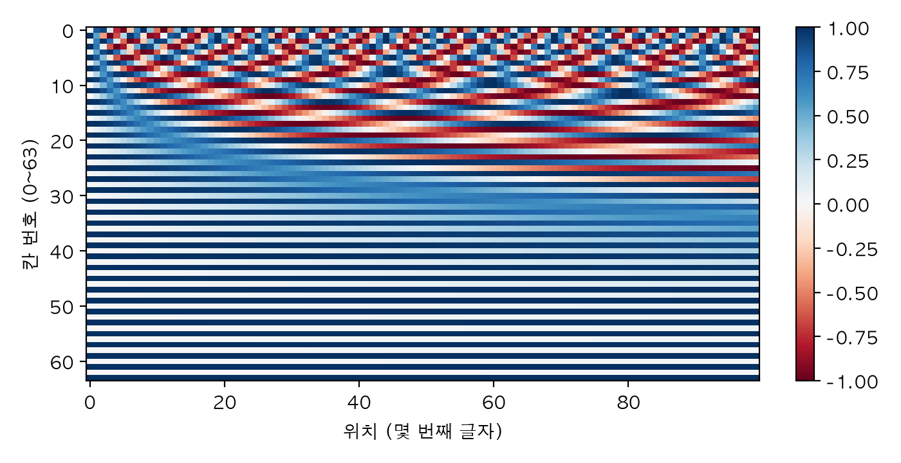
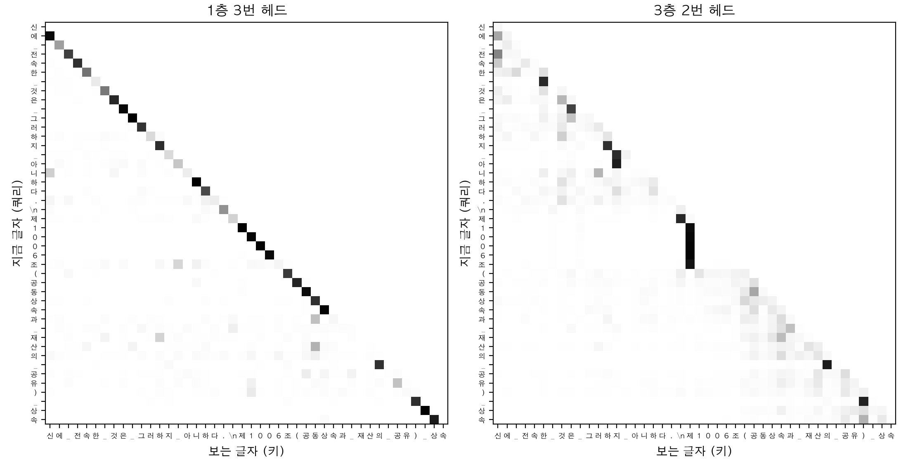

# Chapter 12. 어텐션과 트랜스포머: 처음부터 직접 구현

> **학습 목표**  
> - 어텐션을 "부드럽게 꺼내는 딕셔너리"로 이해하고, 쿼리·키·값으로 직접 계산하기
> - 점수를 d의 제곱근으로 나누는 이유와 마스크(패딩·인과)가 하는 일을 숫자로 확인하기
> - 헤드를 나누고 합치는 모양 바꾸기를 따라가며 멀티헤드 어텐션을 구현하고, PyTorch 내장 부품과 결과 맞춰 보기
> - 어텐션이 순서를 모른다는 것을 확인하고, 위치 정보를 더하는 두 가지 방법 익히기
> - 층 정규화·잔차 연결·피드포워드로 트랜스포머 블록을 조립하고 파라미터 세기
> - 헌법과 민법 조문으로 작은 문자 단위 GPT를 처음부터 학습시켜 한국어 문장을 만들고, 어텐션이 어디를 보는지 들여다보기

---

## 들어가며: "그것"은 무엇을 가리킬까요?

다음 두 문장을 읽어 보세요.

- 고양이가 생선을 먹지 않았다. **그것**이 너무 배불렀기 때문이다.
- 고양이가 생선을 먹지 않았다. **그것**이 너무 상했기 때문이다.

첫 문장의 "그것"은 고양이고, 두 번째 문장의 "그것"은 생선이죠. 사람은 "배불렀다", "상했다"라는 말을 보고 거꾸로 올라가서 "그것"이 무엇인지 바로 압니다. 한 단어의 뜻을 정하려면 **문장 안의 다른 단어 중 어디를 봐야 하는지** 알아야 하는 거예요. 그리고 봐야 할 곳은 바로 옆일 수도 있고, 한참 떨어진 곳일 수도 있습니다.

11장의 RNN은 한 글자씩 순서대로 읽어야 했습니다. 앞에서 읽은 내용을 크기가 정해진 메모장(은닉 상태) 하나에 눌러 담아 다음 글자로 넘기는 방식이라, 멀리 떨어진 단어의 정보는 넘겨지는 동안 점점 흐려지고, 앞 글자를 다 읽기 전에는 다음 글자를 계산할 수도 없었죠. 2017년에 나온 **트랜스포머(Transformer)** 는 생각을 바꿨습니다. 차례로 넘겨받지 말고, **모든 글자가 다른 모든 글자를 한 번에 직접 보게 하자.** 그리고 어디를 얼마나 볼지는 모델이 데이터에서 배우게 하자. 이 "어디를 얼마나 볼지 고르는 장치"가 **어텐션(attention)** 입니다.

오늘날 ChatGPT 같은 대형 언어 모델(LLM)은 거의 모두 트랜스포머이고, 그림을 다루는 모델에도 트랜스포머가 널리 쓰입니다. 그래서 이 장은 이 책에서 가장 중요한 장 가운데 하나예요. 라이브러리 한 줄로 부르고 끝내지 않고, 어텐션 계산 한 줄부터 직접 짜서 쌓아 올릴 겁니다. 마지막에는 대한민국 헌법과 민법 조문을 읽고 "제850조(…" 같은 조문을 스스로 지어내는 작은 GPT를 노트북에서 처음부터 학습시켜요.

필요한 도구는 거의 다 앞에서 익혔습니다. 행렬 곱과 `einsum`, `permute().contiguous().view()`(4장), 소프트맥스와 `nn.Module`(6장), 패딩과 마스크(7장), 드롭아웃·weight decay·스케줄러·그래디언트 클리핑(8장)이 이 장에서 전부 다시 나와요. 이 장의 예제는 PyTorch 2.14, 파이썬 3.12에서 실행해 확인했습니다.

## 12.1 어텐션: 부드럽게 꺼내는 딕셔너리

### 키가 정확히 같지 않아도 꺼낼 수 있다면

1권 7장의 딕셔너리를 떠올려 보세요. `가격표["떡볶이"]`처럼 **키가 정확히 같아야** 값을 꺼낼 수 있었죠. "매콤한 거 있어요?"라고 물으면 딕셔너리는 `KeyError`를 냅니다.

분식집 사장님은 다릅니다. "맵고, 조금 달았으면 좋겠어요"라고 하면 메뉴판을 훑어보고 떡볶이를 가장 먼저 떠올리고, 김치찌개도 조금, 마카롱은 거의 안 떠올리죠. 어텐션은 이 사장님처럼 동작합니다. 키를 **숫자 묶음(벡터)** 으로 두고, 질문과 각 키가 **얼마나 닮았는지**를 재서 그 비율대로 값을 섞어 꺼내요. 음식마다 (매운 정도, 단 정도)를 키로 적어 두고 해 보겠습니다.

```python
import torch

torch.set_printoptions(precision=3, sci_mode=False)   # 소수점 셋째 자리까지, 지수 표기 없이

# 1권 7장의 딕셔너리: 키가 정확히 같아야 값을 꺼낸다
가격표 = {"떡볶이": 4500, "마카롱": 2500, "김치찌개": 9000}
print("딕셔너리:", 가격표["떡볶이"])

# 어텐션: 키를 숫자 묶음으로 두고, 질문과 닮은 정도에 따라 값을 섞어 꺼낸다
키 = torch.tensor([[0.9, 0.6],      # 떡볶이: (매운 정도, 단 정도)
                  [0.0, 1.0],      # 마카롱
                  [1.0, 0.1]])     # 김치찌개
값 = torch.tensor([4500.0, 2500.0, 9000.0])
질문 = torch.tensor([1.0, 0.5])     # "맵고, 조금 달았으면 좋겠어요"

점수 = 키 @ 질문                    # 질문과 키마다 곱하고 더하기(내적) → 닮은 정도
가중치 = torch.softmax(점수, dim=0)  # 합이 1인 비율로
print("점수  :", 점수)
print("가중치:", 가중치)
print("섞어 꺼낸 값:", (가중치 @ 값).round())

# 점수 차이를 키우면 가장 닮은 키 하나에 쏠린다: 딕셔너리처럼 동작
가중치 = torch.softmax(점수 * 20, dim=0)
print("20배 가중치:", 가중치, "→", (가중치 @ 값).round())
```

```text
딕셔너리: 4500
점수  : tensor([1.200, 0.500, 1.050])
가중치: tensor([0.424, 0.211, 0.365])
섞어 꺼낸 값: tensor(5722.)
20배 가중치: tensor([0.953, 0.000, 0.047]) → tensor(4713.)
```

한 줄씩 보겠습니다.

- **점수**: `키 @ 질문`은 키마다 "질문과 같은 자리끼리 곱해서 더한 값", 즉 **내적**을 계산합니다(4장 4.6절의 행렬 곱). 방향이 비슷한 두 벡터일수록 내적이 커서 닮은 정도로 쓸 수 있어요. 떡볶이 1.2, 김치찌개 1.05, 마카롱 0.5가 나왔습니다.
- **가중치**: 점수에 소프트맥스(6장 6.2절)를 씌워 합이 1인 비율 0.424, 0.365, 0.211로 바꿨습니다.
- **섞어 꺼낸 값**: 비율대로 가격을 섞으니 5,722원이 나왔어요. 메뉴판에 없는 값이지만 "그 질문에 어울리는 음식들의 가격을 닮은 정도만큼 섞은 것"입니다.

마지막 두 줄이 재미있습니다. 점수를 20배로 키워서 소프트맥스에 넣으면 가중치가 0.953으로 떡볶이 하나에 거의 몰리고, 꺼낸 값도 떡볶이 가격에 가까운 4,713원이 됩니다. 6장에서 "점수 차이를 10배로 키우면 확률이 거의 0과 1로 쏠린다"고 했던 바로 그 성질이에요. 점수 차이가 아주 크면 어텐션은 딕셔너리처럼 하나를 콕 집어 꺼내고, 차이가 작으면 여러 개를 골고루 섞습니다. 그래서 어텐션을 **부드러운 딕셔너리**라고 부르기도 해요.

어텐션의 세 재료에는 이름이 있습니다.

| 재료 | 비유 | 하는 일 |
|---|---|---|
| **쿼리(query, q)** | 손님의 주문 | "나는 이런 것을 찾는다" |
| **키(key, k)** | 메뉴판에 적힌 특징 | "나는 이런 특징을 가졌다". 쿼리와 내적해서 점수를 낸다 |
| **값(value, v)** | 실제로 내주는 음식 | 가중치대로 섞여서 결과가 된다 |

### 질문 여러 개를 한꺼번에

질문이 하나가 아니라 여러 개라면 어떻게 할까요? 4장에서 배운 대로 반복문을 돌리지 않고 질문들을 한 행렬로 쌓아 행렬 곱 한 번에 계산합니다. 이것이 트랜스포머 논문의 어텐션 공식 그대로예요.

```python
import math

import torch


def 어텐션(q: torch.Tensor, k: torch.Tensor, v: torch.Tensor) -> tuple[torch.Tensor, torch.Tensor]:
    """질문 q마다 키 k와 닮은 정도를 재서, 그 비율대로 값 v를 섞는다."""
    점수 = q @ k.transpose(-2, -1) / math.sqrt(k.size(-1))   # (질문 수, 키 수)
    가중치 = 점수.softmax(dim=-1)                            # 질문마다 합이 1
    return 가중치 @ v, 가중치                                 # (질문 수, 값 차원)


torch.manual_seed(0)
torch.set_printoptions(precision=3)
q = torch.randn(2, 4)       # 질문 2개, 각각 숫자 4개
k = torch.randn(5, 4)       # 키 5개 (질문과 길이가 같아야 내적이 된다)
v = torch.randn(5, 3)       # 값 5개 (키와 개수가 같아야 한다), 각각 숫자 3개

출력, 가중치 = 어텐션(q, k, v)
print("가중치:", tuple(가중치.shape), "출력:", tuple(출력.shape))
print(가중치)
print("질문마다 가중치 합:", 가중치.sum(dim=-1))

# 같은 계산을 einsum으로: 사라지는 글자(d, k)가 곱하고 더해 없어지는 차원
점수 = torch.einsum("qd,kd->qk", q, k) / math.sqrt(4)
print(torch.allclose(torch.einsum("qk,kv->qv", 점수.softmax(dim=-1), v), 출력))
```

```text
가중치: (2, 5) 출력: (2, 3)
tensor([[0.022, 0.055, 0.039, 0.237, 0.648],
        [0.737, 0.069, 0.163, 0.004, 0.027]])
질문마다 가중치 합: tensor([1.000, 1.000])
True
```

`어텐션()` 함수 세 줄이 이 장 전체의 심장입니다. 모양을 따라가 보세요.

- `q @ k.transpose(-2, -1)`: `(질문 2, 숫자 4) @ (숫자 4, 키 5) → (2, 5)`. 질문마다 키 다섯 개와의 점수가 한 줄씩 나옵니다. `k`를 전치한 것은 4장 4.6절의 규칙 `(a, b) @ (b, c)`에 맞추려는 거예요. `transpose(-2, -1)`은 "마지막 두 차원을 바꿔라"라는 뜻이라, 앞에 배치 차원이 붙어도 그대로 쓸 수 있습니다.
- `softmax(dim=-1)`: 키 방향으로 합이 1. 그래서 줄마다 합이 1.000입니다.
- `가중치 @ v`: `(2, 5) @ (5, 3) → (2, 3)`. 질문마다 값 다섯 개를 비율대로 섞은 결과가 하나씩 나와요.

첫 번째 질문은 4번 키에 0.648, 두 번째 질문은 0번 키에 0.737을 줬습니다. 질문마다 보는 곳이 다른 거죠. 모양에서 지켜야 할 규칙은 두 가지예요. 내적을 해야 하니 **쿼리와 키는 숫자 개수가 같아야** 하고, 가중치로 값을 섞어야 하니 **키와 값은 개수가 같아야** 합니다. 값의 숫자 개수(여기서는 3)는 자유롭고요.

마지막 줄은 같은 계산을 4장 4.6절의 `einsum`으로 쓴 것입니다. `"qd,kd->qk"`는 "질문(q)과 키(k)마다 숫자(d)를 곱해 더해 없앤다"는 뜻이라 전치를 따로 신경 쓰지 않아도 돼요. 숫자 4의 제곱근으로 나눈 부분은 바로 다음 절의 주제입니다.

## 12.2 점수를 d의 제곱근으로 나누는 이유

`어텐션()` 함수에서 점수를 `math.sqrt(k.size(-1))`, 즉 **키 숫자 개수의 제곱근**으로 나눴습니다. 이 나눗셈이 왜 필요할까요? 숫자 개수 d를 4, 64, 512로 바꿔 가며 점수의 크기와 소프트맥스의 모양, 그리고 기울기를 재 보겠습니다. 쿼리와 키는 평균 0, 표준편차 1인 난수이고, 쿼리 하나마다 키 8개를 봅니다.

```python
import torch

torch.manual_seed(0)
for d in [4, 64, 512]:
    q = torch.randn(1000, 1, d)             # 질문 1000개
    k = torch.randn(1000, 8, d)             # 질문마다 키 8개
    점수 = (q * k).sum(dim=-1)              # 내적: (1000, 8)
    결과 = []
    for 나눌까 in (False, True):
        s = (점수 / d ** 0.5 if 나눌까 else 점수).detach().requires_grad_()
        가중치 = s.softmax(dim=-1)
        (가중치 * torch.randn(1000, 8)).sum().backward()    # 아무 손실이나 흘려 보기
        결과.append((s.std().item(), 가중치.max(dim=-1).values.mean().item(), s.grad.abs().mean().item()))
    (표1, 최대1, 기울기1), (표2, 최대2, 기울기2) = 결과
    print(f"d={d:3d}  점수 표준편차 {표1:5.2f} → {표2:.2f},  가장 큰 가중치 {최대1:.3f} → {최대2:.3f},"
          f"  기울기 {기울기1:.4f} → {기울기2:.4f}")
```

```text
d=  4  점수 표준편차  2.00 → 1.00,  가장 큰 가중치 0.533 → 0.347,  기울기 0.0686 → 0.0839
d= 64  점수 표준편차  8.08 → 1.01,  가장 큰 가중치 0.878 → 0.361,  기울기 0.0226 → 0.0867
d=512  점수 표준편차 22.69 → 1.00,  가장 큰 가중치 0.960 → 0.362,  기울기 0.0079 → 0.0861
```

세 가지를 차례로 보세요.

1. **나누지 않은 점수의 표준편차**가 2.00, 8.08, 22.69로 d가 커질수록 커집니다. 내적은 숫자 d개를 곱해 **더한** 값이라, 더하는 개수가 많을수록 결과가 크게 흔들리거든요. 정확히는 표준편차가 d의 제곱근배(2, 8, 22.6)가 됩니다. 제곱근으로 나누면 어느 d에서든 1 근처로 돌아와요.
2. 점수가 크게 흔들리면 **소프트맥스가 한 칸으로 쏠립니다.** 12.1절의 20배 실험과 같은 일이에요. d가 512면 키 8개 중 가장 큰 가중치가 평균 0.960이라, 거의 언제나 키 하나만 봅니다. 나눈 뒤에는 0.36 근처로, 여러 키를 섞어 볼 여유가 생겨요.
3. 쏠린 소프트맥스는 **기울기가 거의 0**입니다. 이미 확률이 0과 1에 붙어 있으면 점수를 조금 바꿔도 결과가 거의 변하지 않으니까요. 나누지 않으면 d=512에서 기울기가 0.0079로, 나눈 경우(0.0861)의 10분의 1도 안 됩니다. 학습 초기부터 기울기가 이렇게 작으면 모델이 "어디를 볼지"를 고쳐 나갈 수가 없어요.

그래서 트랜스포머 논문은 이 어텐션을 **스케일드 닷 프로덕트 어텐션(scaled dot-product attention)**, "크기를 맞춘 내적 어텐션"이라고 불렀습니다. 코드로 쓰면 `softmax(Q @ K.T / sqrt(d)) @ V`이고, 앞의 `어텐션()` 함수 세 줄이 정확히 이 수식이에요.

## 12.3 셀프 어텐션: 문장이 자기 자신을 본다

### 같은 입력에서 쿼리·키·값 만들기

지금까지는 쿼리, 키, 값을 따로 준비했습니다. 그런데 처음의 "그것" 문제로 돌아가 보면, 문장 속 글자 하나하나가 **쿼리**("나와 관련된 글자는 어디 있지?")이면서 동시에 다른 글자들의 **키**("나는 이런 글자야")이고 **값**("나를 보면 이 정보를 줄게")이어야 해요. 이렇게 한 문장이 자기 자신을 상대로 어텐션하는 것을 **셀프 어텐션(self-attention)** 이라고 합니다.

같은 글자가 세 역할을 하려면 역할마다 다른 모습이 필요합니다. 그래서 글자 벡터에 서로 다른 `nn.Linear` 세 개를 곱해 쿼리, 키, 값을 따로 만들어요. 어떤 모습으로 바꿀지는 학습으로 정해집니다.

```python
import math

import torch
from torch import nn


class 셀프_어텐션(nn.Module):
    """같은 입력에서 쿼리·키·값을 따로 만들어, 글자마다 다른 글자들을 섞어 본다."""

    def __init__(self, 차원: int) -> None:
        super().__init__()
        self.쿼리 = nn.Linear(차원, 차원, bias=False)   # "나는 무엇을 찾나"
        self.키 = nn.Linear(차원, 차원, bias=False)     # "나는 이런 정보를 가졌다"
        self.값 = nn.Linear(차원, 차원, bias=False)     # "나를 고르면 이걸 준다"

    def forward(self, x: torch.Tensor) -> tuple[torch.Tensor, torch.Tensor]:
        q, k, v = self.쿼리(x), self.키(x), self.값(x)               # 모두 (B, T, C)
        점수 = q @ k.transpose(-2, -1) / math.sqrt(x.size(-1))      # (B, T, T)
        가중치 = 점수.softmax(dim=-1)
        return 가중치 @ v, 가중치


torch.manual_seed(0)
torch.set_printoptions(precision=2)          # 텐서를 소수점 둘째 자리까지만 보여 주기
x = torch.randn(1, 5, 8)            # 문장 1개 × 글자 5개 × 글자마다 숫자 8개
층 = 셀프_어텐션(8)
출력, 가중치 = 층(x)
print("입력", tuple(x.shape), "→ 출력", tuple(출력.shape), "/ 가중치", tuple(가중치.shape))
print(가중치[0].detach())
print("파라미터 수:", sum(p.numel() for p in 층.parameters()))
```

```text
입력 (1, 5, 8) → 출력 (1, 5, 8) / 가중치 (1, 5, 5)
tensor([[0.25, 0.12, 0.23, 0.18, 0.22],
        [0.17, 0.20, 0.15, 0.20, 0.28],
        [0.18, 0.20, 0.20, 0.19, 0.23],
        [0.18, 0.25, 0.17, 0.21, 0.19],
        [0.14, 0.16, 0.17, 0.16, 0.36]])
파라미터 수: 192
```

입력 `(1, 5, 8)`은 문장 1개, 글자 5개, 글자마다 숫자 8개입니다. 앞으로 이 장의 텐서는 거의 모두 이 **(배치 B, 글자 수 T, 숫자 개수 C)** 모양이에요. 4장 4.2절에서 권한 대로 자리마다 이름을 붙여 읽으세요.

- 출력의 모양은 입력과 똑같은 `(1, 5, 8)`입니다. 글자 다섯 개가 저마다 "다른 글자들을 비율대로 섞은 새 벡터"로 바뀌었어요. 모양이 그대로라서 이 층을 여러 번 겹쳐 쌓을 수 있습니다.
- 가중치는 `(1, 5, 5)`, 글자 다섯 개가 글자 다섯 개를 보는 표입니다. 0번 글자의 줄 `[0.25, 0.12, 0.23, 0.18, 0.22]`는 "0번 글자의 새 벡터는 자기 자신을 25%, 1번 글자를 12%, … 섞어 만든다"는 뜻이에요. 아직 학습 전이라 비율이 고만고만합니다.
- 파라미터는 `nn.Linear(8, 8)` 세 개라 8 × 8 × 3 = 192개입니다. 편향은 빼고 만들었어요(`bias=False`).

`셀프_어텐션`은 6장 6.3절에서 배운 대로 `nn.Module`을 상속한 클래스이고, `forward`에서 출력과 가중치를 함께 돌려줍니다. 가중치는 학습에는 필요 없지만, 모델이 어디를 보는지 들여다볼 때 쓸 거예요.

### 어텐션은 순서를 모릅니다

셀프 어텐션에는 이상한 성질이 하나 있습니다. 글자들의 **순서를 뒤섞어서** 넣어 보겠습니다.

```python
import math

import torch
from torch import nn

torch.manual_seed(0)
차원 = 8
쿼리, 키, 값 = (nn.Linear(차원, 차원, bias=False) for _ in range(3))


def 셀프_어텐션(x: torch.Tensor) -> torch.Tensor:
    점수 = 쿼리(x) @ 키(x).transpose(-2, -1) / math.sqrt(차원)
    return 점수.softmax(dim=-1) @ 값(x)


x = torch.randn(1, 5, 차원)             # 글자 5개
순서 = torch.tensor([4, 2, 0, 3, 1])     # 글자 순서를 뒤섞는다
with torch.no_grad():
    원래 = 셀프_어텐션(x)
    섞은 = 셀프_어텐션(x[:, 순서])
print("섞은 입력의 출력 == 원래 출력을 같은 순서로 섞은 것:",
      torch.allclose(섞은, 원래[:, 순서], atol=1e-6))
print("0번 글자의 출력, 원래    :", 원래[0, 0, :4].round(decimals=4))
print("0번 글자의 출력, 섞은 뒤 :", 섞은[0, 2, :4].round(decimals=4))
```

```text
섞은 입력의 출력 == 원래 출력을 같은 순서로 섞은 것: True
0번 글자의 출력, 원래    : tensor([ 0.0907, -0.0069,  0.1461, -0.1893])
0번 글자의 출력, 섞은 뒤 : tensor([ 0.0907, -0.0069,  0.1461, -0.1893])
```

순서를 `[4, 2, 0, 3, 1]`로 섞어 넣었더니, 출력은 원래 출력을 **같은 순서로 섞은 것과 완전히 같았습니다.** 0번 글자는 섞은 입력에서 2번 자리에 있는데, 그 자리의 출력이 원래 0번 출력과 숫자 하나까지 같아요.

생각해 보면 당연합니다. 셀프 어텐션은 "어떤 글자들이 있는가"만 보고 점수를 매기고 섞을 뿐, "그 글자가 몇 번째에 있는가"는 계산 어디에도 들어가지 않거든요. 글자들을 주머니에 넣고 흔들어도 결과는 같습니다. "고양이가 쥐를 쫓는다"와 "쥐가 고양이를 쫓는다"를 구분하지 못하는 셈이에요. RNN은 한 글자씩 순서대로 읽었으니 순서를 저절로 알았지만, 모든 글자를 한꺼번에 보는 어텐션은 이 정보를 잃어버렸습니다. 12.6절에서 위치 정보를 따로 넣어 이 문제를 해결합니다.

## 12.4 마스크: 보면 안 되는 칸 가리기

### 패딩 칸 가리기

7장 7.7절에서 길이가 다른 문장을 한 배치로 묶으려고 짧은 문장 뒤를 0번(빈칸)으로 채웠죠. 그리고 `입력 != 0`으로 진짜 글자 자리를 표시한 마스크를 만들면서 "12장의 어텐션은 이 마스크로 채운 칸은 보지 말라고 알려 준다"고 했습니다. 바로 그 일을 해 보겠습니다.

어떻게 하면 소프트맥스가 특정 칸에 0을 주게 만들 수 있을까요? 소프트맥스는 점수에 지수 함수를 씌운 뒤 합으로 나누는데, 지수 함수에 음의 무한대(`-inf`)를 넣으면 정확히 0이 됩니다. 그러니 **소프트맥스 전에** 가릴 칸의 점수를 `-inf`로 바꾸면 돼요.

```python
import math

import torch

torch.manual_seed(0)
torch.set_printoptions(precision=3)
# 7장의 패딩 배치: 진짜 글자 3개인 문장과 5개인 문장. 0번은 채운 칸
입력 = torch.tensor([[13, 22, 19,  0,  0],
                     [ 7, 14,  1, 25, 21]])
진짜 = 입력 != 0                                    # (2, 5) 진짜 글자 자리
x = torch.randn(2, 5, 4)                            # 글자마다 숫자 4개라고 하자
점수 = x @ x.transpose(-2, -1) / math.sqrt(4)      # (2, 5, 5)

# 키 쪽(열)이 채운 칸이면 -inf로: softmax에서 e^(-inf) = 0이 된다
가린_점수 = 점수.masked_fill(~진짜[:, None, :], float("-inf"))
가중치 = 가린_점수.softmax(dim=-1)
print("첫 문장의 가중치(채운 칸 열은 0):")
print(가중치[0])
print("줄마다 합:", 가중치[0].sum(dim=-1))

# 잘못된 방법: softmax를 먼저 하고 채운 칸을 0으로 지우면 합이 1이 아니다
틀린 = 점수.softmax(dim=-1) * 진짜[:, None, :]
print("softmax 뒤에 지우면 줄마다 합:", 틀린[0].sum(dim=-1))
```

```text
첫 문장의 가중치(채운 칸 열은 0):
tensor([[0.650, 0.107, 0.242, 0.000, 0.000],
        [0.036, 0.938, 0.026, 0.000, 0.000],
        [0.332, 0.109, 0.560, 0.000, 0.000],
        [0.154, 0.645, 0.200, 0.000, 0.000],
        [0.594, 0.016, 0.390, 0.000, 0.000]])
줄마다 합: tensor([1.000, 1.000, 1.000, 1.000, 1.000])
softmax 뒤에 지우면 줄마다 합: tensor([0.567, 0.910, 0.573, 0.374, 0.303])
```

`masked_fill(조건, 값)`은 조건이 참인 칸을 값으로 바꾼 새 텐서를 돌려줍니다. 4장 4.4절의 `torch.where`와 같은 일을 하는 지름길이에요. 마스크 모양 `~진짜[:, None, :]`를 읽어 보세요. `진짜`는 `(2, 5)`인데 가운데에 `None`으로 차원을 끼워 넣어 `(2, 1, 5)`로 만들었습니다. 그러면 브로드캐스팅(4장 4.6절)으로 `(2, 5, 5)` 점수표의 **모든 줄에 같은 열 마스크**가 적용돼요. "어떤 글자가 묻든(줄), 채운 칸(열)은 보지 마"라는 뜻입니다. `~`는 참과 거짓을 뒤집어 "채운 칸"을 고른 것이고요.

결과를 보면 첫 문장의 3번, 4번 열이 모두 0.000이고, 줄마다 합은 여전히 1입니다. 진짜 글자 세 개만으로 비율을 다시 나눠 가진 거예요.

마지막 줄은 흔한 실수입니다. 소프트맥스를 먼저 하고 채운 칸을 0으로 지우면, 지운 만큼 합이 모자라서 줄마다 합이 0.567, 0.910처럼 1보다 작아져요. 가릴 칸은 반드시 **소프트맥스 전에 `-inf`로** 가리세요.

### 앞으로 올 글자 가리기: 인과 마스크

GPT 같은 모델은 글을 한 글자씩 이어 씁니다. "대한민국"까지 보고 다음 글자를 맞히는 식이죠. 그런데 학습할 때는 문장 전체를 한 번에 넣으니, 셀프 어텐션이 **아직 나오지 않은 뒤쪽 글자**까지 훔쳐볼 수 있습니다. 시험 문제를 풀면서 답안지를 보는 셈이에요. 그래서 글자마다 **자기와 자기 앞의 글자만** 보도록 가립니다. 원인이 결과보다 앞선다는 뜻에서 **인과 마스크(causal mask)** 라고 불러요.

```python
import math

import torch

T = 5
보임 = torch.tril(torch.ones(T, T, dtype=torch.bool))    # 아래 삼각형: 나와 내 앞만 보임
print(보임.int())

torch.manual_seed(0)
torch.set_printoptions(precision=2)
x = torch.randn(1, T, 4)


def 인과_어텐션(x: torch.Tensor) -> tuple[torch.Tensor, torch.Tensor]:
    점수 = x @ x.transpose(-2, -1) / math.sqrt(x.size(-1))
    가중치 = 점수.masked_fill(~보임, float("-inf")).softmax(dim=-1)
    return 가중치 @ x, 가중치


출력, 가중치 = 인과_어텐션(x)
print(가중치[0])

# 마지막 글자를 바꿔도 앞 글자들의 출력은 그대로일까?
바꾼_x = x.clone()
바꾼_x[0, -1] = 100.0
바꾼_출력, _ = 인과_어텐션(바꾼_x)
print("앞 네 글자 출력이 같은가:", torch.allclose(출력[:, :4], 바꾼_출력[:, :4]))
print("마지막 글자 출력이 같은가:", torch.allclose(출력[:, 4], 바꾼_출력[:, 4]))
```

```text
tensor([[1, 0, 0, 0, 0],
        [1, 1, 0, 0, 0],
        [1, 1, 1, 0, 0],
        [1, 1, 1, 1, 0],
        [1, 1, 1, 1, 1]], dtype=torch.int32)
tensor([[1.00, 0.00, 0.00, 0.00, 0.00],
        [0.05, 0.95, 0.00, 0.00, 0.00],
        [0.13, 0.25, 0.63, 0.00, 0.00],
        [0.01, 0.01, 0.09, 0.89, 0.00],
        [0.01, 0.01, 0.11, 0.30, 0.58]])
앞 네 글자 출력이 같은가: True
마지막 글자 출력이 같은가: False
```

`torch.tril`은 행렬의 아래 삼각형(대각선 포함)만 남기는 함수입니다. 0번 글자는 자기만, 1번 글자는 0~1번만, 4번 글자는 0~4번 모두를 볼 수 있어요. 가중치 표도 대각선 위가 모두 0이 됐고, 0번 글자는 볼 수 있는 게 자기뿐이라 1.00입니다.

마지막 확인이 핵심입니다. 마지막 글자를 100이라는 엉뚱한 값으로 바꿨는데 **앞 네 글자의 출력은 하나도 바뀌지 않았어요.** 앞 글자들은 마지막 글자를 아예 볼 수 없으니까요. 이 성질 덕분에 문장 하나를 넣으면 "첫 글자 보고 둘째 맞히기", "두 글자 보고 셋째 맞히기", …를 **한 번의 계산으로 동시에** 학습할 수 있습니다. RNN처럼 차례를 기다릴 필요가 없어서 GPU로 훨씬 빨리 학습할 수 있어요. 12.8절에서 이 장점을 그대로 씁니다.

> **Q. 모든 칸이 가려진 줄이 생기면 어떻게 되나요?**
> 소프트맥스에 `-inf`만 들어가면 0 ÷ 0이 되어 그 줄 전체가 `nan`이 됩니다. 패딩 칸을 **줄(쿼리) 쪽까지** 가리거나, 문장 전체가 채운 칸이라 볼 수 있는 키가 하나도 없을 때 생겨요. 그 `nan`이 다음 층으로 퍼지면 학습 전체가 망가집니다. 그래서 패딩 마스크는 위 예제처럼 **열(키) 쪽에만** 적용해요. 위 결과에서 채운 칸인 3·4번 줄도 진짜 글자 세 개를 보며 멀쩡한 가중치를 받았죠. 그 줄들의 출력은 의미 없는 값이니 손실을 계산할 때 빼면 됩니다. 인과 마스크는 대각선(자기 자신)이 언제나 보이니 이런 일이 생기지 않아요.

## 12.5 멀티헤드 어텐션: 여러 관점으로 동시에 보기

### 헤드를 나누고 합치기

"고양이가 생선을 먹지 않았다"에서 "먹지"라는 글자가 봐야 할 곳은 하나가 아닙니다. 누가 먹는지(고양이), 무엇을 먹는지(생선), 바로 앞 글자가 무엇인지가 모두 필요하죠. 그런데 어텐션 한 번은 결국 비율 하나로 섞기 때문에, 여러 곳을 서로 다른 이유로 보기가 어렵습니다.

**멀티헤드 어텐션(multi-head attention)** 은 이 문제를 아주 단순하게 풉니다. 숫자 C개를 H조각으로 나눠서, **조각마다 따로 어텐션**을 하는 거예요. 조각 하나를 **헤드(head)** 라고 부릅니다. 한 문장을 여러 사람이 각자 다른 관점으로 읽고 의견을 모으는 셈이죠. 숫자 8개를 헤드 2개로 나누면 헤드마다 숫자 4개씩입니다. 이 나누고 합치는 모양 바꾸기가 4장 4.5절에서 예고한 바로 그 패턴이에요.

```python
import torch

B, T, C, H = 2, 5, 8, 2                 # 문장 2개, 글자 5개, 숫자 8개, 헤드 2개
D = C // H                              # 헤드마다 숫자 4개씩
x = torch.arange(B * T * C, dtype=torch.float32).view(B, T, C)

나눔 = x.view(B, T, H, D).transpose(1, 2)        # (B, T, C) → (B, T, H, D) → (B, H, T, D)
print("나눈 모양:", tuple(나눔.shape), "이어져 있나?", 나눔.is_contiguous())
print("0번 헤드 = 숫자 0~3번 칸:", torch.equal(나눔[:, 0], x[..., :D]))
print("1번 헤드 = 숫자 4~7번 칸:", torch.equal(나눔[:, 1], x[..., D:]))

결과 = 나눔 @ torch.eye(D)                          # 행렬 곱의 결과는 (B, H, T, D) 순서로 새로 놓인다
되돌림 = 결과.transpose(1, 2)                       # (B, H, T, D) → (B, T, H, D)
try:
    되돌림.view(B, T, C)
except RuntimeError as e:
    print("view 오류:", str(e).split("(")[0].strip())
합침 = 되돌림.contiguous().view(B, T, C)            # 4장의 permute → contiguous → view
print("다시 합친 모양:", tuple(합침.shape), "원래와 같은가?", torch.equal(합침, x))
```

```text
나눈 모양: (2, 2, 5, 4) 이어져 있나? False
0번 헤드 = 숫자 0~3번 칸: True
1번 헤드 = 숫자 4~7번 칸: True
view 오류: view size is not compatible with input tensor's size and stride
다시 합친 모양: (2, 5, 8) 원래와 같은가? True
```

모양 바꾸기를 두 단계로 나눠 보세요.

1. **`view(B, T, H, D)`**: 마지막 차원 C = 8을 (헤드 2, 숫자 4)로 쪼갭니다. 숫자는 하나도 움직이지 않고 읽는 법만 바뀌어요.
2. **`transpose(1, 2)`**: 글자 차원과 헤드 차원을 바꿔 `(B, H, T, D)`로 만듭니다. 헤드를 배치처럼 앞으로 빼 두면, 4장 4.6절에서 본 대로 `@`가 **앞쪽 차원(B, H)을 배치로 보고** 헤드마다 따로 `(T, D) @ (D, T)`를 계산해 줘요.

확인해 보니 0번 헤드는 원래 숫자 0~3번 칸, 1번 헤드는 4~7번 칸과 똑같습니다. 헤드를 나눈다는 건 결국 **숫자 칸을 몇 묶음으로 나눠 따로 쓰는 것**이에요.

다시 합칠 때가 함정입니다. 어텐션 계산(행렬 곱)의 결과는 `(B, H, T, D)` 순서로 새로 놓이는데, 이걸 `transpose(1, 2)`로 `(B, T, H, D)`로 돌린 뒤 바로 `view(B, T, C)`를 하면 오류가 나요. 4장 4.5절에서 본 그대로, 전치한 텐서는 메모리가 보이는 순서대로 이어져 있지 않아서(`is_contiguous()`가 `False`) `view`로 펼 수 없거든요. `.contiguous()`로 보이는 순서대로 새로 늘어놓은 뒤에 `view`하면 됩니다. 이것이 트랜스포머 코드마다 나오는 `transpose(1, 2).contiguous().view(B, T, C)`의 정체예요.

### 멀티헤드 어텐션 직접 만들기

이제 조각을 모아 멀티헤드 어텐션을 완성하고, PyTorch에 준비된 `nn.MultiheadAttention`에 **같은 가중치**를 넣어서 결과가 똑같은지 확인하겠습니다.

```python
import math

import torch
from torch import nn


class 멀티헤드_어텐션(nn.Module):
    def __init__(self, 차원: int, 헤드_수: int) -> None:
        super().__init__()
        self.헤드_수 = 헤드_수
        self.qkv = nn.Linear(차원, 3 * 차원)        # 쿼리·키·값을 한 번에 만든다
        self.출력 = nn.Linear(차원, 차원)            # 헤드들의 결과를 섞는다

    def forward(self, x: torch.Tensor) -> tuple[torch.Tensor, torch.Tensor]:
        B, T, C = x.shape
        q, k, v = self.qkv(x).split(C, dim=2)                      # 각각 (B, T, C)
        q, k, v = (t.view(B, T, self.헤드_수, -1).transpose(1, 2) for t in (q, k, v))
        점수 = torch.einsum("bhqd,bhkd->bhqk", q, k) / math.sqrt(k.size(-1))   # (B, H, T, T)
        미래 = torch.ones(T, T, dtype=torch.bool).triu(1)          # 대각선 위 = 앞으로 올 글자
        가중치 = 점수.masked_fill(미래, float("-inf")).softmax(dim=-1)
        y = (가중치 @ v).transpose(1, 2).contiguous().view(B, T, C)
        return self.출력(y), 가중치


torch.manual_seed(0)
x = torch.randn(2, 6, 16)                      # 문장 2개 × 글자 6개 × 숫자 16개
우리 = 멀티헤드_어텐션(16, 헤드_수=4)
출력, 가중치 = 우리(x)
print("출력", tuple(출력.shape), "가중치", tuple(가중치.shape))
print("파라미터 수:", sum(p.numel() for p in 우리.parameters()))

# PyTorch의 nn.MultiheadAttention에 같은 가중치를 넣고 결과를 비교한다
파이토치 = nn.MultiheadAttention(16, num_heads=4, batch_first=True)
with torch.no_grad():
    파이토치.in_proj_weight.copy_(우리.qkv.weight)      # (3C, C): 쿼리·키·값 순서로 쌓여 있다
    파이토치.in_proj_bias.copy_(우리.qkv.bias)
    파이토치.out_proj.weight.copy_(우리.출력.weight)
    파이토치.out_proj.bias.copy_(우리.출력.bias)
미래 = torch.ones(6, 6, dtype=torch.bool).triu(1)        # True = 보지 마
그쪽_출력, 그쪽_가중치 = 파이토치(x, x, x, attn_mask=미래, average_attn_weights=False)
print("파라미터 수:", sum(p.numel() for p in 파이토치.parameters()))
print("출력이 같은가:", torch.allclose(출력, 그쪽_출력, atol=1e-6))
print("가중치가 같은가:", torch.allclose(가중치, 그쪽_가중치, atol=1e-6))
```

```text
출력 (2, 6, 16) 가중치 (2, 4, 6, 6)
파라미터 수: 1088
파라미터 수: 1088
출력이 같은가: True
가중치가 같은가: True
```

12.3절의 `셀프_어텐션`과 달라진 점을 보세요.

- **`qkv`**: 쿼리·키·값용 `nn.Linear` 세 개를 `nn.Linear(차원, 3 * 차원)` 하나로 합쳤습니다. 한 번 곱한 뒤 `split(C, dim=2)`로 세 토막으로 자르면 따로 곱한 것과 같고, 큰 행렬 곱 한 번이 작은 곱 세 번보다 빨라요.
- **헤드 나누기**: 앞에서 본 `view` → `transpose`를 q, k, v에 똑같이 적용했습니다. `view`의 마지막 자리에 `-1`을 써서 헤드 차원은 알아서 계산하게 했어요(C ÷ H = 4).
- **점수**: `einsum("bhqd,bhkd->bhqk")`로 썼습니다. 4장 4.6절 끝에서 "(배치, 헤드, 단어, 차원)처럼 차원이 넷인 텐서를 곱할 때 einsum으로 쓰면 수식과 코드가 거의 그대로 겹쳐 보인다"고 했던 곳이 여기예요. 배치(b)와 헤드(h)는 짝을 맞춰 따로따로, 숫자(d)는 곱해서 없애고, 쿼리 글자(q)와 키 글자(k)가 남습니다.
- **인과 마스크**: `triu(1)`은 대각선 **위**만 참인 표라서, 12.4절의 `tril`을 뒤집은 "가릴 칸" 표입니다. `(T, T)` 마스크가 `(B, H, T, T)` 점수표에 브로드캐스팅돼요.
- **출력 층**: 헤드들의 결과를 이어 붙인 뒤 `nn.Linear` 하나를 더 통과시킵니다. 헤드마다 따로 본 것을 섞어 주는 단계예요.

파라미터는 `qkv`가 16 × 48 + 48 = 816개, `출력`이 16 × 16 + 16 = 272개로 모두 1,088개입니다. 헤드를 나눠도 파라미터 수는 늘지 않아요. 같은 숫자를 나눠 쓸 뿐이니까요.

`nn.MultiheadAttention`도 파라미터가 1,088개이고, 가중치를 옮겨 넣었더니 출력과 가중치가 모두 같았습니다. `in_proj_weight`가 우리 `qkv.weight`와 똑같이 쿼리·키·값 순서로 쌓인 `(3C, C)` 행렬이라 그대로 복사할 수 있었어요. 직접 짠 코드가 PyTorch 내부와 같은 계산이라는 확인입니다. 이렇게 **내장 부품과 결과를 맞춰 보는 것**은 직접 구현한 모델을 검증하는 가장 확실한 방법이에요.

### 한 줄짜리 함수: scaled_dot_product_attention

실무에서는 점수 계산부터 소프트맥스, 값 섞기까지를 함수 하나로 부르는 경우가 많습니다.

```python
import math

import torch
from torch.nn import functional as F

torch.manual_seed(0)
B, H, T, D = 2, 4, 6, 8
q, k, v = torch.randn(B, H, T, D), torch.randn(B, H, T, D), torch.randn(B, H, T, D)

# 이 장에서 직접 쓴 계산
점수 = q @ k.transpose(-2, -1) / math.sqrt(D)
미래 = torch.ones(T, T, dtype=torch.bool).triu(1)
직접 = 점수.masked_fill(미래, float("-inf")).softmax(dim=-1) @ v

# PyTorch가 준비해 둔 한 줄짜리 함수
한줄 = F.scaled_dot_product_attention(q, k, v, is_causal=True)
print("모양:", tuple(한줄.shape), "같은가:", torch.allclose(직접, 한줄, atol=1e-6))

# 패딩 마스크도 받는다: True인 칸만 본다 (nn.MultiheadAttention과 뜻이 반대이니 주의)
보임 = torch.tensor([[True, True, True, True, False, False]])   # (1, T): 뒤의 두 칸은 채운 칸
직접2 = 점수.masked_fill(~보임, float("-inf")).softmax(dim=-1) @ v
한줄2 = F.scaled_dot_product_attention(q, k, v, attn_mask=보임)
print("패딩 마스크도 같은가:", torch.allclose(직접2, 한줄2, atol=1e-6))
```

```text
모양: (2, 4, 6, 8) 같은가: True
패딩 마스크도 같은가: True
```

`F.scaled_dot_product_attention`은 이름 그대로 12.2절의 "크기를 맞춘 내적 어텐션"을 한 번에 계산합니다. `is_causal=True`를 주면 인과 마스크를 알아서 적용하고, `attn_mask`로 패딩 마스크를 넘길 수도 있어요. 두 경우 모두 직접 쓴 계산과 같았습니다.

결과가 같은데 왜 이 함수를 쓸까요? 장치에 따라 훨씬 빠르고 메모리를 덜 쓰는 계산법(예: FlashAttention)을 알아서 골라 주기 때문입니다. 12.9절에서 보겠지만 어텐션 가중치 표는 문장이 길어지면 엄청나게 커지는데, 이 함수는 그 표를 메모리에 통째로 만들지 않고도 같은 답을 내요. 이 장에서는 가중치를 들여다보려고 직접 계산을 쓰지만, 내 모델을 실제로 학습시킬 때는 이 함수로 바꾸는 것을 권합니다(16장).

주석에 적은 함정 하나는 꼭 기억하세요. 마스크의 `True`가 이 함수에서는 **"본다"**, `nn.MultiheadAttention`의 `attn_mask`에서는 **"가린다"** 입니다. 뜻이 정반대라서, 함수를 바꿀 때 마스크를 뒤집지 않으면 오류 없이 엉뚱한 칸만 보게 돼요.

## 12.6 순서 알려 주기: 위치 정보

### 사인·코사인 위치 인코딩

12.3절에서 어텐션은 글자 순서를 모른다는 것을 확인했습니다. 해결책은 간단해요. 글자 벡터에 **"나는 몇 번째 자리다"라는 정보를 더해** 넣는 겁니다. 자리마다 서로 다른 숫자 묶음을 하나씩 정해 두고, 그 자리의 글자 벡터에 더하는 거죠.

원래 트랜스포머 논문은 빠르기가 서로 다른 물결(사인·코사인)로 이 숫자 묶음을 만들었습니다. 시계를 떠올려 보세요. 초침은 빨리, 분침은 천천히, 시침은 더 천천히 돕니다. 세 바늘의 위치를 함께 보면 하루 중 어느 순간인지 정확히 알 수 있죠. 위치 인코딩도 칸마다 빠르기가 다른 바늘을 두고, 자리마다 그 바늘들이 가리키는 값을 적어 둡니다.

```python
import matplotlib
import matplotlib.pyplot as plt
import torch

matplotlib.use("Agg")                               # 창을 띄우지 않고 파일로만 그리기
plt.rcParams["font.family"] = "AppleGothic"         # macOS 한글 글꼴
plt.rcParams["axes.unicode_minus"] = False
torch.set_printoptions(precision=2, sci_mode=False)


def 사인_위치_인코딩(길이: int, 차원: int) -> torch.Tensor:
    """위치마다 빠르기가 다른 사인·코사인 물결의 값을 이어 붙인 표 (길이, 차원)."""
    위치 = torch.arange(길이).unsqueeze(1)                          # (길이, 1)
    빠르기 = 10000 ** (-torch.arange(0, 차원, 2) / 차원)            # (차원/2,): 1부터 점점 느리게
    표 = torch.zeros(길이, 차원)
    표[:, 0::2] = torch.sin(위치 * 빠르기)                           # 짝수 칸: 사인
    표[:, 1::2] = torch.cos(위치 * 빠르기)                           # 홀수 칸: 코사인
    return 표


표 = 사인_위치_인코딩(100, 64)
print("모양:", tuple(표.shape))
print(표[:4, :6])                                   # 위치 0~3의 앞 칸 여섯 개

# 위치 20과 다른 위치들의 코사인 유사도: 가까울수록 닮았다
단위 = 표 / 표.norm(dim=1, keepdim=True)
닮음 = 단위 @ 단위[20]
for 위치 in [20, 21, 22, 25, 30, 40, 60, 99]:
    print(f"위치 20 vs {위치:2d}: {닮음[위치]:.3f}")

# 표 전체를 그림으로: 가로는 위치, 세로는 칸 번호
그림, 축 = plt.subplots(figsize=(7, 3.6))
색 = 축.imshow(표.T, aspect="auto", cmap="RdBu", vmin=-1, vmax=1)
축.set_xlabel("위치 (몇 번째 글자)")
축.set_ylabel("칸 번호 (0~63)")
그림.colorbar(색, ax=축, fraction=0.03)
그림.tight_layout()
그림.savefig("positional_encoding.png", dpi=200)
```

```text
모양: (100, 64)
tensor([[ 0.00,  1.00,  0.00,  1.00,  0.00,  1.00],
        [ 0.84,  0.54,  0.68,  0.73,  0.53,  0.85],
        [ 0.91, -0.42,  1.00,  0.07,  0.90,  0.43],
        [ 0.14, -0.99,  0.78, -0.63,  0.99, -0.12]])
위치 20 vs 20: 1.000
위치 20 vs 21: 0.966
위치 20 vs 22: 0.884
위치 20 vs 25: 0.734
위치 20 vs 30: 0.658
위치 20 vs 40: 0.590
위치 20 vs 60: 0.481
위치 20 vs 99: 0.466
```

`빠르기`는 첫 칸이 1이고 뒤 칸으로 갈수록 점점 느려집니다. 출력의 첫 두 칸(가장 빠른 바늘)은 위치 0, 1, 2, 3에서 0.00 → 0.84 → 0.91 → 0.14로 크게 출렁이지만, 다섯째·여섯째 칸(느린 바늘)은 0.00 → 0.53 → 0.90 → 0.99로 천천히 움직이죠. 짝수 칸에 사인, 홀수 칸에 코사인을 넣은 것은 `표[:, 0::2]`, `표[:, 1::2]`처럼 1권 6장의 슬라이싱 간격으로 칸을 골라 채웠습니다.

아래쪽 결과가 이 방법의 좋은 점입니다. 위치 20과 다른 위치의 코사인 유사도(4장 4.11절 실습의 그 계산)를 쟀더니 21은 0.966, 25는 0.734, 60은 0.481로 **가까운 위치끼리 더 닮았어요.** 모델이 "바로 옆 글자", "조금 떨어진 글자"를 구분하는 데 쓸 수 있는 성질입니다. 코드 마지막 부분은 표 전체를 `imshow`로 그려 `positional_encoding.png`에 저장합니다. 위쪽 칸(빠른 바늘)은 촘촘하게, 아래쪽 칸(느린 바늘)은 느리게 출렁이는 모습이 보여요.



### 학습하는 위치 임베딩

GPT는 더 단순한 방법을 씁니다. 자리마다 숫자 묶음을 **무작위로 시작해서 학습으로 정하게** 하는 거예요. 이때 쓰는 부품이 11장 11.11절에서 글자 번호를 벡터로 바꿀 때 쓴 `nn.Embedding`입니다. 글자 번호 대신 **자리 번호**를 넣으면 위치 임베딩이 돼요.

```python
import math

import torch
from torch import nn

torch.manual_seed(0)
torch.set_printoptions(precision=3)
글자_임베딩 = nn.Embedding(10, 4)           # 글자 10종류, 글자마다 숫자 4개 (학습되는 표)
번호들 = torch.tensor([[3, 7, 3]])          # 글자 번호 세 개 (첫째와 셋째가 같은 글자)
x = 글자_임베딩(번호들)
print("모양:", tuple(번호들.shape), "→", tuple(x.shape))
print(x[0].detach())
print("표의 3번 줄을 꺼낸 것과 같은가:", torch.equal(x[0, 0], 글자_임베딩.weight[3]))

# 위치 임베딩을 더하면 같은 글자라도 자리에 따라 다른 숫자가 된다
위치_임베딩 = nn.Embedding(8, 4)            # 위치 0~7, 위치마다 숫자 4개
x = x + 위치_임베딩(torch.arange(3))
print("위치를 더한 뒤 0번 == 2번 자리:", torch.allclose(x[0, 0], x[0, 2]))

# 12.3절의 실험을 다시: 순서를 섞으면 이제 결과가 달라진다
층 = nn.Linear(4, 4, bias=False)


def 셀프_어텐션(x: torch.Tensor) -> torch.Tensor:
    return (층(x) @ 층(x).transpose(-2, -1) / math.sqrt(4)).softmax(dim=-1) @ x


with torch.no_grad():
    섞은_번호 = 번호들[:, [1, 0, 2]]
    원래 = 셀프_어텐션(글자_임베딩(번호들) + 위치_임베딩(torch.arange(3)))
    섞음 = 셀프_어텐션(글자_임베딩(섞은_번호) + 위치_임베딩(torch.arange(3)))
print("위치가 있으면 섞은 결과가 원래를 섞은 것과 같은가:", torch.allclose(섞음, 원래[:, [1, 0, 2]]))
```

```text
모양: (1, 3) → (1, 3, 4)
tensor([[ 0.120,  1.238,  1.117, -0.247],
        [-0.174, -0.679,  0.938,  0.489],
        [ 0.120,  1.238,  1.117, -0.247]])
표의 3번 줄을 꺼낸 것과 같은가: True
위치를 더한 뒤 0번 == 2번 자리: False
위치가 있으면 섞은 결과가 원래를 섞은 것과 같은가: False
```

11장에서 본 대로 `nn.Embedding(10, 4)`는 **10줄 4칸짜리 표**이고, 번호를 주면 그 번호의 줄을 꺼내 줍니다(원-핫 @ 표와 같은 계산이었죠). 번호 `[3, 7, 3]`을 넣으니 `(1, 3, 4)`가 나왔고, 첫째와 셋째 줄이 같은 3번 줄이라 숫자도 똑같아요.

위치도 똑같이 `nn.Embedding(최대 길이, 숫자 개수)`로 만들어 `torch.arange(글자 수)`로 꺼낸 뒤 글자 벡터에 더합니다. 그러자 같은 글자였던 0번과 2번 자리가 더 이상 같지 않아요. 같은 글자라도 **자리에 따라 다른 벡터**가 된 거죠. 12.3절의 섞기 실험을 다시 해 보니 이번에는 `False`가 나왔습니다. 순서를 바꾸면 결과가 달라지는, 순서를 아는 모델이 된 거예요.

> **Q. 사인·코사인과 학습하는 위치 임베딩 중 무엇이 좋나요?**
> 작은 모델에서는 성능 차이가 크지 않습니다. 학습하는 방식은 단순하고 데이터에 맞춰지지만, 표에 없는 길이(예: 최대 128자로 만든 모델에 200자)는 다룰 수 없어요. 사인·코사인은 공식이라 어떤 길이든 계산할 수 있습니다. 요즘 LLM은 쿼리와 키를 위치만큼 회전시키는 RoPE 같은 방법을 많이 쓰는데, "자리 정보를 어텐션 점수에 섞어 넣는다"는 생각은 같아요. 이 장의 작은 GPT는 GPT-2처럼 학습하는 위치 임베딩을 씁니다.

## 12.7 트랜스포머 블록 조립하기

어텐션만으로는 모델이 되지 않습니다. 트랜스포머는 어텐션에 세 가지 부품을 더한 **블록**을 여러 층 쌓아 만들어요. 층 정규화, 잔차 연결, 피드포워드입니다.

### 층 정규화: 글자마다 따로 표준화하기

8장 8.4절의 배치 정규화는 **배치 안의 여러 샘플**을 모아 특성마다 평균과 분산을 냈습니다. 그런데 문장에서는 이 방식이 불편해요. 문장마다 길이가 달라 패딩 칸이 평균에 섞이고, 글을 한 글자씩 만들어 낼 때는 배치가 1개뿐이기도 하니까요. 그래서 트랜스포머는 **글자 하나의 숫자들만으로** 평균과 분산을 내는 **층 정규화(layer normalization)** 를 씁니다.

```python
import torch
from torch import nn

torch.set_printoptions(precision=3)
# 문장 2개 × 글자 3개 × 숫자 4개. 둘째 문장의 마지막 글자는 채운 칸(0)이다
x = torch.tensor([[[1.0, 2.0, 3.0, 4.0], [10.0, 20.0, 30.0, 40.0], [2.0, 2.0, 2.0, 6.0]],
                  [[0.5, 0.0, 0.5, 1.0], [3.0, 1.0, 4.0, 1.0], [0.0, 0.0, 0.0, 0.0]]])
층정규화 = nn.LayerNorm(4)                 # 글자 하나의 숫자 4개를 표준화한다
출력 = 층정규화(x)
print(출력[0].detach())

# 손으로: 글자마다(마지막 차원 방향으로) 평균과 분산을 낸다
평균 = x.mean(dim=-1, keepdim=True)
분산 = x.var(dim=-1, keepdim=True, unbiased=False)
print("손 계산과 같은가:", torch.allclose(출력, (x - 평균) / torch.sqrt(분산 + 층정규화.eps), atol=1e-5))
print("글자 1개만 넣어도 된다:", tuple(층정규화(x[:1, :1]).shape))
print("다른 글자와 섞이지 않는다:", torch.allclose(층정규화(x[:1, :1]), 출력[:1, :1]))
```

```text
tensor([[-1.342, -0.447,  0.447,  1.342],
        [-1.342, -0.447,  0.447,  1.342],
        [-0.577, -0.577, -0.577,  1.732]])
손 계산과 같은가: True
글자 1개만 넣어도 된다: (1, 1, 4)
다른 글자와 섞이지 않는다: True
```

첫 문장의 첫 두 글자 `[1, 2, 3, 4]`와 `[10, 20, 30, 40]`은 크기가 10배 다른데, 층 정규화를 하니 똑같이 `[-1.342, -0.447, 0.447, 1.342]`가 됐습니다. 글자마다 **자기 숫자 4개**의 평균을 빼고 표준편차로 나눴기 때문이에요. 손 계산에서도 `dim=-1`, 즉 마지막 차원(숫자 방향)으로 평균과 분산을 냈습니다. 8장의 배치 정규화가 `dim=0`(샘플 방향)으로 냈던 것과 방향이 다르죠.

그래서 아래 두 줄이 가능합니다. 글자 **하나만** 넣어도 잘 동작하고(8장에서 배치 정규화는 샘플 하나를 넣으면 오류가 났죠), 그 결과가 배치 전체를 넣었을 때와 같아요. 다른 글자나 다른 문장, 패딩 칸과 전혀 섞이지 않는다는 뜻입니다. 학습할 때와 평가할 때 계산이 같아서 `train()`/`eval()`에 따라 동작이 달라지지도 않아요. `nn.LayerNorm(4)`에도 배치 정규화처럼 표준화 뒤에 곱하고 더하는 학습 숫자가 4개씩 들어 있습니다.

### 잔차 연결: 깊이 쌓아도 기울기가 흐르게

9장에서 ResNet의 잔차 연결을 만들었죠. 층의 출력에 **입력을 그대로 더해 주는** 지름길입니다. 트랜스포머도 블록 안의 어텐션과 피드포워드마다 잔차 연결을 둡니다. 효과를 다시 한번 숫자로 보겠습니다. `nn.Linear`와 tanh를 32층 쌓고, 첫 층과 마지막 층의 기울기 크기를 재요.

```python
import torch
from torch import nn

torch.manual_seed(0)
깊이 = 32
층들 = nn.ModuleList(nn.Sequential(nn.Linear(64, 64), nn.Tanh()) for _ in range(깊이))
x = torch.randn(16, 64)

for 잔차 in (False, True):
    층들.zero_grad()
    h = x
    for 층 in 층들:
        h = h + 층(h) if 잔차 else 층(h)        # 잔차 연결: 입력을 출력에 더해 준다
    h.pow(2).mean().backward()
    첫층 = 층들[0][0].weight.grad.norm().item()
    끝층 = 층들[-1][0].weight.grad.norm().item()
    print(f"잔차 {'있음' if 잔차 else '없음'}: 첫 층 기울기 {첫층:.2e}, 마지막 층 기울기 {끝층:.2e}")
```

```text
잔차 없음: 첫 층 기울기 1.44e-09, 마지막 층 기울기 1.53e-02
잔차 있음: 첫 층 기울기 1.10e+01, 마지막 층 기울기 5.30e+00
```

잔차가 없으면 마지막 층의 기울기는 0.0153인데 첫 층은 1.44e-09, 즉 0.00000000144입니다. 역전파(5장 5.6절)는 층마다 기울기를 곱해 가며 거꾸로 내려가는데, 32번을 곱하는 동안 기울기가 거의 0으로 줄어든 거예요. 이러면 앞쪽 층은 사실상 학습되지 않습니다. 잔차 연결을 넣으니 첫 층의 기울기가 11.0으로 오히려 마지막 층보다 커졌어요. `h + 층(h)`를 미분하면 "1 + 층의 기울기"가 되어, 층의 기울기가 아무리 작아도 **1이라는 직통 길**이 남기 때문입니다. 트랜스포머가 수십, 수백 층으로 깊어질 수 있는 이유예요.

### 블록 하나 완성하기

이제 부품을 모읍니다. **피드포워드(feed-forward)** 는 6장에서 만든 그 다층 신경망(`Linear` → 활성화 함수 → `Linear`)으로, 숫자 개수를 4배로 넓혔다가 다시 줄입니다. 활성화 함수로는 ReLU를 부드럽게 만든 GELU를 많이 써요. 어텐션이 **글자끼리 정보를 주고받는** 단계라면, 피드포워드는 모은 정보를 가지고 **글자마다 혼자 생각하는** 단계입니다. 회의(어텐션)를 하고 나서 각자 자리로 돌아가 정리하는(피드포워드) 것과 비슷해요.

```python
import math

import torch
from torch import nn


class 멀티헤드_어텐션(nn.Module):
    def __init__(self, 차원: int, 헤드_수: int) -> None:
        super().__init__()
        self.헤드_수 = 헤드_수
        self.qkv = nn.Linear(차원, 3 * 차원)
        self.출력 = nn.Linear(차원, 차원)

    def forward(self, x: torch.Tensor) -> torch.Tensor:
        B, T, C = x.shape
        q, k, v = (t.view(B, T, self.헤드_수, -1).transpose(1, 2) for t in self.qkv(x).split(C, dim=2))
        점수 = q @ k.transpose(-2, -1) / math.sqrt(k.size(-1))
        점수 = 점수.masked_fill(torch.ones(T, T, dtype=torch.bool).triu(1), float("-inf"))
        return self.출력((점수.softmax(dim=-1) @ v).transpose(1, 2).contiguous().view(B, T, C))


class 블록(nn.Module):
    def __init__(self, 차원: int, 헤드_수: int) -> None:
        super().__init__()
        self.정규화1 = nn.LayerNorm(차원)
        self.어텐션 = 멀티헤드_어텐션(차원, 헤드_수)
        self.정규화2 = nn.LayerNorm(차원)
        self.피드포워드 = nn.Sequential(nn.Linear(차원, 4 * 차원), nn.GELU(), nn.Linear(4 * 차원, 차원))

    def forward(self, x: torch.Tensor) -> torch.Tensor:
        x = x + self.어텐션(self.정규화1(x))        # 글자끼리 정보 주고받기
        x = x + self.피드포워드(self.정규화2(x))    # 글자마다 혼자 생각하기
        return x


C = 128
b = 블록(C, 헤드_수=4)
x = torch.randn(2, 10, C)
print("입력", tuple(x.shape), "→ 출력", tuple(b(x).shape))
for 이름, 부품 in b.named_children():
    print(f"  {이름}: {sum(p.numel() for p in 부품.parameters()):,}개")
print(f"합계: {sum(p.numel() for p in b.parameters()):,}개 (12 × C² = {12 * C * C:,})")

내장 = nn.TransformerEncoderLayer(C, nhead=4, dim_feedforward=4 * C, activation="gelu",
                                  batch_first=True, norm_first=True)
print(f"nn.TransformerEncoderLayer: {sum(p.numel() for p in 내장.parameters()):,}개")
```

```text
입력 (2, 10, 128) → 출력 (2, 10, 128)
  정규화1: 256개
  어텐션: 66,048개
  정규화2: 256개
  피드포워드: 131,712개
합계: 198,272개 (12 × C² = 196,608)
nn.TransformerEncoderLayer: 198,272개
```

`블록.forward`의 두 줄이 트랜스포머 블록의 전부입니다.

```text
x = x + 어텐션(층정규화(x))        # 회의: 글자끼리 정보 주고받기
x = x + 피드포워드(층정규화(x))    # 정리: 글자마다 혼자 생각하기
```

정규화를 어텐션과 피드포워드 **앞에** 두는 이 방식을 **Pre-LN**이라고 합니다. 원래 논문은 더한 **뒤에** 정규화했지만(Post-LN), 앞에 두는 쪽이 깊게 쌓아도 학습이 안정적이어서 GPT-2 이후 대부분의 모델이 이 순서를 씁니다. 입력 `(2, 10, 128)`이 출력 `(2, 10, 128)`로 모양이 그대로이니, 블록을 원하는 만큼 겹쳐 쌓을 수 있어요.

파라미터를 세어 보면 어텐션이 66,048개, 피드포워드가 131,712개로 **피드포워드가 두 배**입니다. 어텐션은 C × 3C와 C × C 행렬, 피드포워드는 C × 4C와 4C × C 행렬이라 대략 4C²와 8C², 합쳐서 **12 × C²** 입니다. C = 128이면 196,608개이고, 편향과 층 정규화의 숫자를 더하면 198,272개예요. 모델 크기를 어림할 때 "블록 하나에 12C²"라는 계산은 GPT 계열 어디에나 통합니다.

마지막 줄은 PyTorch에 준비된 `nn.TransformerEncoderLayer`를 같은 설정(정규화를 앞에, GELU, 피드포워드 4배)으로 만든 것입니다. 파라미터 수가 198,272개로 정확히 같아요. 이름은 "인코더"지만 인과 마스크를 넘기면 GPT의 블록으로도 쓸 수 있습니다. 우리 블록이 이 내장 부품과 같은 구조라는 뜻이니, 나중에 내 모델을 만들 때 직접 짠 블록 대신 이 부품을 가져다 써도 됩니다.

### 인코더, 디코더, 그리고 교차 어텐션

"인코더"라는 이름이 나왔으니 트랜스포머의 가족 관계를 정리해 두겠습니다. 원래 트랜스포머는 번역기로 만들어졌고 두 부분으로 되어 있었어요. 원문을 읽는 **인코더**는 마스크 없이 문장 전체를 앞뒤로 다 보고, 번역문을 쓰는 **디코더**는 인과 마스크로 앞만 보면서 한 글자씩 써 나갑니다. 디코더가 원문을 참고할 때는 **쿼리는 번역문에서, 키와 값은 원문에서** 가져오는 어텐션을 하는데, 이것을 **교차 어텐션(cross-attention)** 이라고 해요.

```python
import torch
from torch import nn

torch.manual_seed(0)
torch.set_printoptions(precision=2)
교차_어텐션 = nn.MultiheadAttention(16, num_heads=4, batch_first=True)
원문 = torch.randn(1, 4, 16)          # 인코더가 읽은 원문 단어 4개 (예: 영어 문장)
번역문 = torch.randn(1, 7, 16)        # 디코더가 지금까지 쓴 번역문 7글자

# 쿼리는 번역문에서, 키와 값은 원문에서: "다음 글자를 쓰려면 원문의 어디를 봐야 하나"
출력, 가중치 = 교차_어텐션(번역문, 원문, 원문)
print("출력", tuple(출력.shape), "가중치", tuple(가중치.shape))
print("번역문 0번 글자가 원문 단어들을 보는 비율:", 가중치[0, 0].detach())
```

```text
출력 (1, 7, 16) 가중치 (1, 7, 4)
번역문 0번 글자가 원문 단어들을 보는 비율: tensor([0.25, 0.36, 0.18, 0.21])
```

쿼리(번역문 7글자)와 키·값(원문 4단어)의 개수가 달라도 계산이 됩니다. 12.1절에서 정리한 규칙 그대로, 쿼리와 키는 숫자 개수만 같으면 되고 키와 값은 개수가 같으면 되니까요. 가중치 모양 `(1, 7, 4)`는 "번역문 글자마다 원문 단어 4개를 얼마씩 보는가"입니다. 셀프 어텐션은 이 함수에 같은 텐서를 세 번 넣는 특별한 경우였던 셈이에요.

오늘날의 모델은 이 중 한쪽만 쓰는 경우가 많습니다.

| 종류 | 구조 | 마스크 | 대표 모델 | 잘하는 일 |
|---|---|---|---|---|
| 인코더만 | 셀프 어텐션 블록 | 없음(앞뒤 다 봄) | BERT | 문장 이해, 분류 (13장) |
| 디코더만 | 셀프 어텐션 블록 | 인과 마스크 | GPT | 글 이어 쓰기, 대화 (14장) |
| 인코더-디코더 | 둘 다 + 교차 어텐션 | 디코더에만 인과 | 원래 트랜스포머, T5 | 번역, 요약 |

이 장에서 만들 작은 GPT는 둘째 줄, 디코더만 쓰는 모델입니다.

## 12.8 작은 GPT 만들기

### 학습 재료: 헌법과 민법

부품이 다 모였으니 진짜 글을 학습시킬 차례입니다. 재료로는 **대한민국헌법(1987년 전부개정)과 민법(법률 제17503호)의 조문**을 쓰겠습니다. 헌법과 법률은 저작권법 제7조에 따라 저작권 보호를 받지 않는 저작물이라 누구나 자유롭게 쓸 수 있고, 띄어쓰기와 맞춤법이 반듯한 요즘 한국어인 데다, "제N조(제목) ① …"처럼 구조가 뚜렷해서 모델이 무엇을 배웠는지 눈으로 확인하기 좋아요. 원문은 위키문헌(ko.wikisource.org)에서 받습니다.

이 절과 다음 절의 코드는 여러 예제가 함께 쓰니, 8장에서 `학습도구.py`를 만들었던 것처럼 두 파일로 모아 두겠습니다(1권 14장의 모듈). 먼저 데이터를 준비하는 `법전.py`입니다. 예제를 실행하는 폴더에 저장하세요.

```python
"""12장 작은 GPT의 학습 재료: 대한민국헌법과 민법 조문을 받아 글자 번호로 바꾼다."""
import os
import re
import urllib.parse
import urllib.request
from pathlib import Path

import torch

데이터_폴더 = Path(os.environ.get("BOOK_DATA_DIR", "data"))
위키문헌 = "https://ko.wikisource.org/w/index.php?action=raw&title="
# 위키문헌 문서 제목: (본문이 시작하는 제목, 끝나는 제목). 부칙은 뺀다
원문들 = {"대한민국헌법 (제10호)": ("== 전문 ==", "== 부칙 =="),
          "민법 (대한민국, 제17503호)": ("== 본칙 ==", "== 부칙 ==")}


def 위키문헌_조문(제목: str, 시작: str, 끝: str) -> list[str]:
    """위키문헌에서 법령 원문을 받아 위키 문법을 지우고 줄 목록으로 돌려준다."""
    요청 = urllib.request.Request(위키문헌 + urllib.parse.quote(제목),
                                  headers={"User-Agent": "python-book-example"})
    with urllib.request.urlopen(요청, timeout=30) as 응답:
        원문 = 응답.read().decode("utf-8")
    줄들 = []
    for 줄 in 원문.split(시작)[1].split(끝)[0].splitlines():
        if re.match(r"==[^=]", 줄):                                  # 큰 제목(조문, 본칙)은 버린다
            continue
        줄 = re.sub(r"<[^>]+>|'''|\{\{[^}]*\}\}|^[*:]+\s*", "", 줄)    # 태그, 굵게, 틀, 목록 기호
        줄 = re.sub(r"\[\[(?:[^]|]*\|)?([^]]*)\]{1,2}", r"\1", 줄)    # [[#1001|제1001조]] → 제1001조
        줄 = re.sub(r"\([\u4e00-\u9fff·]+\)", "", 줄)                # 괄호 속 한자 풀이
        줄 = re.sub(r"^=+\s*(.*?)\s*=+$", r"\1", 줄).strip()          # === 제1장 총강 === → 제1장 총강
        if 줄 and not 줄.startswith("["):                            # [본조신설 …] 같은 개정 기록
            줄들.append(줄)
    return 줄들


def 법전_읽기() -> str:
    """헌법과 민법 조문을 이어 붙인 글. 처음 한 번만 받아서 data/법전.txt에 저장한다."""
    경로 = 데이터_폴더 / "법전.txt"
    if not 경로.exists():
        줄들 = [줄 for 제목, (시작, 끝) in 원문들.items() for 줄 in 위키문헌_조문(제목, 시작, 끝)]
        데이터_폴더.mkdir(parents=True, exist_ok=True)
        경로.write_text("\n".join(줄들) + "\n", encoding="utf-8")
    return 경로.read_text(encoding="utf-8")


class 글자표:
    """글자와 번호를 서로 바꿔 주는 표."""

    def __init__(self, 글: str) -> None:
        self.글자들 = sorted(set(글))
        self.번호 = {글자: i for i, 글자 in enumerate(self.글자들)}

    def __len__(self) -> int:
        return len(self.글자들)

    def 인코딩(self, 글: str) -> torch.Tensor:
        return torch.tensor([self.번호[글자] for 글자 in 글])

    def 디코딩(self, 번호들: torch.Tensor) -> str:
        return "".join(self.글자들[i] for i in 번호들.tolist())


def 준비() -> tuple[글자표, torch.Tensor, torch.Tensor]:
    """글 전체를 번호로 바꿔 앞 90%는 학습용, 뒤 10%는 검증용으로 나눈다."""
    글 = 법전_읽기()
    표 = 글자표(글)
    전체 = 표.인코딩(글)
    경계 = int(len(전체) * 0.9)
    return 표, 전체[:경계], 전체[경계:]


def 배치_뽑기(데이터: torch.Tensor, 문맥_길이: int, 배치_크기: int,
             생성기: torch.Generator) -> tuple[torch.Tensor, torch.Tensor]:
    """아무 곳에서나 문맥_길이만큼 잘라 입력으로, 한 글자 밀린 조각을 정답으로."""
    시작 = torch.randint(len(데이터) - 문맥_길이, (배치_크기,), generator=생성기)
    x = torch.stack([데이터[i:i + 문맥_길이] for i in 시작])
    y = torch.stack([데이터[i + 1:i + 1 + 문맥_길이] for i in 시작])
    return x, y
```

하는 일을 순서대로 짚어 보겠습니다.

- **`위키문헌_조문`**: 위키문헌의 원문 보기 주소에 문서 제목을 붙여 위키 문법이 섞인 원문을 받습니다. 1권 17장의 `urllib.request`를 썼고, 위키문헌은 어떤 프로그램이 요청하는지 밝히라고 해서 `User-Agent` 머리글을 붙였어요. 받은 글에서 본문만 잘라 낸 뒤, 1권 17장의 정규표현식으로 태그, 굵게 표시, 링크 기호, 괄호 속 한자 풀이, "[본조신설 …]" 같은 개정 기록을 지웁니다.
- **`법전_읽기`**: 헌법과 민법을 이어 붙여 `data/법전.txt`에 저장합니다. 파일이 있으면 다시 받지 않아요. 맨 위의 `데이터_폴더`는 환경 변수 `BOOK_DATA_DIR`이 있으면 그 폴더를, 없으면 `data`를 씁니다. 여러 장이 데이터를 한 폴더에서 같이 쓰게 하는 설정이라 따로 정하지 않았다면 신경 쓰지 않아도 돼요(부록 A.9절).
- **`글자표`**: 7장 7.7절에서 리뷰 데이터셋을 만들 때 했던 "글자마다 번호 붙이기"를 클래스로 묶었습니다. `인코딩`은 글을 번호 텐서로, `디코딩`은 번호를 다시 글로 바꿔요.
- **`준비`와 `배치_뽑기`**: 잠시 뒤에 자세히 봅니다.

데이터를 받아 둘러보겠습니다.

```python
from collections import Counter

from 법전 import 글자표, 법전_읽기

글 = 법전_읽기()                       # 처음 한 번은 위키문헌에서 받아 data/법전.txt로 저장
줄들 = 글.splitlines()
print(f"글자 {len(글):,}개, 줄 {len(줄들):,}개")
for 줄 in 줄들[1:4] + 줄들[150:152]:
    print(" ", 줄[:60])

표 = 글자표(글)
print("글자 종류:", len(표))
print("자주 나오는 글자:", Counter(글).most_common(12))
번호들 = 표.인코딩("제1조 ① 대한민국은")
print(번호들.tolist())
print(표.디코딩(번호들))
```

```text
글자 165,422개, 줄 2,454개
  제1장 총강
  제1조 ① 대한민국은 민주공화국이다.
  ② 대한민국의 주권은 국민에게 있고, 모든 권력은 국민으로부터 나온다.
  ② 제1항의 탄핵소추는 국회재적의원 3분의 1 이상의 발의가 있어야 하며, 그 의결은 국회재적의원 과반수의 
  ③ 탄핵소추의 의결을 받은 자는 탄핵심판이 있을 때까지 그 권한행사가 정지된다.
글자 종류: 478
자주 나오는 글자: [(' ', 34984), ('의', 5817), ('에', 3931), ('한', 3481), ('는', 3357), ('제', 3192), ('하', 3111), ('다', 2676), ('.', 2578), ('\n', 2454), ('자', 2387), ('이', 2367)]
[348, 9, 350, 1, 20, 1, 114, 439, 196, 63, 321]
제1조 ① 대한민국은
```

헌법과 민법을 합쳐 165,422글자, 2,454줄입니다. 책으로 치면 100쪽 남짓이에요. 쓰인 글자는 띄어쓰기와 줄바꿈, 숫자, ①② 같은 기호까지 478종류입니다. 1권 7장의 `Counter`로 세어 보니 띄어쓰기가 가장 많고, 그다음이 "의", "에", "한", "는", "제" 순이에요. "제"가 많은 건 "제1조", "제2항"처럼 조문 번호마다 붙기 때문입니다. 마지막 두 줄은 "제1조 ① 대한민국은"을 번호 11개로 바꿨다가 다시 글로 되돌린 것이에요.

### 다음 글자 맞히기 문제 만들기

GPT가 배우는 것은 단 하나, **"지금까지의 글자를 보고 다음 글자 맞히기"** 입니다. 정답을 따로 달 필요가 없어요. 글 자체가 문제이자 정답이니까요. `배치_뽑기`가 이 문제를 어떻게 만드는지 짧은 조각으로 보겠습니다.

```python
import torch

from 법전 import 배치_뽑기, 준비

표, 학습_데이터, 검증_데이터 = 준비()
print(f"학습 {len(학습_데이터):,}글자, 검증 {len(검증_데이터):,}글자")

x, y = 배치_뽑기(학습_데이터, 문맥_길이=12, 배치_크기=2, 생성기=torch.Generator().manual_seed(3))
print("입력 모양:", tuple(x.shape), "정답 모양:", tuple(y.shape))
for i in range(2):
    print(f"입력 {i}: {표.디코딩(x[i])!r}")
    print(f"정답 {i}: {표.디코딩(y[i])!r}")

# 조각 하나에 '다음 글자 맞히기' 문제가 문맥_길이만큼 들어 있다
for t in range(5):
    print(f"  {표.디코딩(x[0, :t + 1])!r} 다음은 → {표.디코딩(y[0, t:t + 1])!r}")
```

```text
학습 148,879글자, 검증 16,543글자
입력 모양: (2, 12) 정답 모양: (2, 12)
입력 0: '대법원과 각급법원으로 '
정답 0: '법원과 각급법원으로 조'
입력 1: '재로 주채무를 소멸하게'
정답 1: '로 주채무를 소멸하게 '
  '대' 다음은 → '법'
  '대법' 다음은 → '원'
  '대법원' 다음은 → '과'
  '대법원과' 다음은 → ' '
  '대법원과 ' 다음은 → '각'
```

`준비()`는 글 전체를 번호로 바꾼 뒤 앞 90%(148,879글자)는 학습용, 뒤 10%(16,543글자)는 검증용으로 나눴습니다. 2장에서 배운 대로 무작위로 섞지 않고 **앞뒤로 잘랐어요.** 글자 단위로 섞어 버리면 학습용 조각과 검증용 조각이 같은 조문에서 나와 사실상 답을 미리 보게 되거든요. 뒤쪽 10%는 민법의 상속 편이라, 검증 손실은 "한 번도 못 본 조문을 얼마나 잘 이어 쓰는가"를 잽니다.

`배치_뽑기`는 아무 자리에서나 `문맥_길이`만큼 잘라 입력 `x`로, **한 글자 뒤로 밀린** 조각을 정답 `y`로 만듭니다. "대법원과 각급법원으로 "의 정답이 "법원과 각급법원으로 조"인 거죠. 입력의 t번째 글자 자리에서는 정답의 t번째 글자, 즉 **바로 다음 글자**를 맞혀야 합니다.

마지막 다섯 줄이 중요합니다. 조각 하나에는 "'대' 다음은 '법'", "'대법' 다음은 '원'"처럼 **문제가 문맥_길이만큼** 들어 있어요. 12.4절의 인과 마스크 덕분에 t번째 자리는 앞의 t개 글자만 볼 수 있으니, 이 문제들을 한 번의 계산으로 동시에 풀고 동시에 채점할 수 있습니다. 문맥 길이 128, 배치 32면 한 번의 학습 단계에서 다음 글자 맞히기 문제 4,096개를 푸는 셈이에요.

### 모델 모듈

이제 모델을 담은 `작은GPT.py`입니다. 이 장에서 만든 부품을 그대로 모았어요.

```python
"""12장의 작은 문자 단위 GPT: 모델과 학습 함수."""
import math
from dataclasses import dataclass

import torch
from torch import nn
from torch.nn import functional as F

from 법전 import 데이터_폴더, 배치_뽑기, 준비, 글자표


@dataclass
class 설정:
    어휘_크기: int
    문맥_길이: int = 128       # 한 번에 보는 글자 수
    차원: int = 128            # 글자 하나를 나타내는 숫자 개수
    헤드_수: int = 4
    층_수: int = 4
    드롭아웃: float = 0.1
    위치_사용: bool = True     # 실습용 스위치: 위치 임베딩을 더할까
    인과_마스크: bool = True   # 실습용 스위치: 앞으로 올 글자를 가릴까


class 멀티헤드_어텐션(nn.Module):
    def __init__(self, s: 설정) -> None:
        super().__init__()
        self.헤드_수, self.인과_마스크 = s.헤드_수, s.인과_마스크
        self.qkv = nn.Linear(s.차원, 3 * s.차원)        # 쿼리·키·값을 한 번에
        self.출력 = nn.Linear(s.차원, s.차원)
        self.드롭아웃 = nn.Dropout(s.드롭아웃)
        self.가중치 = None                              # 들여다보기용으로 남겨 두는 어텐션 가중치

    def forward(self, x: torch.Tensor) -> torch.Tensor:
        B, T, C = x.shape
        q, k, v = self.qkv(x).split(C, dim=2)
        # (B, T, C) → (B, 헤드, T, 헤드 차원)
        q, k, v = (t.view(B, T, self.헤드_수, -1).transpose(1, 2) for t in (q, k, v))
        점수 = q @ k.transpose(-2, -1) / math.sqrt(k.size(-1))     # (B, 헤드, T, T)
        if self.인과_마스크:
            미래 = torch.ones(T, T, dtype=torch.bool, device=x.device).triu(1)
            점수 = 점수.masked_fill(미래, float("-inf"))
        가중치 = 점수.softmax(dim=-1)
        self.가중치 = 가중치.detach()
        y = self.드롭아웃(가중치) @ v                              # (B, 헤드, T, 헤드 차원)
        y = y.transpose(1, 2).contiguous().view(B, T, C)          # 헤드를 다시 이어 붙이기
        return self.출력(y)


class 블록(nn.Module):
    """트랜스포머 블록: (층 정규화 → 어텐션) + 잔차, (층 정규화 → 피드포워드) + 잔차."""

    def __init__(self, s: 설정) -> None:
        super().__init__()
        self.정규화1 = nn.LayerNorm(s.차원)
        self.어텐션 = 멀티헤드_어텐션(s)
        self.정규화2 = nn.LayerNorm(s.차원)
        self.피드포워드 = nn.Sequential(
            nn.Linear(s.차원, 4 * s.차원), nn.GELU(),
            nn.Linear(4 * s.차원, s.차원), nn.Dropout(s.드롭아웃))

    def forward(self, x: torch.Tensor) -> torch.Tensor:
        x = x + self.어텐션(self.정규화1(x))        # 글자끼리 정보 주고받기
        x = x + self.피드포워드(self.정규화2(x))    # 글자마다 혼자 생각하기
        return x


class 작은GPT(nn.Module):
    def __init__(self, s: 설정) -> None:
        super().__init__()
        self.s = s
        self.글자_임베딩 = nn.Embedding(s.어휘_크기, s.차원)
        self.위치_임베딩 = nn.Embedding(s.문맥_길이, s.차원)
        self.드롭아웃 = nn.Dropout(s.드롭아웃)
        self.블록들 = nn.Sequential(*[블록(s) for _ in range(s.층_수)])
        self.마지막_정규화 = nn.LayerNorm(s.차원)
        self.머리 = nn.Linear(s.차원, s.어휘_크기)       # 다음 글자의 점수(로짓)

    def forward(self, 번호들: torch.Tensor) -> torch.Tensor:
        B, T = 번호들.shape
        x = self.글자_임베딩(번호들)                               # (B, T, C)
        if self.s.위치_사용:
            x = x + self.위치_임베딩(torch.arange(T, device=번호들.device))
        x = self.블록들(self.드롭아웃(x))
        return self.머리(self.마지막_정규화(x))                    # (B, T, 어휘 크기)

    @torch.no_grad()
    def 생성(self, 번호들: torch.Tensor, 개수: int) -> torch.Tensor:
        """마지막 자리의 예측 확률대로 한 글자를 뽑아 붙이기를 개수만큼 되풀이한다."""
        for _ in range(개수):
            로짓 = self(번호들[:, -self.s.문맥_길이:])[:, -1, :]      # (B, 어휘 크기)
            다음 = torch.multinomial(로짓.softmax(dim=-1), num_samples=1)
            번호들 = torch.cat([번호들, 다음], dim=1)
        return 번호들


def 장치_고르기() -> torch.device:
    """쓸 수 있는 가장 빠른 장치를 고른다."""
    if torch.cuda.is_available():
        return torch.device("cuda")       # NVIDIA GPU
    if torch.backends.mps.is_available():
        return torch.device("mps")        # Apple 실리콘 GPU
    return torch.device("cpu")


@torch.no_grad()
def 손실_재기(모델: 작은GPT, 데이터: torch.Tensor, 장치: torch.device) -> float:
    """늘 같은 자리 640곳(20배치 × 32)에서 잰 평균 손실."""
    모델.eval()
    생성기 = torch.Generator().manual_seed(0)
    합 = 0.0
    for _ in range(20):
        x, y = 배치_뽑기(데이터, 모델.s.문맥_길이, 32, 생성기)
        합 += F.cross_entropy(모델(x.to(장치)).flatten(0, 1), y.to(장치).flatten()).item()
    모델.train()
    return 합 / 20


def 학습(s: 설정, 학습_데이터: torch.Tensor, 검증_데이터: torch.Tensor,
         단계_수: int, 장치: torch.device, 보고_간격: int = 500) -> 작은GPT:
    torch.manual_seed(0)
    모델 = 작은GPT(s).to(장치)
    옵티마이저 = torch.optim.AdamW(모델.parameters(), lr=1e-3, weight_decay=0.1)
    스케줄러 = torch.optim.lr_scheduler.CosineAnnealingLR(옵티마이저, T_max=단계_수)
    생성기 = torch.Generator().manual_seed(0)
    for 단계 in range(1, 단계_수 + 1):
        x, y = 배치_뽑기(학습_데이터, s.문맥_길이, 32, 생성기)
        로짓 = 모델(x.to(장치))                                   # (32, 문맥_길이, 어휘 크기)
        손실 = F.cross_entropy(로짓.flatten(0, 1), y.to(장치).flatten())
        옵티마이저.zero_grad()
        손실.backward()
        nn.utils.clip_grad_norm_(모델.parameters(), 1.0)
        옵티마이저.step()
        스케줄러.step()
        if 단계 % 보고_간격 == 0:
            print(f"{단계:5d}단계  학습 손실 {손실_재기(모델, 학습_데이터, 장치):.3f}"
                  f"  검증 손실 {손실_재기(모델, 검증_데이터, 장치):.3f}")
    return 모델.cpu().eval()


def 학습된_모델(단계_수: int = 3000) -> tuple[작은GPT, 글자표]:
    """저장해 둔 모델이 있으면 불러오고, 없으면 학습해서 data/작은GPT.pt에 저장한다."""
    표, 학습_데이터, 검증_데이터 = 준비()
    s = 설정(어휘_크기=len(표))
    경로 = 데이터_폴더 / "작은GPT.pt"
    if 경로.exists():
        모델 = 작은GPT(s)
        모델.load_state_dict(torch.load(경로, weights_only=True))
        return 모델.eval(), 표
    모델 = 학습(s, 학습_데이터, 검증_데이터, 단계_수, 장치_고르기())
    torch.save(모델.state_dict(), 경로)
    return 모델, 표
```

부품은 모두 앞에서 만든 것이고, 새로 보이는 것은 이렇습니다.

- **`설정`**: 모델 크기를 정하는 숫자들을 1권 8장의 `dataclass`로 묶었습니다. `위치_사용`과 `인과_마스크`는 12.10절 실습에서 부품을 하나씩 빼 볼 스위치예요.
- **`작은GPT.forward`**: 글자 번호 → 글자 임베딩 + 위치 임베딩 → 블록 4개 → 마지막 층 정규화 → `머리`(`nn.Linear`) 순서입니다. `머리`는 자리마다 "다음 글자가 478종류 중 무엇일지"의 점수(로짓)를 냅니다. 6장 6.5절의 분류 모델과 똑같이, 자리마다 478개 클래스 중 하나를 고르는 분류 문제예요.
- **`학습`**: 6장의 다섯 줄 학습 루프에 8장의 도구를 더했습니다. AdamW와 weight decay(8.2절), 코사인 스케줄러(8.7절), 그래디언트 클리핑(8.9절)이에요. 손실을 계산할 때 로짓 `(32, 128, 478)`을 `flatten(0, 1)`로 `(4096, 478)`, 정답 `(32, 128)`을 `(4096,)`로 펴서 `cross_entropy`에 넣습니다. 문제 4,096개짜리 분류 배치로 보는 거죠.
- **`손실_재기`**: 매번 같은 자리 640곳에서 손실을 재도록 생성기의 씨앗을 고정했습니다(4장 4.1절). 그래야 단계마다 잰 손실을 공정하게 비교할 수 있어요.
- **`생성`과 `학습된_모델`**: 12.9절에서 씁니다.

### 학습 전 점검

학습을 시작하기 전에 8장 8.11절의 디버깅 1단계부터 해 봅시다. 모델 크기와 첫 손실을 확인하는 거예요.

```python
import math

import torch
from torch.nn import functional as F

from 법전 import 배치_뽑기, 준비
from 작은GPT import 설정, 작은GPT

표, 학습_데이터, _ = 준비()
s = 설정(어휘_크기=len(표))
print(s)
torch.manual_seed(0)
모델 = 작은GPT(s)
for 이름, 부품 in 모델.named_children():
    개수 = sum(p.numel() for p in 부품.parameters())
    if 개수:
        print(f"  {이름}: {개수:,}개")
print(f"모두 {sum(p.numel() for p in 모델.parameters()):,}개")

x, y = 배치_뽑기(학습_데이터, s.문맥_길이, 32, torch.Generator().manual_seed(0))
with torch.no_grad():
    로짓 = 모델(x)
print("입력", tuple(x.shape), "→ 로짓", tuple(로짓.shape))
print(f"학습 전 손실 {F.cross_entropy(로짓.flatten(0, 1), y.flatten()):.4f}, "
      f"찍기 수준 -ln(1/{len(표)}) = {math.log(len(표)):.4f}")
```

```text
설정(어휘_크기=478, 문맥_길이=128, 차원=128, 헤드_수=4, 층_수=4, 드롭아웃=0.1, 위치_사용=True, 인과_마스크=True)
  글자_임베딩: 61,184개
  위치_임베딩: 16,384개
  블록들: 793,088개
  마지막_정규화: 256개
  머리: 61,662개
모두 932,574개
입력 (32, 128) → 로짓 (32, 128, 478)
학습 전 손실 6.3229, 찍기 수준 -ln(1/478) = 6.1696
```

파라미터는 모두 932,574개, 100만 개가 조금 안 됩니다. 4장 4.3절의 계산(칸 크기 × 개수)으로 float32에서 약 3.6MB예요. 70억 개짜리 모델이 26GB였던 것과 비교하면 정말 작은 모델이죠. 대부분은 블록 4개(793,088 = 198,272 × 4)이고, 글자 임베딩(478 × 128)과 머리(128 × 478 + 478)가 6만여 개씩, 위치 임베딩이 128 × 128 = 16,384개입니다.

로짓의 모양 `(32, 128, 478)`은 "조각 32개 × 자리 128개 × 글자 478종류의 점수"예요. 학습 전 손실은 6.3229로, 478종류를 고르게 찍을 때의 손실 -ln(1/478) = 6.1696과 거의 같습니다. 모델이 아직 아무것도 모르고, 엉뚱한 글자를 강하게 확신하지도 않는 건강한 출발이에요.

### 학습시키기

이제 3,000단계를 학습시킵니다. 이 블록만 계산량이 많아서 `장치_고르기()`로 GPU를 씁니다. 이 책의 실행 환경(Apple M4 Max, MPS)에서 몇 분이 걸렸고, CPU에서는 그보다 몇 배 더 걸려요. 결과 숫자는 MPS에서 나온 값이라 다른 장치에서는 조금 다를 수 있습니다.

```python
import torch

from 법전 import 데이터_폴더, 준비
from 작은GPT import 설정, 장치_고르기, 학습

표, 학습_데이터, 검증_데이터 = 준비()
장치 = 장치_고르기()
print("장치:", 장치)
모델 = 학습(설정(어휘_크기=len(표)), 학습_데이터, 검증_데이터, 단계_수=3000, 장치=장치)
torch.save(모델.state_dict(), 데이터_폴더 / "작은GPT.pt")
print("저장:", 데이터_폴더 / "작은GPT.pt")
```

```text
장치: mps
  500단계  학습 손실 1.929  검증 손실 2.341
 1000단계  학습 손실 1.471  검증 손실 2.079
 1500단계  학습 손실 1.243  검증 손실 2.029
 2000단계  학습 손실 1.113  검증 손실 2.045
 2500단계  학습 손실 1.047  검증 손실 2.036
 3000단계  학습 손실 1.036  검증 손실 2.039
저장: data/작은GPT.pt
```

학습 손실은 6.3에서 시작해 500단계에 1.929, 3,000단계에 1.036까지 내려갔습니다. 검증 손실도 2.341에서 2.029까지 내려갔지만, 1,500단계 뒤로는 2.03~2.05에서 더 내려가지 않아요. 학습 손실과 검증 손실의 차이가 1 가까이 벌어진 것은 8장 8.1절에서 본 **과적합**입니다. 3,000단계 동안 본 글자는 3,000 × 4,096, 약 1,200만 개로 학습 데이터 15만 글자를 80번 넘게 본 셈이니, 조문을 상당 부분 외워 버린 거예요. 데이터가 작을 때는 피할 수 없는 일이고, 8장의 조기 종료를 쓴다면 1,500단계 근처에서 멈추면 됩니다.

손실 2.03을 확률로 바꾸면 e^(-2.03) ≈ 0.13, 즉 한 번도 못 본 조문에서도 다음 글자의 정답에 평균적으로 13% 안팎의 확률을 준다는 뜻입니다(정확히는 확률의 기하 평균이에요). 478종류 중에서 고르는 문제라는 걸 생각하면 꽤 잘 맞히는 셈이죠. 진짜로 쓸 만한지는 글을 만들어 봐야 알 수 있습니다.

## 12.9 글 만들기와 들여다보기

### 한 글자씩 이어 쓰기

학습한 모델로 글을 만드는 방법은 단순합니다. 시작 글을 넣고, **마지막 자리의 예측**에서 다음 글자를 하나 뽑아 뒤에 붙이고, 늘어난 글을 다시 넣는 것을 되풀이해요. `작은GPT.생성`이 바로 이 일을 합니다. 다음 글자는 6장의 `argmax`처럼 가장 높은 것 하나만 고르지 않고, `torch.multinomial`로 **확률대로 뽑습니다.** 그래야 같은 시작에서도 다양한 글이 나와요. 글이 문맥 길이(128자)보다 길어지면 `번호들[:, -128:]`로 최근 128자만 봅니다.

```python
import torch

from 법전 import 준비
from 작은GPT import 학습된_모델

모델, 표 = 학습된_모델()                    # data/작은GPT.pt를 불러온다 (없으면 학습부터)
torch.manual_seed(0)
for 시작 in ["대한민국은", "제850조(", "국민은"]:
    번호들 = 모델.생성(표.인코딩(시작).unsqueeze(0), 개수=100)
    print(표.디코딩(번호들[0]))
    print("-" * 20)

학습_글 = 표.디코딩(준비()[1])               # 학습용 앞 90%를 다시 글로
for 구절 in ["제83조제3호, 제851조 및 제925조의 규정에 위반하거나", "혼인신고의 방법"]:
    print(f"학습 데이터에 있나? {구절 in 학습_글}  ← {구절!r}")
```

```text
대한민국은 평등을 관한다.
② 국가는 국가에 대한무를 받은 경계의 중요한 조국에서 조직을 받거나 직무범위 또는 정부위원은 법률로 정한다.
③ 대안은 국군사무총리의 자의 복리에 관한 특별을 
--------------------
제850조(혼인신고의 방법, 성년후견인의 정이해관) 제83조제3호, 제851조 및 제925조의 규정에 위반하거나 부양을 할 수 있다. 이 경우 가정법원은 본인, 친족, 그 취소 및 청구, 제
--------------------
국민은 안전보장에 위보장된다.
제13조 ① 한정안은 주각부의 대법원·비속에 관하여 관한 조약되음에 관하여 법률로 정한다.
② 제1항 제2항의 규정은 미성년자의 직권으로 지정한다.
제41
--------------------
학습 데이터에 있나? False  ← '제83조제3호, 제851조 및 제925조의 규정에 위반하거나'
학습 데이터에 있나? False  ← '혼인신고의 방법'
```

`학습된_모델()`은 앞 블록이 저장해 둔 `data/작은GPT.pt`를 6장 6.10절의 `state_dict` 방식으로 불러옵니다(파일이 없으면 학습부터 해요). 결과를 읽어 보세요.

- "제850조("로 시작했더니 "혼인신고의 방법, …)"처럼 **괄호 안에 조문 제목**을 짓고 닫는 괄호를 붙인 뒤 본문을 이어 씁니다. "제83조제3호, 제851조 및 제925조의 규정에 위반하거나"처럼 조문 번호를 인용하는 법률 문체도 흉내 내요.
- "대한민국은"과 "국민은"으로 시작한 글은 헌법 말투로 이어지고, 줄을 바꾼 뒤 "② …", "제13조 ① …"처럼 **항 번호와 조 번호의 형식**을 지킵니다. "법률로 정한다", "법률이 정하는 바에 의하여" 같은 자주 나오는 표현도 정확히 씁니다.
- 반면 뜻은 엉망입니다. "평등을 관한다", "국가에 대한무를 받은"처럼 없는 말도 만들어요. 글자 하나하나를 보고 다음 글자를 고를 뿐, 문장의 뜻을 이해하는 건 아니니까요.

11장의 속담 LSTM은 속담 117개(1,642글자)로 학습해서, 지어낸 속담 대부분이 원래 있던 속담 그대로였죠. 이번 모델이 지은 "제83조제3호, 제851조 및 제925조의 규정에 위반하거나"나 "혼인신고의 방법" 같은 구절은 학습 데이터 어디에도 그대로 있지 않습니다. 출력 마지막 두 줄처럼 `in`으로 찾아보면 `False`가 나와요. 데이터가 100배쯤 크고 앞의 128글자를 한꺼번에 볼 수 있으니, 외운 문장을 꺼내는 수준을 넘어 조문의 **형식**을 새로 조립하는 데까지 온 거예요.

100만 개도 안 되는 파라미터로 글자만 보고 배운 것치고는 놀라운 결과입니다. 이 모델과 ChatGPT의 차이는 원리가 아니라 **크기**예요. 파라미터가 수만 배, 학습 글이 수백만 배 많고, 글자 대신 13장에서 볼 토큰 단위로 읽는다는 점이 다를 뿐, "앞의 글을 보고 다음 조각을 확률대로 뽑아 붙인다"는 생성 방식은 똑같습니다. 확률을 그대로 쓸지, 날카롭게 하거나 뭉툭하게 할지(온도), 후보를 몇 개로 좁힐지 같은 뽑는 방법은 14장에서 자세히 다뤄요.

### 어텐션은 어디를 보고 있을까

12.3절에서 어텐션 가중치를 돌려받게 만들어 둔 이유가 여기 있습니다. 학습된 모델이 글자마다 어디를 보는지 들여다볼 수 있거든요. 학습 때 못 본 검증 데이터에서 128글자를 넣어 보겠습니다.

```python
import matplotlib
import matplotlib.pyplot as plt
import torch

from 법전 import 준비
from 작은GPT import 학습된_모델

matplotlib.use("Agg")                               # 창을 띄우지 않고 파일로만 그리기
plt.rcParams["font.family"] = "AppleGothic"         # macOS 한글 글꼴

모델, 표 = 학습된_모델()
_, _, 검증_데이터 = 준비()
x = 검증_데이터[1000:1128].unsqueeze(0)       # 학습 때 못 본 128글자
글 = 표.디코딩(x[0])
with torch.no_grad():
    로짓 = 모델(x)

# 1) 첫 층의 헤드들은 평균 몇 칸 앞을 보고, 바로 앞 글자에 얼마를 줄까 (20번째 글자부터 평균)
거리 = (torch.arange(128)[:, None] - torch.arange(128)[None, :]).clamp(min=0).float()
가중치 = 모델.블록들[0].어텐션.가중치[0]                     # (헤드, 128, 128)
for h in range(4):
    평균_거리 = (가중치[h] * 거리).sum(dim=-1)[20:].mean()
    바로_앞 = 가중치[h].diagonal(-1)[20:].mean()
    print(f"1층 {h}번 헤드: 평균 {평균_거리:4.1f}칸 앞, 바로 앞 글자에 {바로_앞:.2f}")

# 2) "제1006" 다음 글자를 맞힐 때, 층마다 각 헤드가 가장 많이 본 글자
자리 = 글.index("제1006") + 4                                  # '6'의 자리
값, 번호 = 로짓[0, 자리].softmax(dim=-1).topk(2)
print(repr(글[자리 - 30:자리 + 1]), "다음 글자 예측:",
      [(표.글자들[i], round(p, 3)) for p, i in zip(값.tolist(), 번호.tolist())])
for 층, 블 in enumerate(모델.블록들, start=1):
    본_곳 = []
    for h, 줄 in enumerate(블.어텐션.가중치[0, :, 자리]):
        j = 줄.argmax().item()
        본_곳.append(f"{글[j - 2:j]!r}[{글[j]!r}] {줄[j]:.2f}")
    print(f"{층}층:", " | ".join(본_곳))

# 3) 1층 3번 헤드와 3층 2번 헤드의 가중치 표 일부(뒤쪽 44글자)를 그림으로
시작 = 84
라벨 = ["\\n" if c == "\n" else "_" if c == " " else c for c in 글[시작:]]   # 줄바꿈·띄어쓰기를 보이게
그림, 축들 = plt.subplots(1, 2, figsize=(11, 5.6))
for 축, (층, h) in zip(축들, [(0, 3), (2, 2)]):
    축.imshow(모델.블록들[층].어텐션.가중치[0, h, 시작:, 시작:], cmap="Greys", vmin=0, vmax=1)
    축.set_title(f"{층 + 1}층 {h}번 헤드")
    축.set_xticks(range(len(라벨)), 라벨, fontsize=6)
    축.set_yticks(range(len(라벨)), 라벨, fontsize=6)
    축.set_xlabel("보는 글자 (키)")
    축.set_ylabel("지금 글자 (쿼리)")
그림.tight_layout()
그림.savefig("attention_heads.png", dpi=200)
```

```text
1층 0번 헤드: 평균 34.9칸 앞, 바로 앞 글자에 0.02
1층 1번 헤드: 평균 30.1칸 앞, 바로 앞 글자에 0.05
1층 2번 헤드: 평균  8.5칸 앞, 바로 앞 글자에 0.74
1층 3번 헤드: 평균  9.4칸 앞, 바로 앞 글자에 0.71
'속인의 일신에 전속한 것은 그러하지 아니하다.\n제1006' 다음 글자 예측: [('조', 0.999), ('(', 0.0)]
1층: ' 승'['계'] 0.03 | '에 '['전'] 0.06 | '10'['0'] 0.80 | '10'['0'] 0.96
2층: '다.'['\n'] 0.41 | ' 아'['니'] 0.10 | '10'['0'] 0.16 | '다.'['\n'] 0.19
3층: '10'['0'] 0.36 | '10'['0'] 0.17 | '.\n'['제'] 0.98 | '10'['0'] 0.29
4층: '10'['0'] 0.34 | '다.'['\n'] 0.60 | '제1'['0'] 0.51 | '\n제'['1'] 0.33
```

첫 부분은 1층 헤드 넷의 습관을 잰 것입니다. 2번, 3번 헤드는 **바로 앞 글자**에 평균 0.74, 0.71을 줍니다. 아무도 그렇게 하라고 가르치지 않았는데, 다음 글자를 맞히는 데 바로 앞 글자가 가장 중요하다는 것을 스스로 배운 거예요. 반면 0번, 1번 헤드는 평균 30~35칸 앞, 넓은 범위를 두루 봅니다. 같은 층 안에서도 헤드마다 맡은 일이 나뉘었어요. 멀티헤드를 쓰는 이유를 모델이 직접 보여 준 셈입니다.

둘째 부분은 `"…아니하다.\n제1006"` 다음 글자를 맞히는 순간입니다. 모델은 "조"를 0.999로 확신했어요. 숫자 뒤에는 "조"가 온다는 것을 안 거죠. 이때 층마다 각 헤드가 가장 많이 본 글자를 보면, 1층의 2번·3번 헤드는 바로 앞 글자 "0"을, 3층의 2번 헤드는 조문 번호가 시작된 **"제"** 를 0.98로 보고 있습니다. "지금 쓰는 것이 '제…조'의 숫자 부분"이라는 것을 확인하려고 "제"를 찾아간 것처럼 보여요. 2층과 4층의 헤드들은 줄바꿈 기호나 숫자 여러 개에 주의를 나눠 줍니다.

코드의 마지막 부분은 두 헤드의 가중치 표 가운데 뒤쪽 44글자를 `imshow`로 그려 `attention_heads.png`에 저장합니다. 그림으로 보면 차이가 더 분명해요(검은 칸일수록 많이 본 곳).



왼쪽 1층 3번 헤드는 대각선 바로 아래 칸이 진한 **"바로 앞 글자 보기"** 무늬이고, 오른쪽 3층 2번 헤드는 "제1006조"의 숫자와 "조"가 모두 "제" 하나를 보는 **세로 줄** 무늬입니다. 다만 이런 해석은 조심해야 해요. 가중치는 "어디서 정보를 가져왔는가"를 보여 줄 뿐, 모델이 그 정보로 무엇을 했는지까지 말해 주지는 않습니다. 그래도 수십만 개의 숫자 덩어리 속에서 이런 규칙이 저절로 생겨난다는 것은 충분히 신기한 일이죠.

### 문맥 길이의 대가

우리 모델은 한 번에 128글자만 봅니다. 요즘 LLM이 수만~수십만 토큰을 한 번에 읽는 것과 비교하면 아주 짧은데, 그냥 늘리면 안 될까요? 어텐션 가중치 표의 모양을 떠올려 보세요. `(헤드, T, T)`, 즉 글자 수의 **제곱**입니다. 헤드 32개짜리 층 하나의 가중치 표를 2바이트 칸(bfloat16)에 담는다고 하고 4장 4.3절의 계산(칸 크기 × 개수)을 해 보겠습니다.

```python
# 어텐션 가중치 표 (배치 1, 헤드 32, T × T)를 bfloat16(2바이트)으로 담으면 몇 바이트일까
헤드_수, 칸_크기 = 32, 2
for T in [128, 1_024, 8_192, 131_072]:
    바이트 = 헤드_수 * T * T * 칸_크기
    print(f"문맥 {T:>7,}글자: 가중치 표 {바이트 / 1024 ** 3:10.3f} GB (층 하나에)")
```

```text
문맥     128글자: 가중치 표      0.001 GB (층 하나에)
문맥   1,024글자: 가중치 표      0.062 GB (층 하나에)
문맥   8,192글자: 가중치 표      4.000 GB (층 하나에)
문맥 131,072글자: 가중치 표   1024.000 GB (층 하나에)
```

글자 수가 8배(1,024 → 8,192)가 되면 표는 64배(0.062GB → 4GB)가 됩니다. 131,072글자(128K)면 층 하나에 1,024GB, 1TB예요. 어떤 GPU에도 올라가지 않는 크기입니다. 그래서 긴 글을 다루는 모델은 12.5절의 `scaled_dot_product_attention`처럼 이 표를 통째로 만들지 않고 조각조각 계산하는 방법(FlashAttention)을 쓰고, 글을 만들 때는 앞에서 계산한 키와 값을 저장해 두고 다시 쓰는 요령(KV 캐시)도 씁니다. 계산량도 글자 수의 제곱으로 늘어나는 건 피할 수 없어서, 문맥 길이를 늘리는 일은 지금도 LLM 연구의 큰 숙제예요. GPU 메모리를 아끼는 방법은 16장과 17장에서 더 다룹니다.

## 12.10 실습: 부품을 하나씩 빼 보기

이 장에서 만든 부품이 정말 필요한지 확인해 보겠습니다. 기본 모델과 함께, 12.6절의 **위치 임베딩을 뺀 모델**, 12.4절의 **인과 마스크를 뺀 모델**을 똑같이 1,000단계씩 학습시키고, 손실과 생성 결과를 비교해요. `설정`의 스위치만 바꾸면 됩니다. 이번에도 MPS에서 돌린 결과이고, 세 모델을 합쳐 몇 분이 걸립니다.

```python
import torch

from 법전 import 준비
from 작은GPT import 설정, 장치_고르기, 학습

표, 학습_데이터, 검증_데이터 = 준비()
장치 = 장치_고르기()
실험들 = {
    "기본": 설정(어휘_크기=len(표)),
    "위치 임베딩 없음": 설정(어휘_크기=len(표), 위치_사용=False),
    "인과 마스크 없음": 설정(어휘_크기=len(표), 인과_마스크=False),
}
for 이름, s in 실험들.items():
    print(f"[{이름}]")
    모델 = 학습(s, 학습_데이터, 검증_데이터, 단계_수=1000, 장치=장치, 보고_간격=1000)
    torch.manual_seed(0)
    글 = 표.디코딩(모델.생성(표.인코딩("제5조 ").unsqueeze(0), 개수=60)[0])
    print("  생성:", 글.replace("\n", " / "))
```

```text
[기본]
 1000단계  학습 손실 1.824  검증 손실 2.244
  생성: 제5조 ① 기간내에 대하여 타인의 최고가 있어야 한다. / ⑤ 이사생활 기타 국무소) 총리인령의 이나 ① 자총리자정이 
[위치 임베딩 없음]
 1000단계  학습 손실 1.767  검증 손실 2.313
  생성: 제5조 ① 및 이를 주장래한 때에는 그 그 대통무를 받은 경과 생활에 때에 책임있다. / ② 법률행위를 정하여 그 얻어
[인과 마스크 없음]
 1000단계  학습 손실 0.043  검증 손실 0.056
  생성: 제5조 5조조55조조조555조조5조조5조조조조조조55조조조5조555555조조55조조조조조조5555조5조55조조55조
```

먼저 **인과 마스크를 뺀 모델**부터 보세요. 학습 손실 0.043, 검증 손실 0.056으로 기본 모델(1.824, 2.244)보다 수십 배 좋은, 거의 완벽한 점수입니다. 그런데 만든 글은 "5조조55조조조555…"로 완전히 망가졌어요. 마스크가 없으니 학습할 때 t번째 자리가 **t + 1번째 글자, 즉 정답을 그대로 볼 수 있었던** 겁니다. 모델은 "다음 글자를 맞히는 법" 대신 "바로 오른쪽 글자를 베끼는 법"을 배웠어요. 그런데 글을 만들 때는 마지막 자리 오른쪽에 아무것도 없으니 베낄 게 없고, 엉터리 글자만 나옵니다. 검증 손실까지 낮은 것은 검증할 때도 똑같이 답을 볼 수 있었기 때문이에요.

이 실험은 꼭 기억해 둘 교훈을 줍니다. **손실이 믿기 어려울 만큼 좋으면 먼저 답이 새고 있지 않은지 의심하세요.** 2장의 데이터 누수가 데이터를 나눌 때의 실수였다면, 이것은 모델 구조 안에서 생기는 누수입니다. 직접 구현한 GPT에서 마스크를 빠뜨리거나 `tril`과 `triu`를 헷갈리는 일은 아주 흔하고, 오류 메시지도 없어요. 12.4절처럼 "뒤 글자를 바꿔도 앞 출력이 그대로인가"를 테스트로 확인하는 습관이 가장 확실한 예방법입니다.

**위치 임베딩을 뺀 모델**은 예상과 조금 다릅니다. 학습 손실은 1.767로 기본 모델(1.824)보다 오히려 낮고, 검증 손실은 2.313으로 기본 모델(2.244)보다 높아요. 만든 글도 "제5조 ① 및 이를 주장래한 때에는 그 그 대통무를…"처럼 법률 문체 흉내는 냅니다. 12.3절에서 어텐션은 순서를 모른다고 했는데, 어떻게 된 걸까요?

비밀은 인과 마스크에 있습니다. 12.3절의 섞기 실험은 마스크가 **없는** 셀프 어텐션이었어요. 인과 마스크가 있으면 0번 자리는 1글자, 100번 자리는 101글자를 보고 평균을 냅니다. 몇 글자를 섞었는지에 따라 결과의 성질이 달라지니, 모델이 그 차이에서 "대략 몇 번째쯤인지"를 짐작할 수 있는 거예요. 게다가 바로 앞 글자를 찾는 것처럼 "가까운 글자"를 구분하는 일은 이 단서만으로는 어렵습니다. 검증 손실이 더 나쁜 것은 그 때문이라고 볼 수 있어요. 위치 정보가 없어도 완전히 망가지지 않지만, 있는 쪽이 한 번도 못 본 글에서 더 잘 맞힙니다. 그래서 거의 모든 언어 모델이 위치 정보를 따로 넣어요.

기본 모델의 1,000단계 결과(검증 2.244)를 12.8절의 3,000단계 결과(검증 2.029 ~ 2.045)와 비교해 보면, 더 오래 학습한 쪽이 낫다는 것도 보입니다. 직접 더 해 볼 만한 실험을 몇 가지 남겨 둘게요. 실행 시간이 늘어나니 단계 수를 조절해 가며 해 보세요.

- `헤드_수`를 1, 2, 8로 바꿔 보세요. 차원(128)은 헤드 수로 나누어떨어져야 합니다.
- `층_수`를 2나 6으로, `문맥_길이`를 32나 256으로 바꾸고 검증 손실과 생성 결과를 비교해 보세요.
- `드롭아웃`을 0.2로 올리면 학습 손실과 검증 손실의 차이(과적합)가 줄어드는지 확인해 보세요.
- `법전.py`의 `원문들`에 다른 법률을 더해 학습 데이터를 늘려 보세요. 위키문헌에서 문서 제목과 본문의 시작·끝 제목만 확인하면 됩니다.

## 12.11 정리와 다음 장 미리보기

이 장에서 트랜스포머를 부품 하나하나부터 직접 만들었습니다.

- **어텐션**: 쿼리와 키의 내적으로 닮은 정도를 재고, 소프트맥스로 비율을 만들어 값을 섞는다. 부드러운 딕셔너리. `softmax(Q @ K.T / sqrt(d)) @ V`
- **d의 제곱근으로 나누기**: 내적의 크기가 d의 제곱근배로 커져 소프트맥스가 쏠리고 기울기가 사라지는 것을 막는다
- **셀프 어텐션**: 같은 입력에서 `nn.Linear`로 쿼리·키·값을 만든다. 마스크가 없으면 순서를 모른다
- **마스크**: 소프트맥스 **전에** 점수를 `-inf`로. 패딩 마스크는 키(열) 쪽, 인과 마스크는 `tril`로 앞만 보게. `scaled_dot_product_attention`과 `nn.MultiheadAttention`은 마스크의 `True` 뜻이 반대
- **멀티헤드**: `view(B, T, H, D).transpose(1, 2)`로 나누고 `transpose(1, 2).contiguous().view(B, T, C)`로 합친다. 파라미터 수는 그대로. 직접 구현은 내장 부품에 같은 가중치를 넣어 결과를 맞춰 검증한다
- **위치 정보**: 사인·코사인 위치 인코딩 또는 학습하는 위치 임베딩(11장 11.11절의 `nn.Embedding`에 자리 번호를 넣는다)을 글자 벡터에 더한다
- **블록**: `x + 어텐션(층정규화(x))`, `x + 피드포워드(층정규화(x))`. 층 정규화는 글자마다 표준화, 잔차 연결은 깊어도 기울기가 흐르게. 블록 하나에 약 12C²개의 파라미터
- **인코더·디코더**: 인코더는 앞뒤를 다 보고(BERT), 디코더는 앞만 보며(GPT), 교차 어텐션은 쿼리와 키·값을 다른 문장에서 가져온다
- **작은 GPT**: 한 글자 밀린 조각이 정답인 다음 글자 맞히기. 첫 손실은 -ln(1/어휘 크기). 만들 때는 마지막 자리의 확률대로 한 글자씩 뽑아 붙인다. 문맥 길이의 대가는 제곱으로 커진다
- **실습의 교훈**: 손실이 너무 좋으면 누수를 의심한다. 인과 마스크가 빠지면 정답을 베낀다

우리 GPT는 글자 단위로 읽었습니다. 글자 478종류로 시작하니 간단하지만, "대한민국"을 네 글자로 쪼개 읽으니 128자 문맥에 담을 수 있는 내용이 적고, 모델이 글자를 모아 단어를 이해하는 데까지 힘을 써야 해요. 그렇다고 단어 단위로 자르면 "대한민국은", "대한민국의", "대한민국에서"가 모두 다른 단어가 되어 어휘가 끝없이 늘어나죠. 조사와 어미가 붙는 한국어에서는 특히 그렇습니다. 다음 13장에서는 글자와 단어 사이 어딘가에서 글을 자르는 **토크나이저**를 만나고, 한국어 문장을 미리 학습한 트랜스포머 인코더를 가져와 감성 분류 모델로 미세조정해 봅니다.
