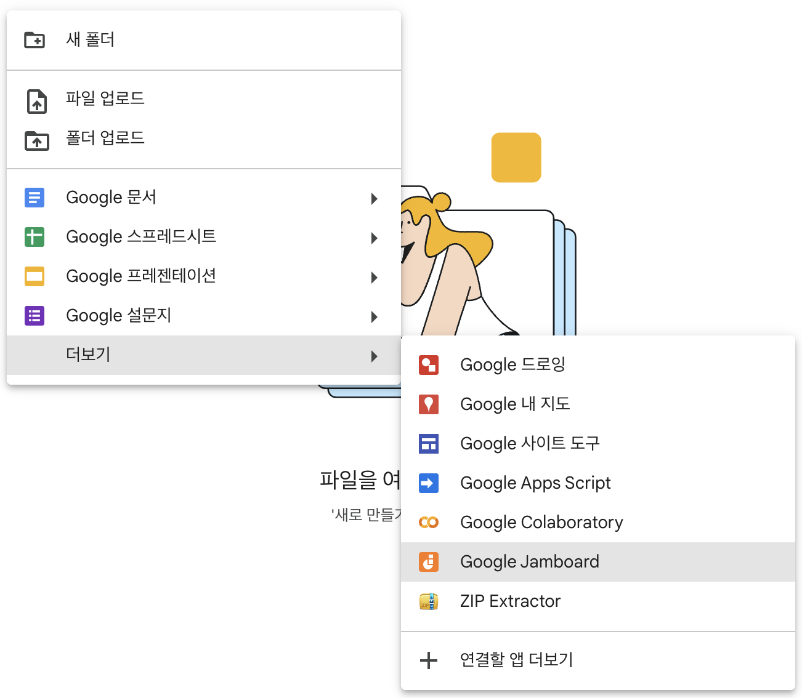
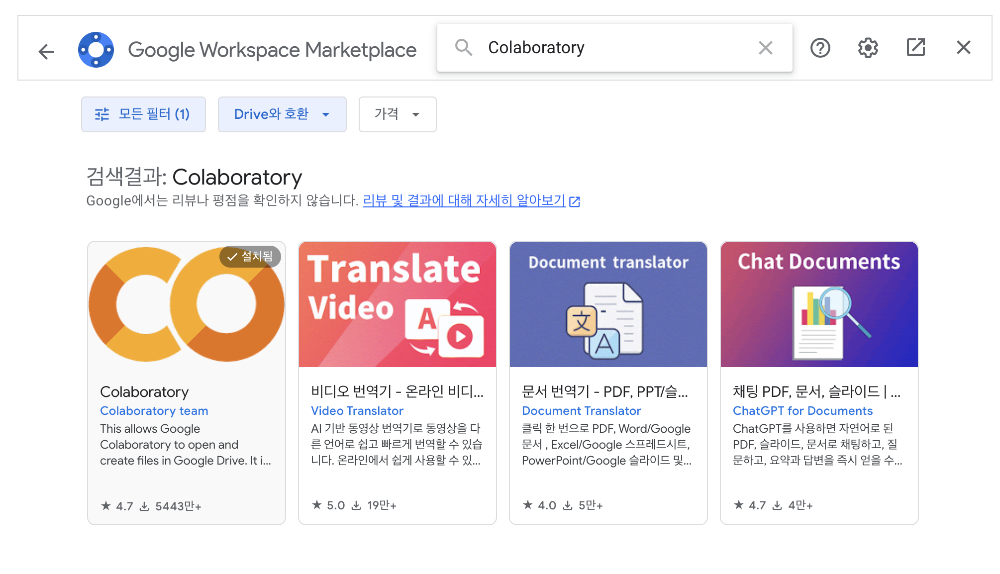
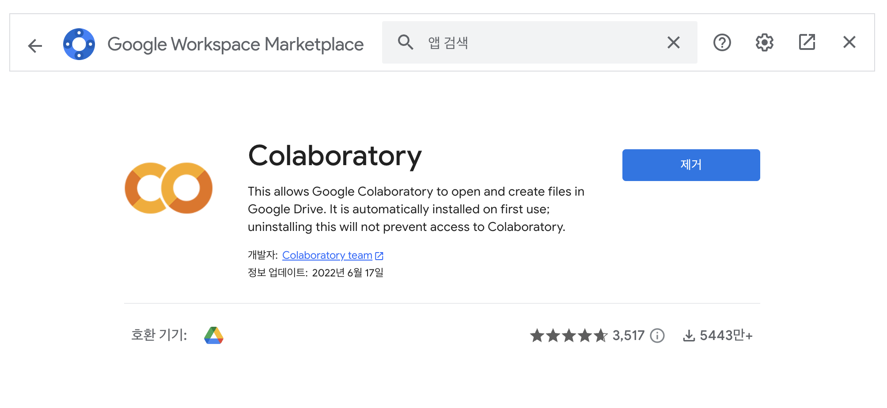
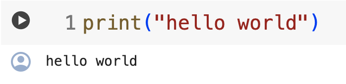
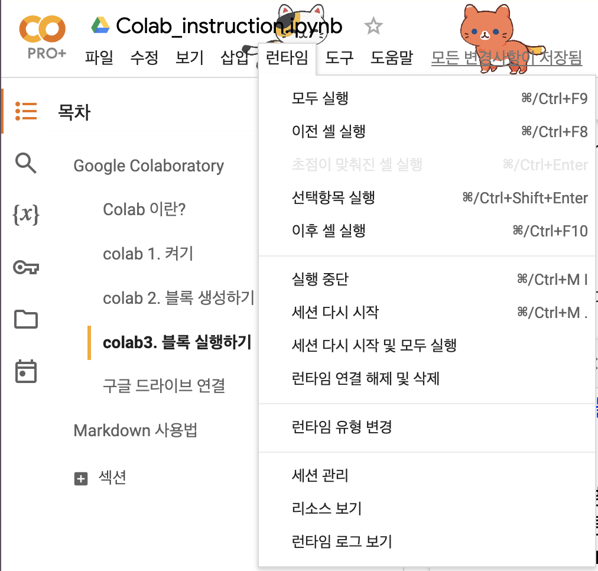
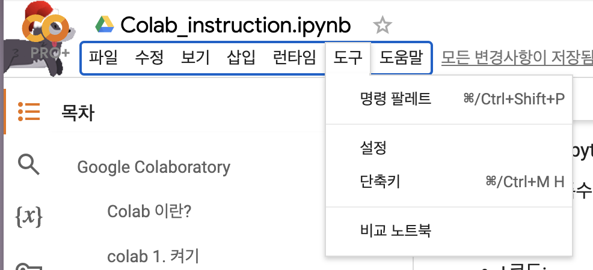
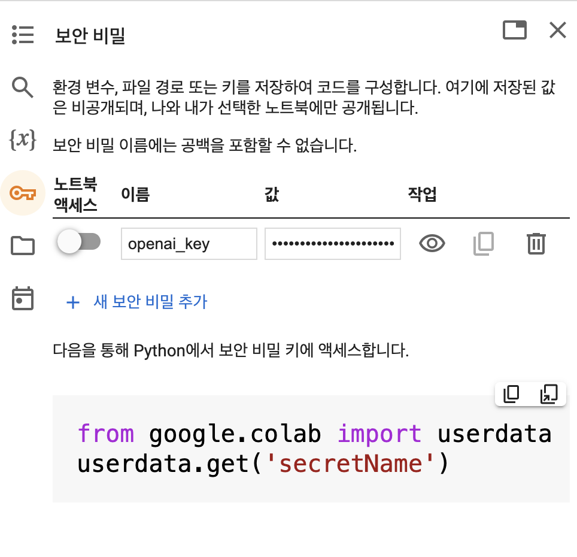

# Chapter 1. 파이썬 첫 걸음

> **학습 목표**  
> - 파이썬의 철학과 특징 이해
> - 현대적 개발 환경 구축 (uv 패키지 매니저 활용)
> - 첫 번째 파이썬 프로그램 작성

---

## 들어가며: 프로그래밍이 뭔가요?

질문을 하나씩 따라가 볼게요.

- 프로그래밍이 뭔가요? 프로그램을 작성하는 일입니다.
- 프로그램은 뭔가요? 컴퓨터가 어떤 일을 하도록 적어 둔 명령 덩어리예요.
- 그 일이 뭔데요? 결국은 계산입니다.
- 컴퓨터는요? 계산하는 기계죠!

영어 compute(계산하다)에 -er(하는 사람)을 붙이면 computer, 원래는 **계산하는 사람**이라는 뜻이었습니다. 실제로 기계가 나오기 전에는 사람이 종이와 연필로 복잡한 계산을 하는 직업이 있었어요.

그 일을 기계에게 맡기기까지 여러 천재들의 생각이 이어졌습니다. 조지 불은 "그리고(and), 또는(or), 아니다(not)" 같은 논리를 기호로 계산할 수 있다는 것을 보였고(불 대수), 클로드 섀넌은 이 논리 계산이 켜고 끄는 스위치 회로와 정확히 1:1로 대응한다는 것을 보였습니다. 논리를 회로로 만들 수 있게 된 거죠. 앨런 튜링은 "계산할 수 있다는 게 대체 무슨 뜻인가?"라는 질문에 답하려고 종이 테이프 위에서 기호를 읽고 쓰는 상상 속의 기계, **튜링 머신**을 생각해 냈어요. 그리고 놀랍게도 다른 튜링 머신의 설명을 입력으로 받아 그대로 흉내 내는 튜링 머신도 만들 수 있었습니다. 프로그램을 실행하는 기계, 바로 오늘날의 컴퓨터죠. 존 폰 노이만은 프로그램과 데이터를 같은 메모리에 담아 두고 차례로 꺼내 실행하는 구조를 정리했고, 우리가 쓰는 컴퓨터는 지금도 대부분 이 구조를 따릅니다.

그런데 컴퓨터가 알아듣는 말은 0과 1뿐입니다. 사람이 `0100110101…`로 명령을 적는다면 얼마나 괴로울까요? 그래서 사람이 읽고 쓰기 쉬운 말로 적으면 컴퓨터의 말로 바꿔 주는 **프로그래밍 언어**가 생겼습니다. 언어니까 단어와 문법이 있고, 그 약속만 지키면 됩니다. 파이썬은 여러분의 말을 컴퓨터에게 전해 주는 통역사 친구인 셈이에요.

외국어를 배울 때 가장 좋은 방법은 원어민과 계속 대화하는 거죠? 파이썬도 같습니다. 시작하기 전에 세 가지만 약속해 주세요.

1. **에러를 두려워하지 마세요.** 파이썬은 여러분을 혼내지도, 귀찮아하지도 않습니다. 에러 메시지는 꾸중이 아니라 "이 부분을 못 알아들었어"라는 대답이에요.
2. **직접 말을 거세요.** 책의 코드를 눈으로만 읽지 말고 직접 실행하고, 조금씩 바꿔 가며 반응을 보세요.
3. **같은 실수를 쳇바퀴 돌듯 반복하지 마세요.** 계속 같은 거절을 당한다면 잠깐 멈추고 생각하거나, 검색하거나, 물어보세요.

## 1.1 파이썬이란 무엇인가?

파이썬은 1991년 귀도 반 로섬(Guido van Rossum)이 만든 **고급 프로그래밍 언어**입니다. 

여기서 "고급"은 비싸다는 뜻이 아니라 **사람의 말에 가깝다**는 뜻입니다. 0과 1에 가까운 기계어 쪽을 "저급", 사람 쪽을 "고급"이라고 불러요. 그럼 이름은 왜 하필 비단뱀(python)일까요? 뱀과는 상관없습니다. 귀도 반 로섬이 영국 코미디 프로그램 "몬티 파이썬의 비행 서커스(Monty Python's Flying Circus)"를 좋아해서 붙인 이름이에요. 파이썬이 최초의 프로그래밍 언어도 아닙니다. 그 전에도 수많은 언어가 있었고, 파이썬은 그 경험 위에서 "읽기 쉬운 코드"를 가장 중요하게 여기며 태어났습니다.

### 파이썬의 철학 - The Zen of Python

> **Q. Zen은 '선'이라는 뜻이잖아요. 파이썬에 선(善)이 있으면 악도 있나요?**  
> 여기서 Zen은 착할 선(善)이 아니라 참선할 때의 선(禪)입니다. 파이썬을 쓰는 사람이라면 마음에 새겨 두면 좋을 가르침이라는 뜻이에요. 파이썬 개발자 팀 피터스(Tim Peters)가 정리한 이 문장들은 파이썬 안에 숨겨져 있어서 코드 한 줄로 꺼내 볼 수 있습니다.

```python
import this
```

위 코드를 실행하면 파이썬의 철학을 볼 수 있습니다:

- **Beautiful is better than ugly** - 아름다운 것이 추한 것보다 낫다
- **Explicit is better than implicit** - 명시적인 것이 암시적인 것보다 낫다
- **Simple is better than complex** - 단순한 것이 복잡한 것보다 낫다

실제로 실행하면 "The Zen of Python, by Tim Peters"라는 제목 아래 19줄이 나옵니다. 몇 줄만 더 골라 볼게요.

- **Readability counts** - 가독성은 중요하다. 코드는 쓰는 시간보다 읽히는 시간이 훨씬 깁니다.
- **Errors should never pass silently** - 에러는 조용히 넘어가면 안 된다. 문제가 생기면 숨기지 말고 드러내라는 뜻이에요.
- **There should be one-- and preferably only one --obvious way to do it** - 어떤 일을 하는 분명한 방법은 하나, 되도록 딱 하나만 있어야 한다.

지금 다 이해할 필요는 없습니다. 책을 읽다가 "왜 파이썬은 이렇게 만들었지?" 싶을 때 다시 돌아와 보세요. 대부분 이 문장들 안에 답이 있습니다. 사람들이 "파이썬답다(Pythonic)"고 말할 때 기준이 되는 것도 바로 이 철학이에요.

### 파이썬의 특징

아래 표의 낯선 말들을 하나씩 풀어 볼게요. **인터프리터 언어**는 통역사가 한 문장씩 바로바로 통역하듯 코드를 한 줄씩 읽어 실행합니다. 책 전체를 번역해 두고 읽는 방식(컴파일)보다 고친 결과를 바로 확인하기 좋죠. **동적 타이핑**은 "이 상자에는 숫자만 넣겠습니다"라고 미리 선언하지 않아도, 값을 넣는 순간 파이썬이 알아서 종류를 판단한다는 뜻입니다(2장에서 자세히 봅니다). **객체지향**은 프로그램을 세포처럼 만들자는 생각이에요. 세포 하나하나는 단순하지만 각자 맡은 역할이 있고, 서로 잘 협력하면 몸 전체가 움직이죠. 파이썬에서는 숫자, 문자, 함수까지 모든 것이 이런 객체입니다(11장).

| 특징 | 설명 | 장점 |
|------|------|------|
| **동적 타이핑** | 변수 타입을 미리 선언하지 않음 | 빠른 프로토타이핑 |
| **인터프리터 언어** | 실행 전 컴파일 불필요 | 즉시 실행 및 테스트 |
| **객체지향** | 모든 것이 객체 | 재사용성과 확장성 |
| **풍부한 라이브러리** | 표준 라이브러리 + 서드파티 패키지 | 빠른 개발 |

장점만 있는 것은 아닙니다. 한 줄씩 통역하고 종류를 실행 중에 판단하는 만큼, 미리 번역해 두는 언어보다 실행 속도는 느린 편이에요. 그래서 계산이 아주 많은 부분은 다른 언어로 만든 라이브러리에 맡기고, 파이썬은 그것들을 쉽게 엮는 역할을 맡는 경우가 많습니다.

---

## 1.2 개발 환경 구축 (현대적 접근)

> **Q. 제 컴퓨터로 코딩이 되나요?**  
> 됩니다. 이 절의 순서대로 파이썬을 설치하면 노트북 한 대로 충분해요. 설치가 어렵거나 학교·회사 컴퓨터라 설치할 수 없다면, 인터넷만 되면 브라우저에서 바로 파이썬을 쓰는 방법도 있습니다. 절 끝의 "설치가 어렵다면: Colab에서 시작하기"를 보세요.

글을 쓰려면 종이와 펜이 필요하듯, 파이썬을 쓰려면 파이썬 자체와 코드를 적을 편집기가 필요합니다. 여기에 하나가 더 있어요. 남이 만들어 둔 코드 묶음(**패키지**)을 내려받고 관리해 주는 도구, **패키지 매니저**입니다. 이 책은 패키지 매니저로 uv를 씁니다.

### uv 패키지 매니저 설치

uv 하나로 파이썬 버전 설치, 프로젝트별 환경(가상 환경) 만들기, 패키지 설치를 모두 할 수 있습니다. 프로젝트마다 환경을 따로 두는 이유는 간단해요. 프로젝트 A는 어떤 패키지의 1버전이, 프로젝트 B는 2버전이 필요할 수 있거든요. 방마다 따로 짐을 풀어 두면 서로 섞이지 않죠.

**기존 방식의 문제점:**
- `pip` + `virtualenv` 조합의 복잡성
- 의존성 해결의 어려움
- 버전 관리의 불편함

**uv의 장점:**
- **극도로 빠름** (Rust로 작성)
- **안전한 의존성 해결**
- **통합된 워크플로우**

자기 운영체제에 맞는 방법 하나만 골라 **터미널**(Windows는 PowerShell)에 입력하면 됩니다. 터미널은 마우스 대신 글자로 컴퓨터에 명령하는 창이에요.

#### macOS에서 uv 설치

Homebrew를 이미 쓰고 있다면 첫 줄을, 아니라면 공식 설치 스크립트를 쓰세요.

```bash
# Homebrew 사용
brew install uv

# 또는 공식 설치 스크립트
curl -LsSf https://astral.sh/uv/install.sh | sh
```

#### Windows에서 uv 설치

시작 메뉴에서 PowerShell을 열고 입력합니다.

```bash
# PowerShell에서
irm https://astral.sh/uv/install.ps1 | iex

# 또는 Scoop 사용
scoop install uv
```

#### Linux에서 uv 설치

macOS의 공식 설치 스크립트와 같은 명령입니다.

```bash
curl -LsSf https://astral.sh/uv/install.sh | sh
```

설치가 끝나면 터미널을 새로 열고 `uv --version`을 입력해 보세요. 버전 번호가 나오면 성공입니다.

### 프로젝트 초기화

이제 작업할 방(프로젝트)을 하나 만듭니다. `uv init`은 프로젝트 폴더와 기본 파일을 만들고, `uv python install`과 `uv python pin`은 이 프로젝트에서 쓸 파이썬 버전을 설치하고 고정합니다. `uv add`로 추가한 패키지는 이 프로젝트 안에만 설치되고, `--dev`를 붙이면 테스트·코드 검사처럼 개발할 때만 쓰는 도구로 따로 기록됩니다. 지금 당장 모든 패키지가 필요하지는 않으니, 처음에는 `uv init`부터 `uv python pin`까지 네 줄만 따라 해도 충분해요.

```bash
# 새 파이썬 프로젝트 생성
uv init my-first-python-project
cd my-first-python-project

# Python 버전 지정 (3.12 권장)
uv python install 3.12
uv python pin 3.12

# 기본 패키지 추가
uv add requests pandas jupyter

# 개발용 패키지 추가
uv add --dev pytest black ruff mypy
```

### VS Code 설정

코드는 메모장에도 쓸 수 있지만, 코드 전용 편집기를 쓰면 색으로 문법을 구분해 주고 오타를 미리 알려 주고 실행까지 한 곳에서 할 수 있습니다. 이런 도구를 통합 개발 환경(IDE)이라고 해요. VS Code, PyCharm, Vim 등 저마다 장단점이 있으니 손에 맞는 것을 쓰면 되고, 이 책은 무료이면서 가장 널리 쓰이는 VS Code를 기준으로 설명합니다.

**필수 확장팩:**

1. **Python** (Microsoft)
2. **Python Debugger** (Microsoft)
3. **Pylance** (Microsoft)
4. **Ruff** (Astral Software)

**VS Code 설정 (`.vscode/settings.json`):**

```json
{
    "python.defaultInterpreterPath": ".venv/bin/python",
    "python.terminal.activateEnvironment": false,
    "python.testing.pytestEnabled": true,
    "[python]": {
        "editor.formatOnSave": true,
        "editor.codeActionsOnSave": {
            "source.fixAll": "explicit",
            "source.organizeImports": "explicit"
        },
        "editor.defaultFormatter": "charliermarsh.ruff"
    }
}
```

`.venv/bin/python`은 uv가 프로젝트 안에 만든 가상 환경의 파이썬입니다. 이 경로를 알려 주면 VS Code가 그 방의 파이썬과 패키지를 쓰게 돼요. Windows에서는 이 경로가 `.venv\Scripts\python.exe`가 됩니다. `[python]` 안의 설정은 파이썬 파일을 저장할 때마다 Ruff 확장(`charliermarsh.ruff`)으로 코드 모양을 정리하고, 고칠 수 있는 문제를 고치고, `import` 순서를 정돈하라는 뜻이에요. 확장의 설정 이름은 버전에 따라 바뀌기도 하니, 설정이 먹히지 않으면 확장 페이지의 안내를 확인하세요.

### 설치가 어렵다면: Colab에서 시작하기

설치 과정에서 막혔다면 잠시 미뤄 두고 **Google Colab**(정식 이름은 Colaboratory)으로 시작해도 괜찮습니다. Colab은 구글이 제공하는 서비스로, 파이썬이 이미 설치된 컴퓨터를 인터넷 너머에서 빌려 쓰는 것이라고 생각하면 됩니다. 필요한 것은 구글 계정과 브라우저뿐이에요.

외장 하드를 떠올려 보세요. 내 컴퓨터에 꽂으면 그 안의 파일을 내 것처럼 쓸 수 있죠. 구글 드라이브는 인터넷 너머에 있는 외장 하드이고, Colab은 거기에 붙어 있는 파이썬 실행기입니다. 그래서 Colab에서 만든 파일은 구글 드라이브에 저장되고, 어느 컴퓨터에서든 이어서 작업할 수 있어요. 대신 인터넷이 끊기는 곳(비행기 안처럼)에서는 쓸 수 없고, 한동안 쓰지 않으면 빌린 컴퓨터는 반납됩니다. 오래 쓸 환경은 결국 내 컴퓨터에 uv로 만드는 것이 좋아요.

#### Colab 연결하기

구글 계정으로 구글 드라이브에 접속한 뒤 왼쪽 위의 **+ 신규** 버튼을 누르고 **더보기**로 가면 **Google Colaboratory**가 보입니다. 이것을 누르면 새 Colab 노트북이 만들어져요.



목록에 Google Colaboratory가 없다면 같은 메뉴 맨 아래의 **연결할 앱 더보기**를 누르세요. Google Workspace Marketplace 창이 열리면 검색창에 "Colaboratory"를 입력하고, 검색 결과에서 Colaboratory team이 만든 Colaboratory를 고릅니다.



앱 화면에서 설치 버튼을 누르면 연결이 끝납니다. 아래 화면은 이미 설치된 상태라서 버튼이 **제거**로 바뀌어 있어요. 설명에 적혀 있듯 처음 쓸 때 자동으로 설치되기도 하니, 이미 연결되어 있다면 이 단계는 건너뛰면 됩니다.



#### 셀에 코드를 쓰고 실행하기

Colab 노트북은 **셀**이라는 칸들로 이루어져 있습니다. 셀에는 코드를 쓰는 코드 셀과 설명을 적는 텍스트 셀이 있어요. 코드 셀에 코드를 적고 왼쪽의 실행 버튼(동그라미 안의 삼각형)을 누르거나 Ctrl+Enter(맥은 Command+Enter)를 누르면, 바로 아래에 결과가 나옵니다. 1.3절의 첫 프로그램을 Colab에서 실행하면 이렇게 보여요.



위쪽 메뉴 가운데 자주 쓰는 것은 **런타임**입니다. 런타임은 코드를 실제로 실행하는 빌린 컴퓨터를 말해요. **모두 실행**은 노트북의 셀을 위에서부터 전부 실행하고, 코드가 멈추지 않을 때는 **실행 중단**, 이상하게 꼬였을 때는 **세션 다시 시작**으로 깨끗하게 처음부터 시작할 수 있습니다. **런타임 유형 변경**은 더 빠른 계산 장치(GPU)가 필요할 때 쓰는데, 2권(딥러닝 편)에서 만나게 됩니다.



**도구** 메뉴에는 **명령 팔레트**, **설정**, **단축키**가 있습니다. 메뉴를 하나하나 찾기 귀찮을 때는 명령 팔레트에서 기능 이름을 검색하면 되고, 단축키 목록도 여기서 볼 수 있어요. 위의 화면 구석에 고양이와 강아지가 돌아다니는 게 보이나요? 원저자가 설정에서 켜 둔 재미 기능입니다. 글꼴 크기 같은 편집기 옵션과 함께 설정을 한번 둘러보세요.



#### Colab에서 파일과 폴더 다루기

컴퓨터 안의 모든 것은 결국 파일과 폴더입니다. 그리고 지금 "어디에" 있는지가 중요해요. 친구에게 길을 알려 줄 때 "서울시 ○○구 ○○로 12"처럼 처음부터 전부 말할 수도 있고, "여기서 두 블록 가서 왼쪽"처럼 지금 위치를 기준으로 말할 수도 있죠. 파일 위치도 같습니다. 맨 꼭대기 `/`부터 전부 적는 것을 **절대 경로**, 지금 있는 폴더를 기준으로 적는 것을 **상대 경로**라고 해요. 상대 경로에서 `.`은 지금 폴더, `..`은 한 칸 위 폴더를 뜻합니다.

Colab 코드 셀에서는 `%pwd`로 지금 위치를 확인하고(처음에는 `/content`), `%ls`로 그 안의 목록을 보고, `%cd 폴더이름`으로 이동할 수 있습니다. 이 명령들은 파이썬 문법이 아니라 Colab(정확히는 그 안의 IPython)이 덧붙여 준 편의 기능이에요. 파이썬에 없는 패키지가 필요하면 `!pip install 패키지이름`처럼 앞에 `!`를 붙여 Colab 컴퓨터에 직접 명령합니다. 내 구글 드라이브의 파일을 쓰려면 `from google.colab import drive`를 실행한 뒤 `drive.mount('/content/drive')`로 드라이브를 연결하세요. 그러면 `/content/drive` 아래에서 드라이브 폴더가 보입니다.

#### 비밀번호와 API 키는 보안 비밀에

나중에 인공지능 서비스 같은 외부 서비스를 쓰다 보면 비밀번호 역할을 하는 키를 받게 됩니다. 이런 값을 코드에 그대로 적으면 노트북을 공유하는 순간 함께 퍼져 버려요. Colab 왼쪽의 열쇠 모양 아이콘을 누르면 **보안 비밀** 창이 열립니다. **새 보안 비밀 추가**로 이름과 값을 저장해 두고, 화면에 나온 것처럼 코드에서는 `userdata.get('이름')`으로 꺼내 쓰세요. 저장된 값은 비공개이고, **노트북 액세스**를 켠 노트북에서만 읽을 수 있습니다.



---

## 1.3 첫 번째 파이썬 프로그램

### Hello World부터 시작

처음 만난 사람에게는 무엇부터 하죠? 당연히 인사부터 합니다. 프로그래밍 언어를 배울 때도 화면에 "Hello, World!"라는 인사를 출력하는 것으로 시작하는 전통이 있어요.

전통적인 "Hello, World!" 프로그램을 한국어로 만들어보겠습니다.

```python
# hello.py
print("안녕, 파이썬!")
```

한 줄짜리지만 뜯어보면 세 조각입니다.

- `print`: "화면에 찍어라(인쇄하라)"라는 동작의 이름입니다. 파이썬이 미리 만들어 둔 **내장 함수**예요.
- `( )`: 이름 뒤에 괄호를 붙이면 "그 동작을 지금 해라"라는 뜻이 됩니다. 괄호 안에는 동작에 필요한 재료를 넣어요.
- `"안녕, 파이썬!"`: 재료입니다. 따옴표로 감싸면 "이건 명령이 아니라 글자 그대로의 문자"라는 표시가 됩니다.

`#`으로 시작하는 첫 줄은 **주석**입니다. 파이썬은 `#` 뒤를 읽지 않고 건너뛰어요. 사람에게 남기는 메모죠. 우리가 명령을 보냈고, 파이썬은 그 명령을 수행해 결과를 보여 줬습니다. 파이썬과의 첫인사 성공이에요!

**실행 방법:**

위 코드를 `hello.py`라는 파일로 저장하고, 1.2절에서 만든 프로젝트 폴더의 터미널에서 다음처럼 실행합니다. `uv run`은 이 프로젝트의 가상 환경으로 명령을 실행하라는 뜻이에요. Colab을 쓴다면 코드 셀에 `print("안녕, 파이썬!")`만 적고 실행하면 됩니다.

```bash
# uv 환경에서 실행
uv run python hello.py
```

> **Q. 그런데 print는 왜 하는 거예요? 결과는 어차피 컴퓨터 안에 있잖아요.**  
> 알리오 올리오 레시피를 보고 요리했는데 이상한 맛이 났다고 해 봅시다. 면을 덜 익혔나? 기름이 부족했나? 소금 대신 설탕을 넣었나? 요리가 끝난 접시만 봐서는 알 수 없으니 단계마다 맛을 봐야 하죠. 프로그램도 같습니다. 레시피처럼 순서대로 적은 명령이 **알고리즘**이고, 그걸 적는 일이 코딩이에요. 결과가 이상할 때 중간중간 `print`로 값을 찍어 보면 어디서부터 틀렸는지 거꾸로 추적할 수 있습니다. 이렇게 잘못을 찾아 고치는 과정을 **디버깅**이라고 해요. 에러가 났다면 에러가 뜬 줄만 문제인지, 그 앞에서 이미 틀린 값이 넘어온 건지도 의심해 보세요.

### 입력 받기: input()

출력만 해서는 재미가 없죠. 반대로 사용자에게서 값을 받는 함수가 `input()`입니다. 괄호 안의 문장을 보여 주고, 사용자가 무언가를 입력하고 Enter를 누를 때까지 기다렸다가, 입력한 내용을 돌려줍니다. 그런데 숫자를 입력하면 어떻게 될까요?

```python
나이 = input("나이를 입력하세요: ")   # 25를 입력했다고 하면
print(type(나이))                     # <class 'str'>
print(int(나이) + 1)                  # 26
```

`25`를 넣었는데 `type()`으로 종류를 확인해 보면 숫자(`int`)가 아니라 문자열(`str`)입니다. `input()`은 무엇을 입력하든 **항상 문자열로 돌려줍니다.** 키보드로 친 것은 일단 다 글자니까요. 그래서 숫자로 계산하려면 `int()`로 정수로 바꿔 줘야 해요. 이렇게 값의 종류를 바꾸는 것을 **형 변환**이라고 하고, 값의 종류(자료형)는 2장에서 자세히 다룹니다.

### 한국어 친화적 예제

이번에는 지금 시각에 따라 인사말이 바뀌는 프로그램입니다. 아직 배우지 않은 문법(`import`, `def`, `if`)이 섞여 있지만, 한 줄씩 소리 내어 읽어 보면 뜻이 짐작될 거예요. "datetime 도구를 가져와라, 지금 시각을 구해라, 12시 전이면 아침 인사를 골라라"처럼요. 문법은 뒤의 장에서 하나씩 배우니 지금은 실행해 보고 결과만 확인해도 충분합니다.

```python
# korean_greeting.py
import datetime

def 한국어_인사():
    현재시간 = datetime.datetime.now()
    
    if 현재시간.hour < 12:
        인사말 = "좋은 아침입니다"
    elif 현재시간.hour < 18:
        인사말 = "안녕하세요"
    else:
        인사말 = "안녕하세요, 수고하셨습니다"
    
    return f"{인사말}! 오늘은 {현재시간.strftime('%Y년 %m월 %d일')}입니다."

# 함수 실행
메시지 = 한국어_인사()
print(메시지)
```

**출력 예시:**
```
안녕하세요! 오늘은 2024년 09월 05일입니다.
```

출력은 실행한 시각에 따라 달라집니다. 오전에 실행하면 "좋은 아침입니다", 저녁 6시 이후에는 "안녕하세요, 수고하셨습니다"가 나와요. 컴퓨터의 시계를 읽어서 그때그때 다른 결과를 내는 것, 이것이 미리 적어 둔 글과 프로그램의 차이입니다.

### 코드 분석

위 예제에서 볼 수 있는 파이썬의 특징들:

1. **한글 변수명 지원** - 파이썬은 유니코드를 완벽 지원
2. **datetime 모듈 활용** - 표준 라이브러리의 강력함
3. **f-string 활용** - 현대적인 문자열 포매팅
4. **조건문과 함수** - 프로그래밍의 기본 구조

---

## 실습 프로젝트: 나만의 인사말 생성기

### 프로젝트 요구사항

1. 사용자의 이름을 입력받기
2. 현재 시간에 따른 적절한 인사말 선택
3. 사용자의 나이에 따른 존댓말 조절
4. 특별한 날짜(생일, 기념일) 확인

앞에서 본 두 가지를 합칩니다. `input()`으로 이름과 나이를 받고, 지금 시각과 나이에 따라 인사말과 말투를 고르는 거예요. 한 번에 다 만들려고 하지 말고 요구사항을 하나씩 해결한다고 생각하세요.

### 완성 코드

코드를 읽을 때 눈여겨볼 곳은 세 군데입니다. 첫째, 나이를 받을 때 `int(input(...))`로 바로 정수로 바꿉니다. 둘째, 사용자가 숫자가 아닌 글자를 입력하면 `int()`가 실패하는데, `try`/`except`가 그 실패를 붙잡아 나이를 0으로 처리합니다(예외 처리는 12장에서 자세히 배웁니다). 셋째, 시간대와 나이에 따라 `if`/`elif`/`else`로 갈림길을 나눕니다. 이 부분은 4장의 주제예요.

```python
# greeting_generator.py
import datetime
from typing import Optional

def 인사말_생성기():
    """개인 맞춤형 인사말을 생성하는 함수"""
    
    # 사용자 정보 입력
    이름 = input("이름을 입력하세요: ")
    try:
        나이 = int(input("나이를 입력하세요: "))
    except ValueError:
        나이 = 0
    
    # 현재 시간 정보
    현재시간 = datetime.datetime.now()
    시간 = 현재시간.hour
    
    # 시간대별 인사말
    if 시간 < 6:
        기본인사 = "늦은 밤"
    elif 시간 < 12:
        기본인사 = "좋은 아침"
    elif 시간 < 18:
        기본인사 = "좋은 오후"
    else:
        기본인사 = "좋은 저녁"
    
    # 나이에 따른 존댓말 조절
    if 나이 >= 60:
        존댓말 = f"{이름} 어르신"
        인사말 = f"{기본인사}입니다"
    elif 나이 >= 20:
        존댓말 = f"{이름}님"
        인사말 = f"{기본인사}입니다"
    else:
        존댓말 = f"{이름}아" if 이름 else "친구"
        인사말 = f"{기본인사}이야"
    
    # 특별한 날짜 확인 (예: 새해)
    특별메시지 = ""
    if 현재시간.month == 1 and 현재시간.day == 1:
        특별메시지 = " 새해 복 많이 받으세요!"
    elif 현재시간.month == 12 and 현재시간.day == 25:
        특별메시지 = " 메리 크리스마스!"
    
    # 최종 메시지 조합
    최종메시지 = f"{존댓말}, {인사말}!{특별메시지}"
    
    return 최종메시지

# 프로그램 실행
if __name__ == "__main__":
    print("=== 개인 맞춤형 인사말 생성기 ===")
    결과 = 인사말_생성기()
    print(f"\n{결과}")
```

### 실행 예시

오후에 이름 "김철수", 나이 25를 입력하면 이렇게 나옵니다.

```
=== 개인 맞춤형 인사말 생성기 ===
이름을 입력하세요: 김철수
나이를 입력하세요: 25

김철수님, 좋은 오후입니다!
```

나이를 15로 넣으면 "김철수아, 좋은 오후이야!"처럼 반말이 되고, 나이 칸에 글자를 넣으면 나이가 0으로 처리되어 역시 반말이 나옵니다. 받침 없는 이름이면 "철수야"가 되어야 하는데 "철수아"가 되고, "좋은 오후이야"도 어색하죠? 이런 것을 직접 찾아 고쳐 보는 것이 가장 좋은 연습입니다.

---

## 연습문제

### 기초 문제 (3개)

1. **Hello World 변형**
   - "안녕하세요, [본인이름]입니다!"를 출력하는 프로그램 작성

2. **간단한 계산**
   - 올해 연도에서 본인 태어난 연도를 뺀 나이를 계산하는 프로그램 작성

3. **조건문 연습**
   - 숫자를 입력받아 양수/음수/0을 판별하는 프로그램 작성

### 중급 문제 (4개)

4. **시간 계산기**
   - 현재 시각과 점심시간(12:00)까지 남은 시간 계산

5. **간단한 메뉴**
   - 사용자가 선택할 수 있는 3가지 메뉴를 만들고 선택에 따른 반응 출력

6. **반복문 활용**
   - 1부터 입력받은 숫자까지의 합 계산

7. **문자열 처리**
   - 입력받은 문장에서 한글과 영어의 개수를 각각 세는 프로그램

### 고급 문제 (3개)

8. **함수 활용**
   - 여러 숫자를 입력받아 평균을 계산하는 함수 작성

9. **예외 처리**
   - 나이를 입력받되, 잘못된 입력시 다시 입력받는 프로그램

10. **종합 프로젝트**
    - 간단한 가계부 프로그램 (수입/지출 입력, 잔액 계산)

---

## 이번 챕터에서 배운 것

### 핵심 개념
- [ ] 파이썬의 철학과 특징
- [ ] uv 패키지 매니저 설치와 사용
- [ ] 현대적 개발 환경 구축
- [ ] 첫 번째 파이썬 프로그램 작성
- [ ] 한국어 변수명과 문자열 처리

### 실무 스킬
- [ ] uv를 이용한 프로젝트 초기화
- [ ] VS Code 개발 환경 설정
- [ ] 기본적인 입출력 처리
- [ ] 조건문과 함수 활용

### 다음 챕터 미리보기

다음 챕터에서는 **변수와 데이터 타입**에 대해 자세히 알아보겠습니다:
- 파이썬의 모든 데이터 타입
- 타입 힌트 활용법
- 메모리 관리 원리

---

> **팁:** 이 챕터의 모든 코드는 `uv run python 파일명.py` 형태로 실행할 수 있습니다. 궁금한 점이 있다면 언제든지 코드를 수정해서 실험해보세요!